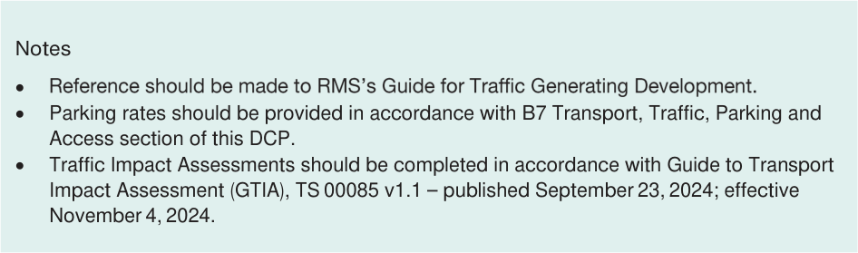
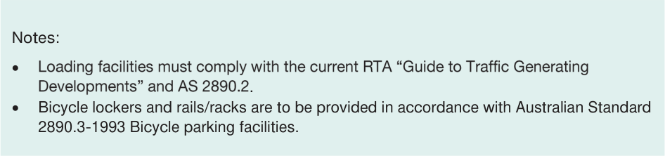

## 6. Parking and access

Explanation Car parking, access and loading/servicing areas often occupy a substantial proportion of industrial sites. This subsection provides objectives and controls to guide their efficient, functional and well-designed and layout while minimising impacts on site amenity and the surrounding area.

Objectives The objectives for parking and access are to:

1\. Ensure safe and efficient vehicle movements in and out of an industrial development including clear and legible circulation within the site

2\. Provide sufficient on-site parking to meet operational needs, without adversely impacting the function or amenity of surrounding streets

3\. Achieve well-designed, safe and functional car parking and circulation areas that contribute to orderly development and safe site layout

4\. Ensure loading/unloading areas are adequate, accessible and appropriately located, and designed to minimise impacts on adjacent land uses including residential areas

5\. Provide safe and convenient cyclist and pedestrian access including separation from heavy vehicle movements and service areas.

Controls

a) All vehicles must enter and leave the site in a forward direction

b) Vehicle movements within servicing areas must minimise reversing movements. Where reversing is unavoidable development must demonstrate design measures that maximise safety and minimise operational noise impacts including the need for reversing vehicle alarms/beepers

c) Where an alternative road access is available, loading and unloading facilities and the majority of car parking must be located along secondary road frontage

d) Loading, unloading and services areas must be clearly separated from car parking areas and designed to ensure safe and efficient operation

e) Service areas including waste and recycling areas and external storage areas must be located away from primary street frontages and screened from public view

f) All loading and unloading operations must occur wholly within the site at all times

g) Loading docks, car parking spaces and access driveways must be kept clear and available for their intended use at all times. These areas must be clearly line marked and must not be used for the storage of goods, materials and waste materials.

> [Picture on page 17: a picture, saved as a picture (images/part-c10-industrial-areas-page-17-1.gif, 150 dpi).]
> Words printed on the picture (title and legend, copied from the PDF):
> Notes
> • Reference should be made to RMS’s Guide for Traffic Generating Development.
> • Parking rates should be provided in accordance with B7 Transport, Traffic, Parking and
> • Traffic Impact Assessments should be completed in accordance with Guide to Transport

Access section of this DCP.

Impact Assessment (GTIA), TS 00085 v1.1

– published September 23, 2024; effective

November 4, 2024.

> [Picture on page 17: a picture, saved as a picture (images/part-c10-industrial-areas-page-17-6.gif, 150 dpi).]
> Words printed on the picture (title and legend, copied from the PDF):
> Notes:
> • Loading facilities must comply with the current RTA “Guide to Traffic Generating
> Developments” and AS 2890.2 .
> • Bicycle lockers and rails/racks are to be provided in accordance with Australian Standard
> 2890.3-1993 Bicycle parking facilities.
