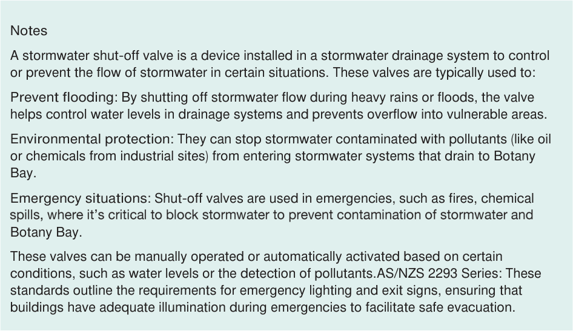

## 8. Water quality

Explanation The effective management of stormwater runoff is important to protect the quality Randwick City’s natural waterways and receiving environment. Uncontrolled stormwater can transport pollutants, sediments and contaminants from development sites into the drainage network, adversely impacting aquatic ecosystems and environmental health. Development must incorporate appropriate stormwater management measures to minimise runoff impacts, improve water quality, and support the long-

term protection of the City’s natural

and built water systems.

Objectives The objectives for stormwater and water quality are to:

1\. Manage stormwater quality and quantity and minimise stormwater discharge on adjoining properties

2\. Minimise surface water runoff through appropriate and integrated site design and water sensitive management measures

3\. Protect ground water from contamination associated with industrial development

4\. Encourage on site stormwater collection, treatment and reuse and promote water sensitive urban design (WSUD)

5\. Maintain natural drainage patterns and minimise unnecessary site disturbance and modification

6\. To minimise the risk and impact of flooding on development and surrounding land.

Controls

a) Disturbance to the existing drainage pattern should be minimised where possible

b) Applicants should demonstrate adequate measures during construction to ensure that erosion/sedimentation during construction is minimised. Revegetation and soil stabilisation measures are to be implemented promptly upon completion of construction

c) Development is to a

ddress all requirements in Council’s Private Stormwater Code

d) An emergency stormwater shut-off valve must be installed on all stormwater system outlets discharging to Council infrastructure, natural waterways, or drainage reserves. The valve must be:

i. Manually or automatically operable

ii. Located in an accessible position for emergency response personnel

iii. Capable of fully stopping the flow of stormwater during pollution events, spillages, or maintenance works

iv. Have signage indicating the valve location and operation located adjacent to the control point.

> [Picture on page 21: a picture, saved as a picture (images/part-c10-industrial-areas-page-21-1.gif, 150 dpi).]
> Words printed on the picture (title and legend, copied from the PDF):
> spills, where it’s critical to block stormwater to prevent contamination of stormwater and

Notes A stormwater shut-off valve is a device installed in a stormwater drainage system to control or prevent the flow of stormwater in certain situations. These valves are typically used to: Prevent flooding: By shutting off stormwater flow during heavy rains or floods, the valve helps control water levels in drainage systems and prevents overflow into vulnerable areas. Environmental protection: They can stop stormwater contaminated with pollutants (like oil or chemicals from industrial sites) from entering stormwater systems that drain to Botany Bay. Emergency situations: Shut-off valves are used in emergencies, such as fires, chemical

Botany Bay. These valves can be manually operated or automatically activated based on certain conditions, such as water levels or the detection of pollutants.AS/NZS 2293 Series: These standards outline the requirements for emergency lighting and exit signs, ensuring that buildings have adequate illumination during emergencies to facilitate safe evacuation.
