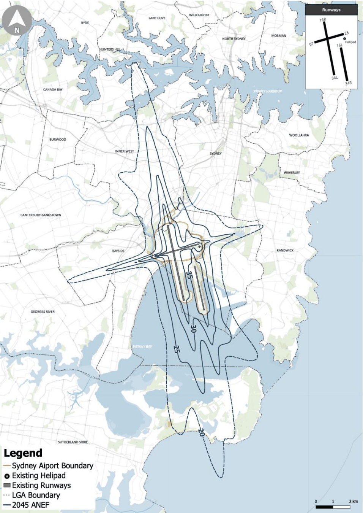

## 2. Aircraft noise

All development located on land near or within an ANEF contour of 20 or greater that Council considers is likely to be adversely affected by aircraft noise must comply with Clause 6.9 of the RLEP. Parts of Randwick City Council fall within the 20 ANEF 2045 contour. Development proposals in these areas, which involve the creation of additional dwellings or substantial alterations to existing residential buildings, are encouraged to submit a Pre-Lodgement Application to Council. This is to ensure that potential noise issues are identified early and that relevant mitigation measures are appropriately addressed in the DA.

Note The Sydney Airport Master Plan 2039 includes an Australian Noise Exposure Forecast for 2039 (ANEF 2039), as shown in Chapter 16 (Map 29) and Appendix G (Map 33). On 26 February 2026, Airservices Australia endorsed for technical accuracy the new Australian Noise Exposure Forecast for 2045 for Sydney Airport (ANEF 2045) which has replaced ANEF 2039. A copy of ANEF 2045 can be downloaded at: 13836g131c SYD 2045 ANEF Endorsement Chart. The Sydney Airport Master Plan 2039 is scheduled to be replaced by the Sydney Airport Master Plan 2045. Information about the current state of the draft Master Plan 2045 can be found at Sydney Airport Master Plan 2045 | Preliminary Draft (Sept 2025).

> [Picture on page 6: a picture, saved as a picture (images/part-c11-sydney-airport-page-6-1.gif, 150 dpi).]

Figure 1: ANEF 2045 (source: Airservices Australia)

Note All development within an ANEF affected area (including ANEF contour 20) must comply with Australian Standard AS 2021-2015.

Note Refer also to the National Airports Safeguarding Framework for relevant guidelines (National Airports Safeguarding Framework | Department of Infrastructure, Transport, Regional Development, Communications and the Arts)
