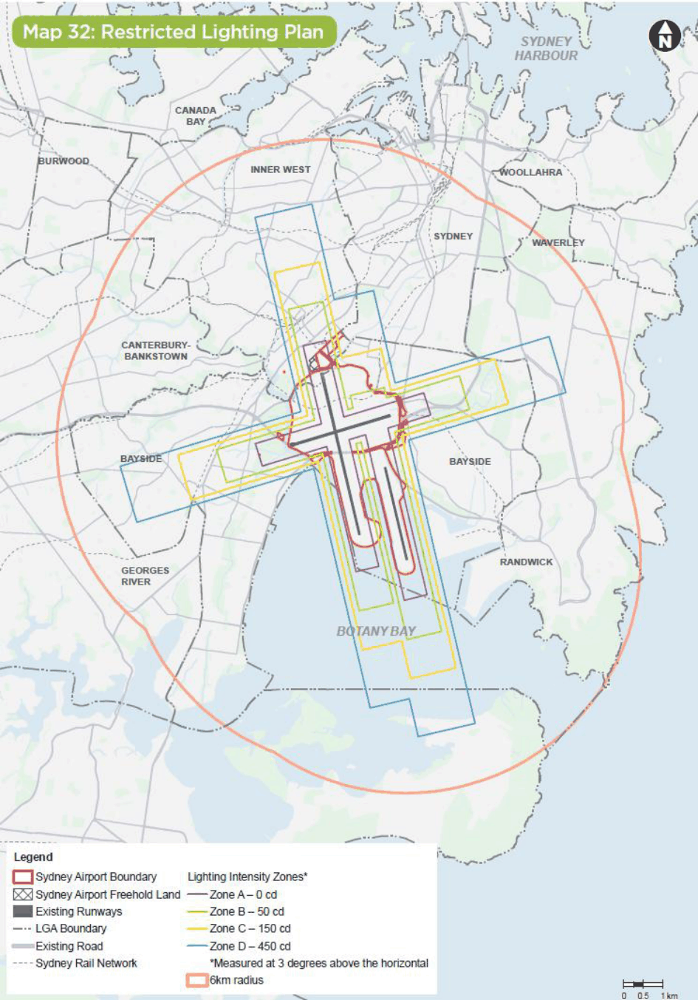

## 3.  Lighting hazards

The Civil Aviation Safety Authority (CASA) has the authority, under the Civil Aviation Regulations 1988 and the Airports Act 1996, to control ground lights that may cause confusion or distraction to pilots due to glare. To assist lighting designers and installation contractors near airports, CASA has established guidelines on the location and permitted intensities of ground lights within a six-kilometre radius around an airport, as outlined in the Manual of Standards 2019 - Part 139 (Aerodromes). This area is divided into four lighting zones (Zones A, B, C, and D), reflecting the degree of interference ground lights can cause as pilots approach landing. External advertising, sports field floodlighting, and street lighting are some of the more likely sources requiring consideration. Parts of Randwick and Kingsford fall within Zone D. The Manual of Standards 2019 - Part 139 (Aerodromes) requires Sydney Airport to notify CASA in writing if they become aware of any installation, equipment, or laser outside the aerodrome boundary that has or may have lighting intensity greater than specified. CASA may issue a notice to an owner or person in charge of a non-compliant light, directing them to extinguish or screen the light and refrain from exhibiting similar lights in the future.

Note The Sydney Airport Masterplan provides a Restricted Lighting map to assist in identifying the covered areas.

Note Refer also to the National Airports Safeguarding Framework for relevant guidelines (National Airports Safeguarding Framework | Department of Infrastructure, Transport, Regional Development, Communications and the Arts)

Figure 2: Restricted Lighting (source: Sydney Airport Masterplan 2039)

> [Picture on page 8: a picture, saved as a picture (images/part-c11-sydney-airport-page-8-2.gif, 150 dpi).]
