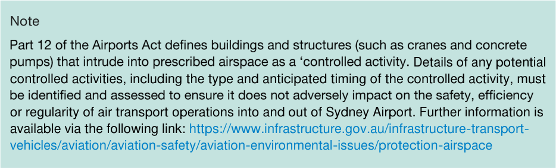

## 4. Controls

### 4.1 Prescribed airspace

Controls

a) Development applications must include accurate and detailed drawings indicating the height levels (above AHD) of all roof elements including parapet, lift overruns, roof ridges and roof-mounted structures for referral to SACL

b) Landscaping must consider bird and obstacle hazard management and ensure trees to be planted are not capable of intruding the Obstacle Limitation Surface when mature (i.e. over 15 metres)

c) Details of any cranes or temporary structures proposed during construction must be submitted to SACL, including maximum operating height above AHD.

> [Picture on page 9: a picture, saved as a picture (images/part-c11-sydney-airport-page-9-12.gif, 150 dpi).]
> Words printed on the picture (title and legend, copied from the PDF):
> Note
> Part 12 of the Airports Act defines buildings and structures (such as cranes and concrete
> pumps) that intrude into prescribed airspace as a ‘controlled activity. Details of any potential
> be identified and assessed to ensure it does not adversely impact on the safety, efficiency

controlled activities, including the type and anticipated timing of the controlled activity, must

or regularity of air transport operations into and out of Sydney Airport. Further information is available via the following link: https://www.infrastructure.gov.au/infrastructure-transport-vehicles/aviation/aviation-safety/aviation-environmental-issues/protection-airspace

### 4.2 Noise

Controls

a) Development within areas affected by ANEF contours must incorporate suitable noise attenuation measures recommended by a qualified acoustic consultant

b) Acoustic treatments should support sustainable design principles, maintaining reasonable internal amenity and avoid adverse impacts on the building’s architectural quality or surrounding streetscape.

### 4.3 Lighting

Controls

a) Development applications must include detailed drawings indicating any proposed external lighting installations for referral to SACL

b) Landscaping and lighting design must consider aviation safety. External lighting must not exceed 450cs (candelas) in intensity within Zone D requirements.

Randwick City Council 30 Frances Street Randwick NSW 2031

1300 722 542 council@randwick.nsw.gov.au www.randwick.nsw.gov.au
