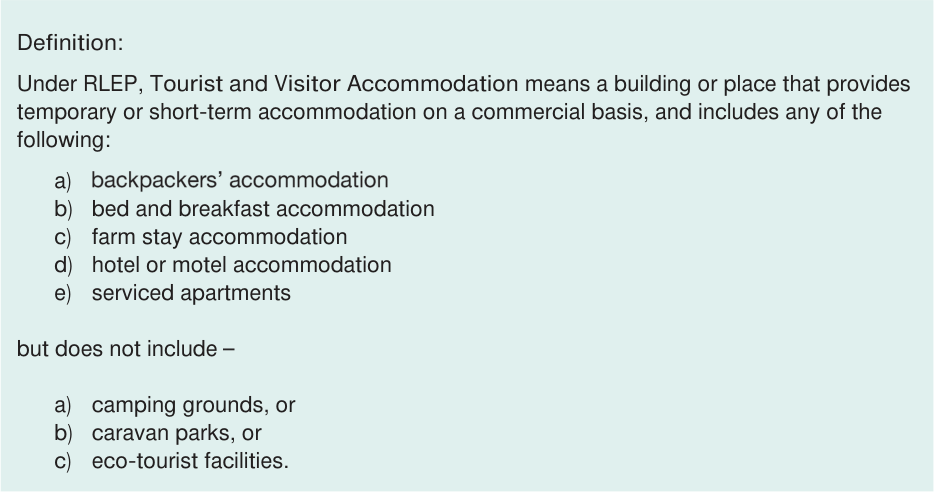

## 1. Introduction

Explanation Tourist and Visitor accommodation in the Randwick LGA has evolved over time resulting in a diverse range of accommodation types.  This Part reflects the diversity of accommodation typologies and provides guidance for their planning management. It supports the strategic objectives of the Economic Development Strategy and the Local Strategic Planning Statement by promoting the delivery of high quality, varied short-term accommodation that enhances the local visitor economy. In doing so, it aims to balance economic benefits with the need to manage potential impacts on surrounding residential areas. This section applies to:

• any development application for new tourist and visitor accommodation; and

• any alterations, additions or change of use relating to the following accommodation types:

i. Backpacker accommodation;

ii. Hotel or motel accommodation; and

iii. Serviced apartments

> [Picture on page 4: a picture, saved as a picture (images/part-c12-tourist-and-visitor-accommodation-page-4-17.gif, 150 dpi).]
> Words printed on the picture (title and legend, copied from the PDF):
> but does not include
> –
> a) camping grounds, or
> b) caravan parks, or
> c) eco-tourist facilities.

Definition: Under RLEP, Tourist and Visitor Accommodation means a building or place that provides temporary or short-term accommodation on a commercial basis, and includes any of the following:

a) backpackers’ accommodation

b) bed and breakfast accommodation

c) farm stay accommodation

d) hotel or motel accommodation

e) serviced apartments

This section of the DCP should be read in conjunction with:

• Part A - Introduction

• Part B - General Controls of the DCP; including B6 Waste Management, B9 Management Plans & B12

– Outdoor Advertising and signage;

• Part C Land Use controls

• Other sections of the DCP for specific development types, sites or locations, if relevant to the application.
