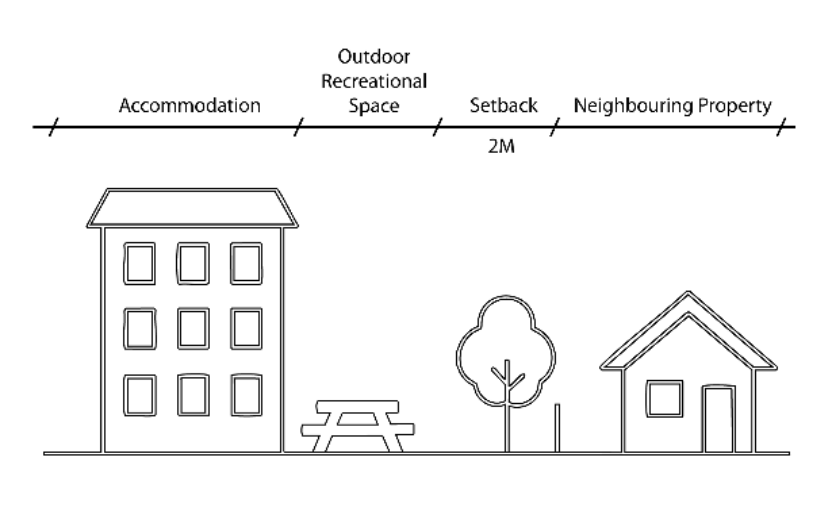

## 2. General objectives and controls

Explanation Tourist and visitor accommodation must be designed to deliver suitable levels of amenity for guests, respond sensitively to the character and amenity of the surrounding area, and achieve a high-quality built form. This includes the provision of adequate facilities for guests and accommodation that incorporates acceptable levels of solar access, ventilation and acoustic performance. Developments must not only respect the scale, form, and architectural context of neighbouring buildings and contribute positively to the streetscape, but also minimise any adverse impacts on neighbouring properties as a result of the proposed use. To do this it ’s not only important to ensure the design of the development is appropriate, but that the proposed management of the development is adequate to minimise any potential impacts to both neighbouring residents and other guests.

Objectives The objectives for Tourist and Visitor Accommodation are to:

1\. Ensure that any proposals for tourist and visitor accommodation maintains or enhances the character and amenity of the area

2\. Provide a high standard of amenity and security for guests staying in the accommodation

3\. Encourage a diverse and accessible range of accommodation typologies that cater to a broad spectrum of tourists and visitors, thereby supporting diversity within Randwick City’s local tourism and visitor economy

4\. Encourage tourist and visitor accommodation to be located within proximity to public transport, services and facilities

5\. Encourage the inclusion of universal design features for ground floor accommodation to improve accessibility and accommodate a wider range of needs.

Controls The following controls apply to all tourist and visitor accommodation:

Amenity

a) All communal sanitary facilities are to be in accordance with AS 1428 and gender separated as practically as possible

b) Ground floor dwellings should meet accessibility requirements as outlined in AS 1428.1

c) Food and kitchen servicing facilities must be designed and managed in accordance with the Australian Food Safety Standards 2023

d) Mechanical plant and equipment must be located in areas away from living or sleeping rooms within the development and adjacent buildings

e) Rooms that generate noise (such as laundries, communal spaces, and kitchens) should be located as far as practicable from sleeping rooms. Where noise-generating rooms are in close proximity to sleeping rooms, additional acoustic treatments must be provided

f) Design buildings to prevent laundry or clothing from being hung on windows facing the street elevation(s)

g) Setback any outdoor recreation areas from neighbouring residential properties by a minimum of 2 metres to minimise neighbouring impacts. A vegetation buffer is to be provided to further mitigate privacy and sound impacts

Figure 1: Outdoor setback

> [Picture on page 6: a picture, saved as a picture (images/part-c12-tourist-and-visitor-accommodation-page-6-5.gif, 150 dpi).]

Source: Randwick City Council

h) All Tourist and Visitor accommodation is to provide a reception area capable of accommodating at least one staff member, point of sale facilities and a small waiting area to ensure that guests awaiting check-in/check-out or transport do not have to congregate outdoors. The reception is to be well located to the front of the site and to be of a suitable size relative to the size of the development

i) Light of communal outdoor spaces and illuminated signage must be designed or positioned to minimise glare or light overspill to surrounding residential properties

j) Demonstrate CPTED design principles such as:

i. Adequate surveillance for shared spaces and entrances

ii. Avoiding blind spots in shared spaces and entrances

iii. Using architectural and landscaping cues to distinguish public and private areas.

Management

a) The operators of the accommodation must maintain an updated guest register including full names, addresses, arrival and departure dates

b) Applications must submit a

‘Registration of Place of Shared Accommodation ’ form prior

to the commencement of any operations

c) Applications must submit waste management and generation rates based on Council’s most recent Waste Management Guidelines in accordance with to Part B6 Waste management of the DCP

d) Applications must submit a Management Plan in accordance with Part B9 Management Plans, additionally detailing the proposed management of guests and additional measures to mitigate noise generated from such uses (the level of detail should be proportionate to the intensity of the proposed use)

e) Applications must submit an acoustic report prepared by a suitably qualified acoustic consultant addressing:

i. Potential noise sources from the operation of the development including any outdoor communal areas, mechanical plant and equipment and kitchen exhaust systems

ii. Desirable acoustic performance criteria addressing potential external night time noise activities including outdoor dining, cafes, restaurants, small bars, outdoor performances and live music

iii. Mitigation measures such as appropriate sound proofing construction and management practices to ensure:

• Compliance with the Australian Standards, Protection of the Environment Operations Act 1997 and Protection of the Environment Operations Regulation 2008

• Compliance with Australian Standard AS 2107:2016 with additional measures proposed for uses that intensify noise beyond that of residential developments.

• Noise from commercial plant and the use of communal spaces, when assessed as LAeq,15min must not exceed the LA90,15min background noise level by more than 3 dB when measured inside any habitable room (with windows closed) of any affected residence.
