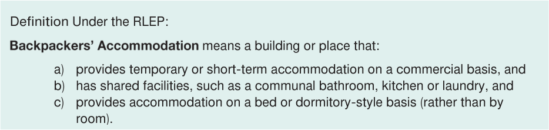

## 3. Specific controls - backpacker accommodation

Explanation Backpacker accommodation offers a unique accommodation typology typically due to its affordability, therefore catering to tourists on lower budgets. Proposed development must fall under the definition within the RLEP and must comply with the relevant provisions of the RLEP. In addition, the development must comply with the controls within this section and Part B General Controls of the DCP, and any other relevant chapters for provisions on

– but not limited

to

– built form, character and heritage considerations applicable to the site.

> [Picture on page 8: a picture, saved as a picture (images/part-c12-tourist-and-visitor-accommodation-page-8-11.gif, 150 dpi).]
> Words printed on the picture (title and legend, copied from the PDF):
> Definition Under the RLEP:
> Backpackers’ Accommodation means a building or place that:
> room).

a) provides temporary or short-term accommodation on a commercial basis, and

b) has shared facilities, such as a communal bathroom, kitchen or laundry, and

c) provides accommodation on a bed or dormitory-style basis (rather than by
