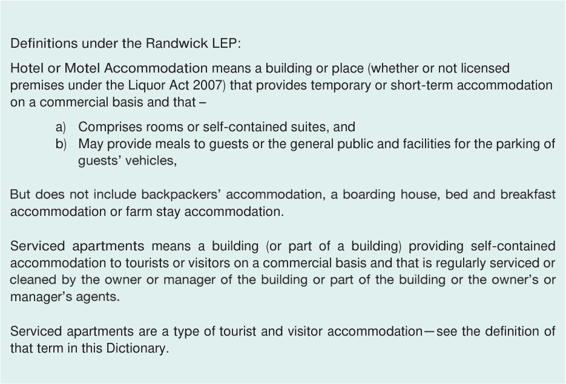

## 4. Specific controls hotel, motel accommodation and serviced apartments

Explanation Hotel and motel accommodation and serviced apartments have historically played, and continue to play, a key role in supporting both the tourist and visitor economies, as many people still prefer these options over other forms of accommodation. Being a well-defined land use, hotels and motels can deliver better outcomes

—not only in terms of guest amenity, but also in

managing impacts on surrounding residents —because their clear classification enables a robust assessment of proposals. This contrasts with certain forms of short-term rental accommodation (STRA), which

often fall under ‘exempt development’ and therefore lack the same level of

scrutiny. Council encourages the development of hotel or motel accommodation provided it is well planned and managed and considers its surroundings.

> [Picture on page 10: a picture, saved as a picture (images/part-c12-tourist-and-visitor-accommodation-page-10-16.gif, 150 dpi).]
> Words printed on the picture (title and legend, copied from the PDF):
> –
> guests’ vehicles,
> But does not include backpackers’ accommodation, a boarding house, bed and breakfast
> cleaned by the owner or manager of the building or part of the building or the owner’s or
> manage
> r’s agents.

Definitions under the Randwick LEP: Hotel or Motel Accommodation means a building or place (whether or not licensed premises under the Liquor Act 2007) that provides temporary or short-term accommodation on a commercial basis and that

a) Comprises rooms or self-contained suites, and

b) May provide meals to guests or the general public and facilities for the parking of

accommodation or farm stay accommodation.

Serviced apartments means a building (or part of a building) providing self-contained accommodation to tourists or visitors on a commercial basis and that is regularly serviced or

Serviced apartments are a type of tourist and visitor accommodation —see the definition of that term in this Dictionary.
