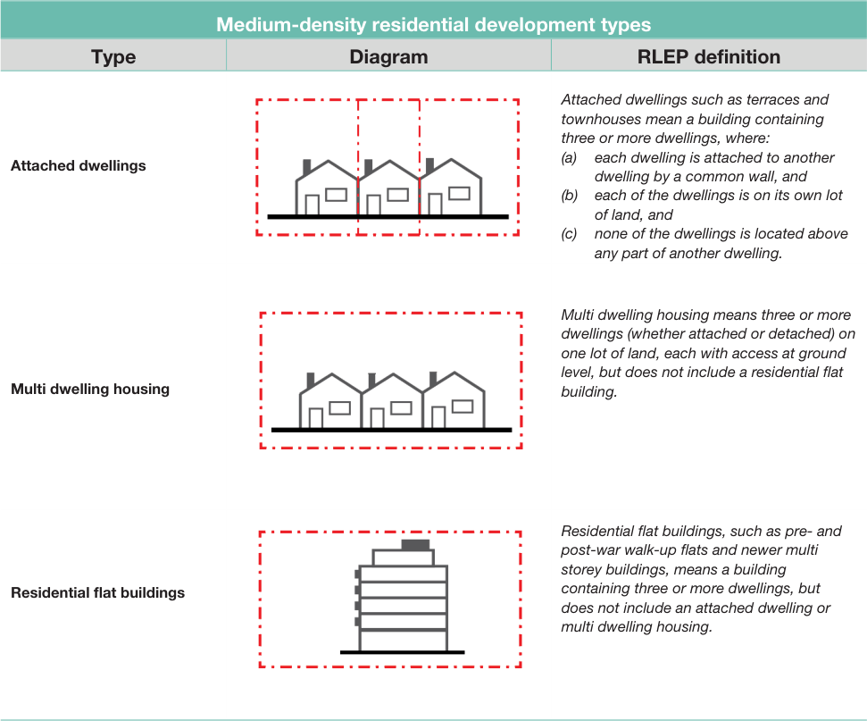

## 1. Introduction

#### Explanation

This C2 section of Randwick Development Control Plan (DCP) 2025 establishes objectives and design controls which apply to new development and alterations and additions relating to medium density residential development.   The controls apply to development types defined under the Randwick LEP 2012 including:

• Attached dwellings

• Multi dwelling housing

• Residential flat buildings The Randwick LEP establishes the applicable land Zoning, Height of Building (HOB) and Floor Space Ratio (FSR) controls for properties within medium density residential areas. Medium density residential development is permitted within R1 General Residential and R3 Medium Density Residential land use zones.

#### Figure 1: Types of medium-density residential development

> [Picture on page 5: a picture, saved as a picture (images/part-c2-medium-density-residential-page-5-15.gif, 150 dpi).]
> Words printed on the picture (title and legend, copied from the PDF):
> Attached dwellings
> Attached dwellings such as terraces and
> townhouses mean a building containing
> three or more dwellings, where:
> (a) each dwelling is attached to another
> dwelling by a common wall, and
> (b) each of the dwellings is on its own lot
> of land, and
> (c) none of the dwellings is located above
> any part of another dwelling.
> Multi dwelling housing
> Multi dwelling housing means three or more
> dwellings (whether attached or detached) on
> one lot of land, each with access at ground
> level, but does not include a residential flat
> building.
> Residential flat buildings
> Residential flat buildings, such as pre- and
> post-war walk-up flats and newer multi
> storey buildings, means a building
> containing three or more dwellings, but
> does not include an attached dwelling or
> multi dwelling housing.

#### Medium-density residential development types

#### Type

#### Diagram

#### RLEP definition

Source: Randwick City Council 2025

Over half the housing stock in the Randwick Local Government Area (LGA) consists of medium density residential housing, characterised by terraces, pre and post war residential flat buildings (RFB), walk up flats, and mid-rise apartment buildings. This Part of the DCP should be read in conjunction with:

• Part A – Introduction

• Part B - General Controls including:

- A2 Connecting with Country

- B1 Local Character Areas

- B2 Heritage

- B3 Sustainability

- B6 Waste management

- B7 Transport, traffic and parking

- B13 Noise management

- B15 Artwork and Creative Hoardings

• Other sections of the DCP for specific development types, locations or sites, as are relevant to the application.
