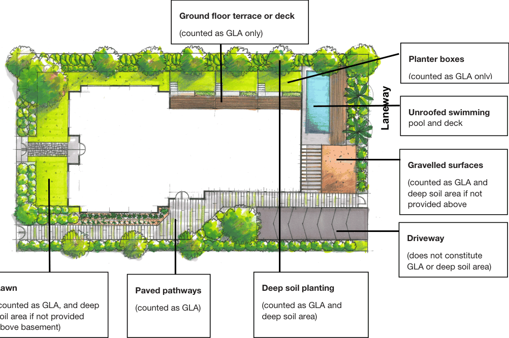

### 3.3. Landscape, deep soil and tree canopy

Landscaped areas should provide a range of usable, attractive and accessible landscaped open space and recreation areas for the use of occupants of the dwellings. Landscaped open space also contributes to the relationship of the building to adjoining and nearby development and has a significant relationship to the level of amenity and quality of life for residents. Landscaped areas include deep soil zones suitable for the growth of vegetation and large trees. Deep soil zones enable planting of significant vegetation, which can grow to a mature size and provide a permeable ground surface alternative to paving or other hard surface treatments, which allows infiltration of surface water into the soil. Deep soil zones have important

environmental benefits including supporting the healthy growth of large trees with large canopies, protecting existing mature trees and improving infiltration of stormwater. Well-designed landscaping of open spaces, gardens, terraces, and rooftops of buildings contributes significantly to our quality of life and experience of spaces. It can also help to reduce the urban heat island effect, maintain a comfortable environment during hotter months and reduce stormwater run-off. In addition, when new development is located within established residential areas, landscaping will assist to integrate new residential buildings within their surroundings, and provide buffers and transitions in building scale, and to heritage items. Refer to Part B4 Landscaping and biodiversity of the Randwick DCP for further explanation of landscaped area requirements.

#### Objectives

The objectives for landscaping are to:

1\. Enhance the quality of life and attractiveness of medium density residential areas by providing landscaped green spaces for shared amenity

2\. Bring about environmental benefits such as mitigating the urban heat island effect, reducing flooding impacts and improving localised air quality

3\. Result in a net gain of vegetation and canopy cover with consideration for the existing vegetation within medium density residential areas

4\. Provide landscaped open space of sufficient size to enable the space to be used for recreational activities or be capable of growing substantial vegetation

5\. Reduce impermeable surface cover including hard paving

6\. Improve stormwater quality and reduce quantity.

#### Controls

a) The minimum Gross Landscape Area, Deep Soil Permeable Area and Tree Canopy Cover must be met for development proposals, as per Table 1 below.

Table 1: Gross landscape area, deep soil permeable area and tree canopy cover requirements

| Medium Density Residential Areas | Gross landscape area | Deep soil permeable area | Tree canopy cover |
|---|---|---|---|
| R1 and R3 zone | 60% | If ADG applies, then 7%- 15% subject to site area. Where ADG does not apply 35% | 25% |

#### Definitions

Gross Landscape Area - is the sum of all landscaped areas within a development and may include (but is not limited to) ground plane, gardens, outdoor terraces, planter boxes, sky gardens, roof terraces, and green walls. Deep Soil Permeable Surfaces - include areas used for the growing of plants (including grasses, shrubs and trees) and areas occupied by loose gravels upon soil at the ground level of the site. Deep soil permeable surfaces do not include swimming and spa pools, paved areas, areas of artificial turf, planter boxes, or planted areas above basements, podiums, roofs or slabs. Tree Canopy Cover - includes trees with a minimum mature height of 5m after 10 years from the completion of development, that have trunks located within the site area.

#### Figure 2: GLA and deep soil permeable – typical example

> [Picture on page 20: a map, saved as a picture (images/part-c2-medium-density-residential-page-20-13.gif, 150 dpi); the street names and other small labels are on the picture.]
> Words printed on the picture (title and legend, copied from the PDF):
> Ground floor terrace or deck
> (counted as GLA only)
> (counted as GLA only)
> pool and deck
> (counted as GLA only)
> (counted as GLA and
> deep soil area if not
> (does not constitute
> GLA or deep soil area)
> Deep soil planting
> (counted as GLA)
> (counted as GLA and
> deep soil area)
> (counted as GLA, and deep
> soil area if not provided

#### Laneway

#### Main Street Frontage

Source: Randwick City Council 2025
