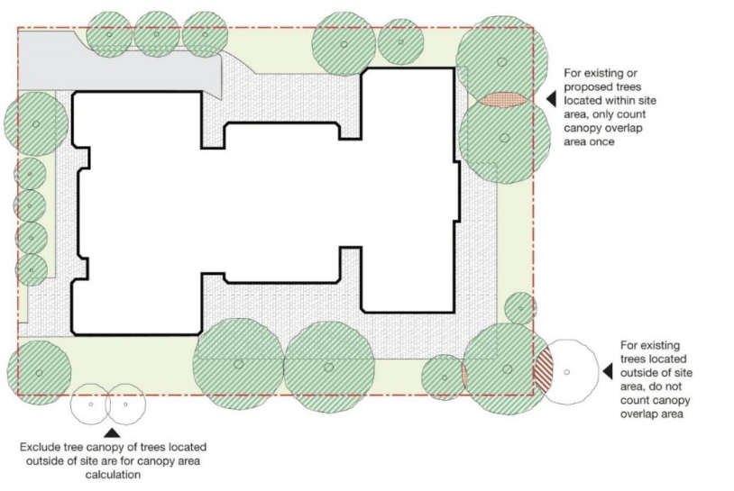

#### 3.3.3. Tree Canopy Cover

Minimum tree canopy requirements apply to new developments to realise the Randwick City 22% tree canopy target for the LGA by 2040.

#### Controls

a) A minimum of 25% canopy coverage as a percentage of the site area is required – to be achieved within 10yrs from the completion of development based on the maturity of the trees selected. Trees must achieve the minimum mature height of 5m. Refer to the ‘Notes’ below that explain the calculation of future canopy cover based on tree species and average growth rates.

Figure 3: Calculating canopy cover - typical apartment development with 25% canopy cover

> [Picture on page 24: a picture, saved as a picture (images/part-c2-medium-density-residential-page-24-2.gif, 150 dpi).]

Source: Randwick City Council 2022

#### Note

Tree species guidance and average mature dimensions for canopy calculations can be found in Council’s Street Tree Master Plan. It can be downloaded from the following link -https://www.randwick.nsw.gov.au/environment-and-sustainability/trees/preserving-our-trees An interactive version of the Precincts and Precinct Palette Species list contained within the Street Tree Master Plan can be accessed here - https://randwick-council.maps.arcgis.com/apps/webappviewer/index.html?id=5343844065dd44b0adc4d4ea 537816d5 Native / indigenous plant species are required to be provided as they are better suited to the local soils and climate, they support native fauna (through providing food and habitat), and they generally require less water and are more drought tolerant.
