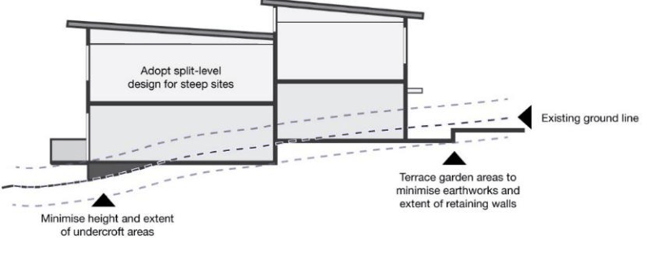

### 3.8. Earthworks

#### Explanation

The resolution of the levels of a site, is critical early step in achieving high quality relationship between internal living spaces, external private open space and adjoining properties. From an environmental perspective, development should avoid unnecessary alteration of the natural landform and subsurface conditions. In particular, extensive excavation, including for basements, should not unduly modify the site’s water table or broader hydrological conditions

#### Objectives

The objectives for earthworks are to:

1\. Ensure earthworks respond to the natural topography, maintain or minimise cut and fill of the natural ground level

2\. Ensure excavation and backfilling of a site does not result in unreasonable structural, visual, overshadowing and privacy impacts on the adjoining properties

3\. Enable the provision of usable communal or private open space with adequate gradient

4\. Maintain site stability and ensure earthworks do not result in adverse stormwater impacts on the adjoining properties

5\. For planting on structure, the soil depth and volume are to be sufficient for the proposed planting to thrive and is to comply with ADG section 4P Planting on structures.

#### Controls Excavation and backfilling

a) Excavation and backfilling within the building footprint on relatively flat sites must be minimised and must not exceed 1m at any point on the allotment, excluding excavation associated with swimming pools or spa pools

b) On sloping sites, development must respond to the natural topography and minimise earthworks. Split-level building design is to be adopted where necessary to reduce the extent of cut and fill

c) Where site constraints including steep gradients limit the ability to comply with the above controls, development may be considered on merit having regard to:

i. The natural topography and constraints of the site

ii. Potential Adverse impacts on adjoining properties including changes in level, privacy, visual bulk and overshadowing

iii. Relevant geotechnical considerations including soil stability

iv. stormwater management and drainage outcomes

d) Any cut and fill outside the building footprint (including for the provision of communal or private open space) must be designed as terraced or stepped landforms that follow following the natural contours of the site, minimise the height and extent of retaining walls and earthworks and avoid abrupt changes in level at site boundaries. The appropriate extent of site modification will be assessed on merit.

#### Figure 4: Measures for minimising earthworks

> [Picture on page 33: a picture, saved as a picture (images/part-c2-medium-density-residential-page-33-22.gif, 150 dpi).]

Source: RCC

#### Retaining walls

a) Retaining walls, excavation, piling and other sub-surface structures are to be setback a minimum of 900mm from side and rear boundaries. The location, thickness and footing design of retaining walls must be clearly shown on submitted plans

b) Retaining walls are to be designed in response to the natural landform and stepped or terraced to minimise visual bulk and avoid continuous, monolithic structures when viewed from adjoining properties and the public domain

c) Where site constraints necessitate retaining walls within 900mm of a side or rear boundary, the design must:

i. be appropriately stepped, with each vertical section not exceeding 1.5m–2.0m in height (measured from existing ground level)

ii. minimise impacts on adjoining properties, including visual bulk and overshadowing

iii. be integrated with boundary fencing where appropriate

d) On sites that slope upward from the street, retaining walls visible from the public domain must:

iv. minimise the extent of blank, unarticulated wall surfaces

v. incorporate articulation, varied materials and finishes, or architectural detailing

vi. be supplemented with landscaping, including planting in deep soil zones where feasible, to soften visual impacts

b) Retaining walls are not to result in abrupt level changes at property boundaries and must provide a reasonable transition to adjoining land.

#### Note

Development proposed on land adjacent to busy roads should consider Section 6 of the Development near Rail Corridors and Busy Roads – Interim Guideline (2008). https://www.planning.nsw.gov.au/sites/default/files/2023-03/development-near-rail-corridors-and-busy-roads-interim-guideline.pdf
