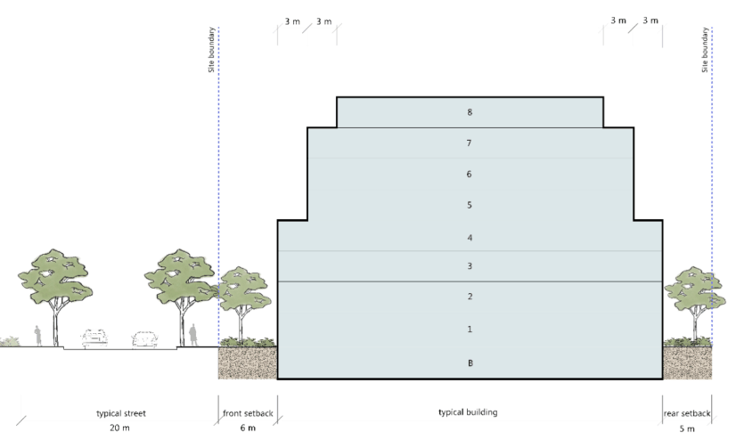

#### 4.3.1. Front setback

#### Controls

a) The front setback on the primary (and secondary for corner sites) property frontages must be consistent with the prevailing setback line along the street. Notwithstanding this, the front setback generally must be no less than 6m in all circumstances to allow for suitable landscaped areas to building entries. Further, upper-level setbacks are required when the proposed development is above four, and the sixth or seventh storey height. Setbacks are to comply with Table 2 and Figure 5

b) Where a development is proposed in an area identified as undergoing a transition in height and density, the front setback will be determined by Table 2 and Figure 5

c) Where a precinct specific DCP section applies to the site, the detail block plan controls apply

#### Definition

Transitional areas can be areas of mixed character, without clearly prevailing characteristics or features. Areas subject to new planning controls which permit increased height and density. They can also be precincts or localities in the process of undergoing change in terms of character or built form.

d) The front setback areas must be free of structures, such as swimming pools, above-ground rainwater tanks and outbuildings

e) The entire front setback must incorporate landscape planting, except for driveways and pathways.

#### Table 2: Minimum front setback

| Minimum front setback in the LMR area |  |  |
|---|---|---|
| Zero to 4 storeys | 5 to 7 storeys | Top level of building setback (at level 7 or 8) |
| Align with predominant building line of the primary street frontage. and provide a minimum setback of 6m setback from front property boundary. | Provide 3m setback from predominant building alignment to the primary street frontage | Provide 3m setback from level below |
| Minimum front setback outside the LMR area |  |  |
| Zero to 3 storeys | 4 storeys and above |  |
| Align with predominant building line of the primary street frontage. and provide a minimum setback of 6m setback from front property boundary | 3m setback from predominant building alignment to the primary street frontage |  |

#### Figure 5: Front setback requirements

> [Picture on page 38: a picture, saved as a picture (images/part-c2-medium-density-residential-page-38-4.gif, 150 dpi).]
