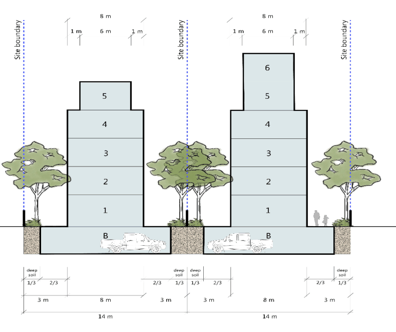
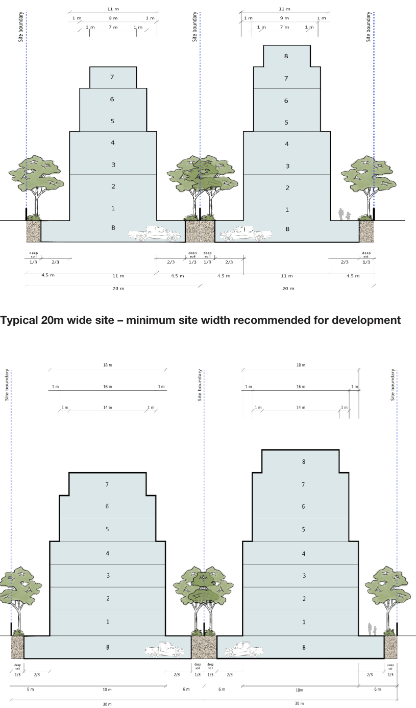
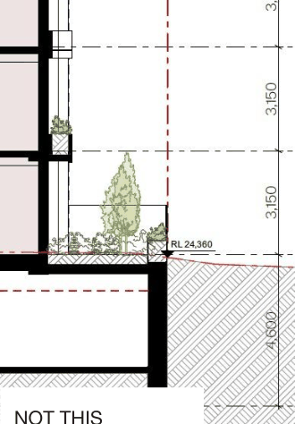
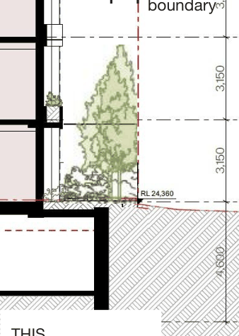
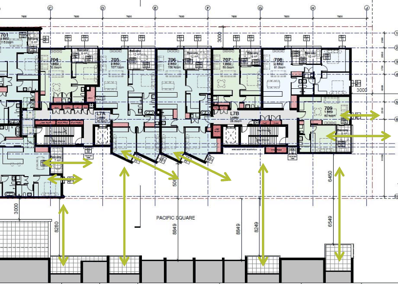
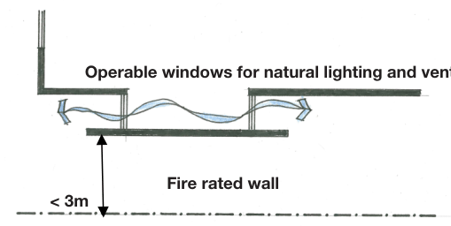

#### 4.3.2. Side setback

#### Controls – Buildings above 9.5m height

a) Residential Flat Buildings (RFB) and Shop-Top housing developments are to comply with the building separation requirements of the Apartment Design Guideline (ADG). New RFB development of three storeys and above, are to equally share the side setback with their neighbour. For example, an ADG 12m building separation would require a 6m setback for the new building from the shared side property boundary

b) All medium density residential development is to comply with the minimum side setback requirements stated below for dwellings above 9.5m in height:

#### Table 3 – Minimum side setback (buildings above 9.5m)

| Minimum side setback in the LMR area |  |  |  |
|---|---|---|---|
| Site width | Zero to 4 storeys | 5 to 7 storeys | Top level of building setback (at level 7 or 8) |
| Less than 15m | Merit assessment, no less than 3m | Merit assessment, no less than 4m | 1m setback from level below |
| 15m to less than 25m | 4.5m | 5.5m | 1m setback from level below |
| 25m and greater | 6m | 7m | 1m setback from level below |
| Minimum side setback outside the LMR area |  |  |  |
| Site width | Zero to 3 storeys | 4 storeys and above |  |
| Less than 15m | Merit assessment, no less than 3m | Merit assessment, no less than 4m |  |
| 15m to less than 25m | 4.5m | 5.5m |  |
| 25m and greater | 6m | 7m |  |

#### Figure 6: Example side setback required for 14m, 20m and 30m site width

> [Picture on page 39: a picture, saved as a picture (images/part-c2-medium-density-residential-page-39-4.gif, 150 dpi).]

#### Typical 14m wide site – not recommended for redevelopment above 6 stories

> [Picture on page 40: a picture, saved as a picture (images/part-c2-medium-density-residential-page-40-1.gif, 150 dpi).]

#### Typical 20m wide site – minimum site width recommended for development

#### Typical 30m wide site

a) Where a merit assessment is permitted in relation to the minimum side setback control, the proposal will be assessed having regard to the unique site-specific environmental conditions including whether adequate building separation has been achieved to ensure:

i. visual and acoustic privacy

ii. solar access and management of overshadowing

iii. natural ventilation

iv. the provision of adequate screening landscaping in deep soil.

c) A reduced minimum setback that varies from Table 3 as outlined above may be considered in the following circumstances:

i. Where the development does not exceed four (4) storeys in height; and

ii. The development complies with relevant landscaping, tree canopy and deep soil provisions; and

iii. The development will not unreasonably impact upon the residential amenity of neighbouring properties in terms of solar access, privacy, views and visual bulk.

d) An average side setback will be assessed on merit and will only be considered if it can be demonstrated that

i. variation in setback distances provides enhanced façade articulation and built form modulation

ii. areas of reduced setback are offset by increased setbacks elsewhere along the side elevation

iii. there is no net loss of landscaped setback area between adjoining building elevations

iv. the overall outcome achieves equal or improved residential amenity, including privacy

h) Development must incorporate side setbacks greater than the minimum required where necessary, to:

i. Provide articulation and modulation of building facades

ii. Facilitate useable open space areas and provide opportunities for landscaping, preferably in deep soil planting

iii. Protect the visual amenity and acoustic privacy for the development and the adjoining properties

iv. Ensure adequate solar access and natural ventilation to both the development and the neighbouring dwellings

v. Minimise overshadowing impacts

vi. Provide appropriate transition of built form scale to both lower density development, heritage items and sensitive environmental interfaces

vii. Improve visual amenity and outlook for both new and existing residents.

i) Development must be designed to protect the privacy of adjoining new and existing residents. The full length of the building’s side elevations, is to incorporate appropriate articulation which may include:

i. careful placement and orientation of windows and balconies

ii. the use of sawtooth or projecting/recessed wall and window elements, or other suitable screens to protect privacy where appropriate

iii. integration of screening devices where required

j) Each window on the subject façade is to be designed to ensure visual and acoustic privacy is achieved at all potential interfaces

k) In protecting privacy and residential amenity, priority is to be given to building separation, window siting, orientation and window placement. Design solutions are to minimise overlooking of Private or Communal Open Space in the first instance rather than secondary design measures such as window screens, frosted glass windows or screen landscaping. Secondary measures, such as fixed screens, obscure glazing or screen planting, are to be used only where primary design measures are insufficient

l) A minimum of one-third (33%) of the side setback area, and no less than a continuous 1-metre-wide strip, is to be provided as deep soil planting. The deep soil zone is to accommodate vegetation that provides effective visual screening, contributing to improved privacy and outlook for residents. Refer to Figure 7

#### Figure 7: Screen planting in deep soil at the side boundary

> [Picture on page 42: a picture, saved as a picture (images/part-c2-medium-density-residential-page-42-6.gif, 150 dpi).]
> Words printed on the picture (title and legend, copied from the PDF):
> NOT THIS

Side setback

1/3 deep soil and no less than 1m setback from side

> [Picture on page 42: a picture, saved as a picture (images/part-c2-medium-density-residential-page-42-10.gif, 150 dpi).]
> Words printed on the picture (title and legend, copied from the PDF):
> THIS

boundary

m) Building basements are to be setback from the side property boundaries, a minimum of 1m to provide a deep soil zone suitable for screen planning to provide privacy for residents

n) Where exceptional site constraints apply, variations to the above controls may be considered on merit, having regard to the building massing and design response, and whether the development adequately mitigates potential impacts relating to:

i. visual and acoustic privacy

ii. solar access and overshadowing

iii. access to sunlight iv. natural cross ventilation

o) Development must incorporate appropriate design measures to achieve visual privacy for new and existing residents. This may include:

i. adequate building separation

ii. recessed or screened balconies

iii. strategic location of service areas and blank walls

iv. staggered or offset building arrangements

v. careful placement and orientation of windows

vi. use of articulated façade elements, such as recessed or projecting forms. These measures are to be designed to minimise direct overlooking between dwellings and adjoining properties

p) All windows, balconies and terraces are to be considered in the design of each façade to ensure visual and acoustic privacy is achieved throughout the development. Refer to Figure 8

#### Figure 8: Visual privacy design techniques

> [Picture on page 43: a picture, saved as a picture (images/part-c2-medium-density-residential-page-43-2.gif, 150 dpi).]

q) Where windows are proposed within 3 metres of a common boundary in a residential flat building or multi-dwelling housing development, a Fire Safety Statement prepared by a suitably qualified building consultant must be submitted. The Fire Safety Statement must demonstrate how the design and construction will enable the operation of windows (where required) while ensuring compliance with the relevant provisions of the National Construction Code (NCC). Solutions include, but are not limited to, orienting side windows generally to the front and rear of the site and incorporating blade walls for fire protection and separation.

#### Note

Clearly show all affected windows/openings on the DA plans.

#### Figure 9: Fire protection option

> [Picture on page 43: a picture, saved as a picture (images/part-c2-medium-density-residential-page-43-14.gif, 150 dpi).]
> Words printed on the picture (title and legend, copied from the PDF):
> Operable windows for natural lighting and ventilation
> Fire rated wall
> < 3m

#### Side boundary

Source: RCC

#### Controls – Buildings up to 9.5m in height

a) Attached Dwellings should comply with the minimum side setback requirements for residential dwellings in Randwick DCP section C1 Low Density Residential, 3.3.2 Side setbacks, Figure 7

b) Notwithstanding the above, side setbacks do not need to comply where they attach to another dwelling within the same development.

#### Controls – Buildings adjoining a State or Local listed heritage property

a) Development adjoining a State or locally listed heritage item must provide a minimum setback of:

i. 3 metres from the common boundary with the heritage property; and

ii. 6 metres between the new building and the heritage item or contributory building.

b) Additional upper-level setbacks are required above the fourth and sixth or seventh storeys, in accordance with Table 3 and Figure 6. Increased setbacks may be required subject to site-specific assessment and advice from Council’s heritage advisor

c) Building setbacks are to provide sufficient space for a landscaped buffer that:

i. protects the setting and visual curtilage of the heritage item

ii. provides an appropriate visual backdrop to the heritage item

iii. supports privacy and amenity for adjoining residents

d) A minimum of one-third (33%) of the side setback area between the new development and the heritage boundary, and no less than a continuous 1-metre-wide strip, is to be provided as deep soil planting. Landscaping is to include suitable screen planting to enhance privacy and soften the interface with the heritage property.

#### Controls – Low and Mid Rise (LMR) and Transition Zones

a) Development in Low and Mid Rise (LMR) areas and identified Transition Zones must respond to site-specific conditions and provide an appropriate transition in scale where there is a significant change in building height, such as between 1–2 storey dwellings and 6–8 storey apartment buildings

b) Side and upper-level setbacks are to be provided in accordance with Table 3 and Figure 6 to:

i. moderate changes in building scale and bulk

ii. provide a landscaped buffer between buildings

iii. establish an appropriate visual backdrop

iv. protect the privacy and amenity of new and existing residents

c) A minimum of one-third (33%) of the side setback area, and no less than a continuous 1-metre-wide strip, is to be provided as deep soil planting between the new building and the property boundary. Landscaping is to include suitable screen planting to enhance privacy and soften the interface between buildings

d) Basement structures are to be setback a minimum of 1 metre from side boundaries to enable the provision of deep soil zones suitable for screen planting, contributing to privacy, landscape continuity and canopy establishment.
