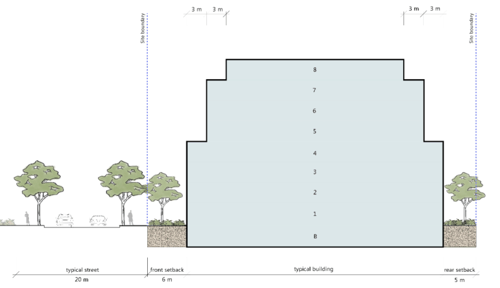

#### 4.3.3. Rear setback

#### Controls

a) For Residential Flat Buildings and Multi Dwelling Housing, provide a minimum rear setback of 15% of allotment depth or 5m, whichever is the greater

b) For attached dwellings, provide a minimum rear setback of 25% of the allotment depth or 8m, whichever is the lesser. Any garages fronting rear lanes may encroach upon the rear setback areas

c) Rear building setbacks are to comply with Table 4 and Figure 10

d) The required rear setback may be varied in the following scenarios:

i. Allotments with an irregular shape

ii. Allotments with the longest boundary abutting the street or the rear adjoining neighbour (that is, the frontage width being longer than the site depth)

iii. Allotments with the rear boundary abutting a laneway

iv. If a central courtyard is provided in the development.

#### Table 4: Minimum rear setback

| Minimum rear setback in the LMR area |  |  |
|---|---|---|
| Zero to 4 storeys | 5 to 7 storeys | Top level of building setback (at level 7 or 8) |
| RFBs and Multi-dwelling Housing - Setback to be a minimum of 15% of the site depth, or 5m, whichever is the greater. | 3m setback from predominant rear building alignment | 3m setback from level below |
| Minimum rear setback outside the LMR area |  |  |
| Zero to 3 storeys | 4 storeys and above |  |
| RFBs and Multi-dwelling Housing - Setback to be a minimum of 15% of the site depth, or 5m, whichever is the greater. | 3m setback from predominant rear building alignment |  |
| Attached dwellings |  |  |
| Setback to be a minimum of 25% of the site depth, or 8m, whichever is the lessor. | 3m setback from predominant rear building alignment | 6m setback from predominant rear building alignment |

#### Figure 10: Rear setback for RFB

> [Picture on page 45: a picture, saved as a picture (images/part-c2-medium-density-residential-page-45-14.gif, 150 dpi).]
