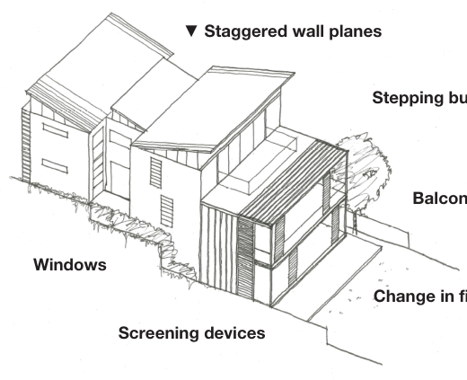

## 5.  Building design

### 5.1. General

#### Explanation

Following the establishment of the permissible building envelope (defined by FSR, Height of Building (HOB), and front, side and rear setbacks), development must be designed to respond to the site’s specific characteristics and its surrounding natural and built context. Building form, massing and articulation play a critical role in determining how development is perceived within the streetscape and from adjoining properties. Well-designed façades and building elements can reduce the apparent bulk and scale of development, contribute to visual interest, and reinforce the desired character and continuity of the street. Façade composition, including the arrangement of building elements, materials and detailing, should be carefully considered to achieve a high-quality architectural outcome that enhances both the public domain and residential amenity.

#### Objectives

The design objectives are to:

1\. Ensure the form, scale, massing and proportions of development respond to and are compatible with the site’s characteristics including topography, configuration, orientation and surrounding natural and built context

2\. Ensure building facades are well articulated to contribute positively to the character of the streetscape, rhythm and continuity of the streetscape

3\. Promote high quality internal design, with well proportioned, functional dwelling layouts that deliver a high standard of residential amenity

4\. Encourage contemporary and innovative designs that enhances neighbourhood character particularly in areas undergoing change.

#### Controls

a) Development must respond to the natural topography of the site. On sloping sites, the building form is to be modelled or stepped to follow the prevailing landform and avoid concentrating excessive structural bulk on either the uphill or downhill portions of the site

b) Building form should avoid “wedding cake” or “pyramid” configurations where these result in dominant or visually intrusive built forms that are inconsistent with the natural landform or surrounding context. Building façades must be articulated to reduce apparent bulk and scale, and to achieve a human scale when viewed from adjoining properties, the public domain and key vantage points. This may be achieved through a combination of the following design measures:

i. variation and modulation of window openings

ii. inclusion of balconies, terraces or private open space elements

iii. articulation of entry elements such as porches or lobbies

iv. use of recessed and projecting wall planes

v. variation in materials, finishes and textures

vi. incorporation of architectural detailing and design elements

#### Figure 11: Design measures for modelling and articulating a building

> [Picture on page 47: a picture, saved as a picture (images/part-c2-medium-density-residential-page-47-2.gif, 150 dpi).]
> Words printed on the picture (title and legend, copied from the PDF):
> ▼ Staggered wall planes
> Windows
> Screening devices

#### Stepping building to suit site topography

#### Balconies / terraces

#### Change in finishes and materials

Source: Randwick City Council

c) Divide side elevations into sections, bays or modules of not more than 12m length, separated by measures, such as recesses or side courtyards, to avoid massive or unrelieved walls. Refer Figure 11

d) Articulate all street elevations for development on corner allotments

e) Alterations and additions to an existing dwelling must present an integrated design with suitable configuration, materials and detailing, so that the new and retained structures provide an integrated composition

#### Note

For heritage items or buildings located within Heritage Conservation Areas (HCAs), a clear distinction must be made between original (historic) fabric and new works. This ensures that additions or alterations are sympathetic to the heritage significance of the place. Refer to Part B2 – Heritage of the Randwick Development Control Plan (DCP) for detailed requirements and guidance on heritage conservation, including design principles, documentation, and assessment criteria.

f) Balconies, terraces and decks must be of a size and configuration that are appropriate to the proportions of the building without excessively increasing its visual bulk

g) Master bedrooms must have a minimum area of 10m2 and other bedrooms 9m2, both with a minimum dimension of 3m (excluding wardrobe space).
