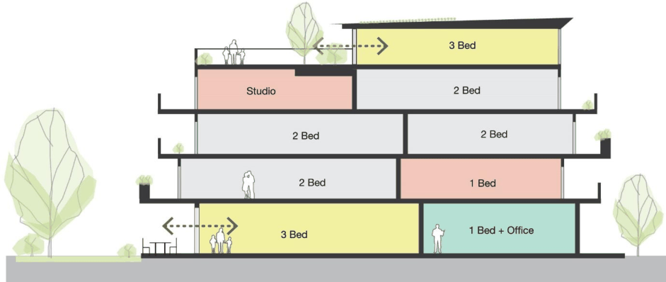

### 5.2. Housing mix

#### Explanation

There is a growing demand for apartment living within well serviced, high amenity areas across the Randwick LGA. Medium density residential areas are generally located within proximity to frequent public transport, commercial centres and open space, making them well-suited to a diverse range of households.

As identified in the Randwick Local Strategic Planning Statement (LSPS), the future population is expected to comprise a broad mix of household types including single persons, couples, families with children and group households. It is therefore essential that apartment development delivers a diversity of dwelling types to respond to varying lifestyle needs, household structures and affordability considerations. A balanced mix of one, two, and large three or more bedroom apartments, is required to support residents at different life stages, including families, older persons and key workers and to promote inclusive and sustainable communities.

#### Figure 12: Housing mix

> [Picture on page 48: a picture, saved as a picture (images/part-c2-medium-density-residential-page-48-10.gif, 150 dpi).]

Source: Randwick City Council 2022

#### Objectives

The objectives for housing mix are to:

1\. Provide a diversity of housing types to meet the needs of a range of demographics, household structures, physical abilities and income groups

2\. Ensure development delivers a balanced mix of dwelling sizes and configurations to respond to current and future social and demographic trends within the Randwick LGA

3\. Achieve consistency with the Apartment Design Guide (ADG), including Objective 4K (Apartment Mix), by encouraging flexible and adaptable dwelling design that can respond to changing occupant needs over time.

#### Controls

a) Development is to comprise a mix of apartment types, where gardens, adaptability and accessibility are more easily achievable for elderly people, families with children, or people living with disabilities

b) At least 30% of the total number of dwellings (to the nearest whole number of dwellings) within a development are to be one or two bedroom dwellings, or both

c) At least 30% of the total number of dwellings (to the nearest whole number of dwellings) within a development are to be three or more-bedroom dwellings

d) At least 20% of the total number of apartments of three bedrooms or more are to be located on the lower floors of the building or with access to large, landscaped terraces

e) Family friendly apartments should be located at the ground and podium levels to utilise larger terrace areas for play, and in positions with direct sightlines of Communal Open Space for parental supervision.

#### Definition

Family friendly apartments are dwellings specifically designed for family accommodation with more bedrooms and enhanced access to green spaces, child play spaces and communal spaces.

#### Note

As a result of the above dwelling mix controls, self-contained studio apartments cannot make up more than 40% of the total number of dwellings within a development.
