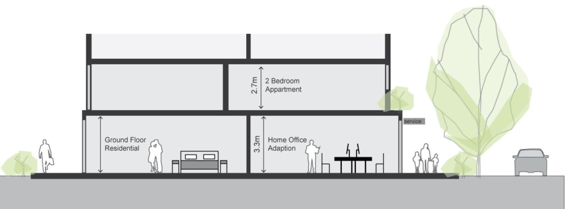

### 5.4. Floor to ceiling heights

#### Explanation

Ceiling height together with room sizes and balconies or terraces are important elements of good design and enhanced resident amenity. Adequate ceiling height can create a sense of spaciousness and provide greater access to sunlight and daylight, improving sustainability and allow flexibility for future uses. Floor-to-ceiling heights for apartments are to comply with the requirements of the Apartment Design Guide (ADG).

#### Figure 13: Building cross section showing potential ground floor commercial use

> [Picture on page 50: a picture, saved as a picture (images/part-c2-medium-density-residential-page-50-23.gif, 150 dpi).]

Source: Randwick City Council 2022

#### Objectives

The objectives for floor to ceiling heights are to:

1\. Promote daylight access and cross ventilation of building interiors and contribute to the flexible use of buildings

2\. Provide a high level of internal amenity to all floors of the building including common areas and circulation spaces

3\. Allow the lower levels of buildings, near commercial zones, to be converted from a residential to a non-residential use in the future

4\. Allow adequate space between floors for acoustic treatment

5\. Ensure that buildings are well proportioned and contribute to ground level activation.

#### Controls

a) Minimum floor-to-ceiling heights (in accordance with the ADG) are to be provided as follows:

i) Ground Floor – 3.3m

ii) First Floor and above – 2.7m

b) The minimum floor-to-floor height of residential building levels, first floor and above, should be 3.1m, unless detailed cross sections and engineering justifications are provided that establish the feasibility of a lesser height. Council prefers 3.2m floor-to-floor to accommodate ceilings, floor finishes, services and step downs.
