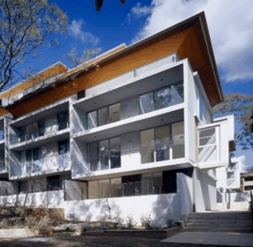
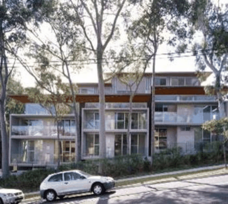
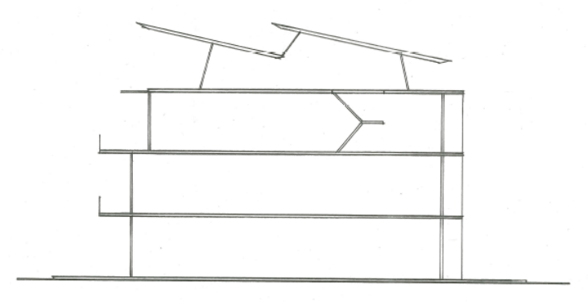

### 5.6. Roof design

#### Explanation

The roof is a key architectural component that contributes to the overall form, silhouette and expression of a building. Roof design plays an important role in how development is perceived within the streetscape and broader skyline, particularly where buildings are visible from multiple vantage points. A well‑considered roof form can enhance the visual character of the locality, reinforce the architectural composition of the building, and contribute to a coherent and legible built form. Roof design also supports environmental performance through the integration of elements such as shading, natural ventilation and opportunities for renewable energy generation.

#### Objectives

The objectives for roof design are to:

1\. Ensure roof design integrates with the overall form, proportions and façade composition of the building

2\. Ensure any recreational use of the roof integrates with the built form and does not cause unreasonable privacy and noise impacts on the surrounding residences

3\. Broaden the dwelling mix by creating opportunities for larger sized units on the uppermost storey

4\. Promote high amenity apartment design with good natural ventilation

5\. Provide opportunities for creating interesting roof forms that contribute to the streetscape and neighbourhood character.

Figure 14: The roof structure contributes to the three-dimensional form of the building.

> [Picture on page 53: a picture, saved as a picture (images/part-c2-medium-density-residential-page-53-13.gif, 150 dpi).]

> [Picture on page 53: a picture, saved as a picture (images/part-c2-medium-density-residential-page-53-14.gif, 150 dpi).]

Source: Candalapas Architects

#### Controls

a) Design the roof form, in terms of massing, pitch, profile and silhouette to relate to the three-dimensional form (size and scale) and façade composition of the building

b) Design the roof form to respond to the orientation of the site, such as eaves and skillion roofs to respond to sun access

c) Use a similar roof pitch to adjacent buildings, particularly if there is consistency of roof forms across the streetscape

d) Articulate or divide the mass of the roof structures on larger buildings into distinctive sections to minimise the visual bulk and relate to any context of similar building forms

e) Use clerestory windows and skylights to improve natural lighting and ventilation of internalised space on the top floor of a building where feasible. The location, layout, size and configuration of clerestory windows and skylights must be sympathetic to the overall design of the building and the streetscape

f) Any services and equipment, such as plant, machinery, ventilation stacks, exhaust ducts, lift overrun and the like, must be contained within the roof form or screened so that they are not readily visible from the public domain

g) Terraces, decks or trafficable outdoor spaces on the roof may be considered only if:

i. There are no direct sightlines to the habitable room windows and private and communal open space of the adjoining residences

ii. The size and location of terrace or deck will not result in unreasonable noise impacts on the adjoining residences

iii. Any stairway and associated roof do not detract from the architectural character of the building and are positioned to minimise direct and oblique views from the street

iv. Any shading devices, privacy screens and planters do not adversely increase the visual bulk of the building

i) The provision of landscape planting on the roof (that is, a “green roof”) is encouraged. Any green roof must be designed by a qualified structural engineer, and by a Landscape Architect or designer with details shown on a landscape plan.

#### Figure 15: Roof design can create an interesting top to a building

> [Picture on page 54: a picture, saved as a picture (images/part-c2-medium-density-residential-page-54-14.gif, 150 dpi).]

Source: Randwick City Council
