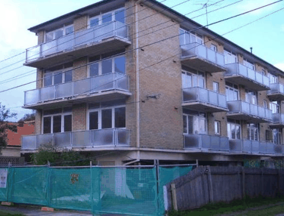
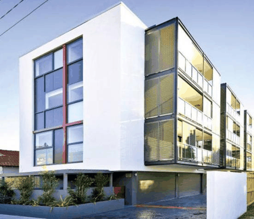

### 5.13. Alterations and additions to Residential Flat Buildings

#### Explanation

Walk-up Residential Flat Buildings (RFB), typically built between the 1950s-1970s, form a significant proportion of medium density residential dwellings in the Randwick LGA. These older RFBs are often now in need of redevelopment or refurbishment to meet current lifestyle needs, improve sustainability and to update the building’s appearance. Randwick City Council’s ‘Design Ideas for Rejuvenating Flat Buildings’ manual, contains design principles and concepts to promote and guide the refurbishment of older RFBs.

#### Objective

The objective for alterations and additions to RFBs is to:

1\. Promote design excellence in the refurbishment of older RFBs.

#### Controls

a) The comprehensive refurbishment of older walk-up RFBs must have regard to the Randwick City Council ‘Design Ideas for Rejuvenating Residential Flat Buildings’ manual

b) Alterations and additions to RFBs located within HCAs or a heritage item shall ensure that the overall aesthetic improvements to the appearance of the building can make a positive contribution to the heritage streetscape by:

i. Providing for a combination of materials, colours and finishes to the building façade that are compatible with the HCA or heritage item

ii. Incorporating elements such as shading devices, blade walls or vertical elements to articulate the façade of the building

iii. Providing for balconies and terraces that can help recess garages

iv. Incorporating landscaping and where practical suitable fencing to the street frontage

v. Where practical, remove external elements that detract from the appearance of the HCA or heritage item.

#### Figure 16: Example of RFB refurbishment

> [Picture on page 60: a picture, saved as a picture (images/part-c2-medium-density-residential-page-60-2.gif, 150 dpi).]

#### Before

> [Picture on page 60: a picture, saved as a picture (images/part-c2-medium-density-residential-page-60-4.gif, 150 dpi).]

#### After

Source: Smart Design Studio
