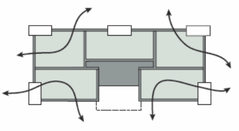
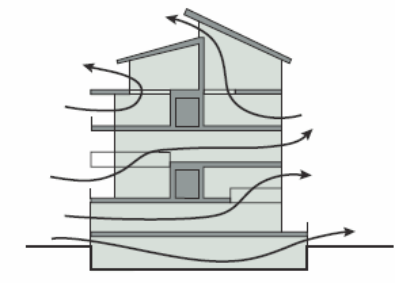
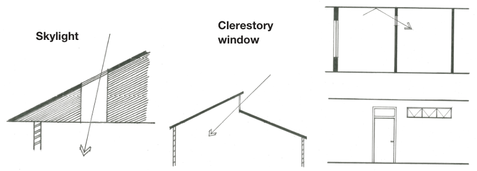

### 6.2. Energy efficiency and natural ventilation

#### Explanation

Natural ventilation is the circulation of sufficient volumes of fresh air through an apartment to create a comfortable indoor environment.

#### Objectives

The objectives for natural ventilation and energy efficiency are to:

1\. Ensure that dwellings are designed to provide all habitable rooms with direct access to fresh air and assist in promoting thermal comfort for occupants

2\. Provide natural ventilation in non-habitable rooms, where possible

3\. Reduce energy consumption by minimising the use of mechanical ventilation, particularly air conditioning.

#### Figure 17: Achieving natural cross-ventilation in RFBs

> [Picture on page 63: a picture, saved as a picture (images/part-c2-medium-density-residential-page-63-1.gif, 150 dpi).]

Plan

> [Picture on page 63: a picture, saved as a picture (images/part-c2-medium-density-residential-page-63-3.gif, 150 dpi).]

Section

Source: ADG

#### Controls

a) Sun shading devices appropriate to the orientation should be provided for the windows and glazed doors of the building

#### Figure 18: Measures for optimising daylight access to the interior of dwellings

> [Picture on page 63: a picture, saved as a picture (images/part-c2-medium-density-residential-page-63-10.gif, 150 dpi).]
> Words printed on the picture (title and legend, copied from the PDF):
> Clerestory
> window
> Skylight

Highlight windows in internal partitions for borrowing ambient, reflected light from adjacent room

Source: ADG

b) All habitable rooms (that is living rooms, dining rooms, rumpus rooms, kitchens and bedrooms) must incorporate windows opening to outdoor areas. The sole reliance on skylight or clerestory windows for natural lighting and ventilation is not acceptable

c) All new residential units must be designed to provide natural ventilation to all habitable rooms. Mechanical ventilation must not be the sole means of ventilation to habitable rooms

d) Aligning with ADG section 4B Natural ventilation requirements, a minimum of 60% of residential units in the first nine storeys are to be naturally cross ventilated

e) Developments, which seek to vary from the minimum standards, must demonstrate how natural ventilation can be satisfactorily achieved, particularly in relation to habitable rooms.
