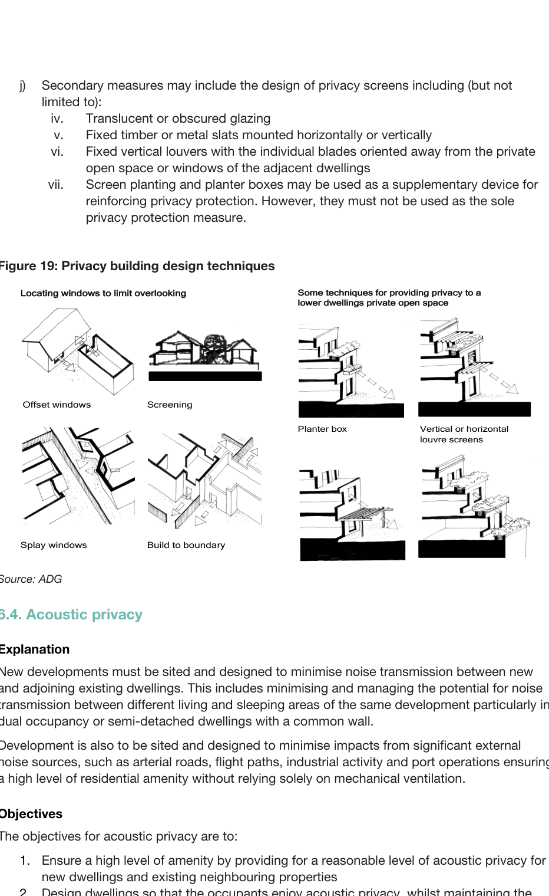

### 6.3. Visual privacy

#### Explanation

Developments are to be designed to optimise privacy by minimising cross viewing and overlooking from the indoor and outdoor living areas of new dwellings to the living spaces of adjoining dwellings. Design measures are to be considered to protect privacy, including the location and type of window element, physical screens, the positioning and orientation of balconies, decks and terraces, screen planting in deep soil and planter boxes ‘on structure’.

#### Objectives

The objectives for visual privacy are to ensure:

1\. A high level of amenity by providing for a reasonable level of visual privacy for dwellings and neighbouring properties

2\. New development is designed so that its occupants enjoy visual and acoustic privacy, whilst maintaining the existing level of privacy of adjoining and nearby properties

3\. The sensitive design of buildings optimises visual privacy, by minimising cross viewing and the overlooking of adjoining dwelling habitable and recreational garden space (POS and COS).

#### Controls

a) Where unique site conditions occur, or in the case of NSW Pattern Book developments, exceptions are assessed on merit, with consideration of the design of the relevant building to mitigate potential issues of visual privacy

b) Locate windows and balconies of habitable rooms to minimise overlooking of windows or glass doors in adjoining dwellings (whether part of the development or on adjoining properties). Refer to the Figure 14 which illustrates techniques to protect privacy

c) Orient balconies to the front and rear boundaries or to courtyards as much as possible. Avoid orienting balconies to any habitable room windows on the side elevations of the adjoining dwelling

d) Orient buildings on narrow sites to the front and rear of the lot, utilising the street width and rear garden depth to increase the separation distance

e) Locate and design areas of POS to ensure a high level of user privacy. Landscaping, screen planting, fences, shading devices and screens are used to prevent overlooking and to improve privacy

f) Development must be designed to protect the visual and acoustic privacy of adjoining new and existing residents. Side elevations are to incorporate appropriate design measures, including:

i. careful placement and orientation of windows and balconies

ii. use of recessed and projecting façade elements or articulated wall planes

iii. integration of screening devices where required

g) Design measures are to minimise direct overlooking and be applied consistently along the full length of the elevation

h) All windows, balconies and terraces are to be considered in the design to ensure privacy is achieved at all potential interfaces

i) In achieving privacy and residential amenity, priority is to be given to building separation, siting, orientation and window placement. Development must minimise overlooking of Private or Communal Open Space through primary design measures.  Secondary measures including fixed screens, obscure glazing or screen planting are to be used only where primary responses are insufficient

> [Picture on page 65: a map, saved as a picture (images/part-c2-medium-density-residential-page-65-1.gif, 150 dpi); the street names and other small labels are on the picture.]
> Words printed on the picture (title and legend, copied from the PDF):
> Locating windows to limit overlooking
> Offset windows Screening
> Build to boundary
> Locating windows to limit overlooking
> Some techniques for providing privacy to a
> lower dwellings private open space
> Vertical or horizontal
> Build to boundary
> Some techniques for providing privacy to a
> lower dwellings private open space
> Vertical or horizontal

Figure 19: Privacy building design techniques

j) Secondary measures may include the design of privacy screens including (but not

iv. Translucent or obscured glazing

v. Fixed timber or metal slats mounted horizontally or vertically

vi. Fixed vertical louvers with the individual blades oriented away from the private open space or windows of the adjacent dwellings

vii. Screen planting and planter boxes may be used as a supplementary device for reinforcing privacy protection. However, they must not be used as the sole privacy protection measure.
