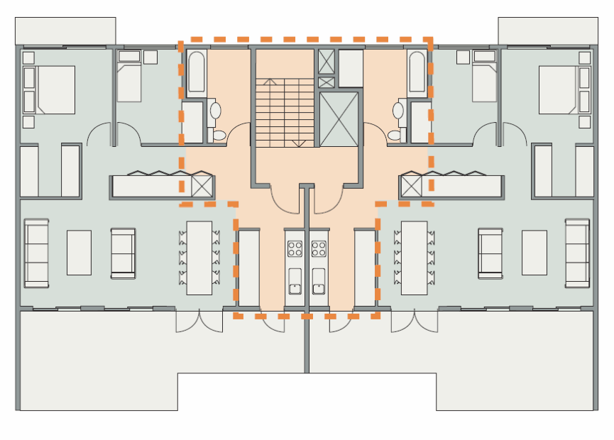
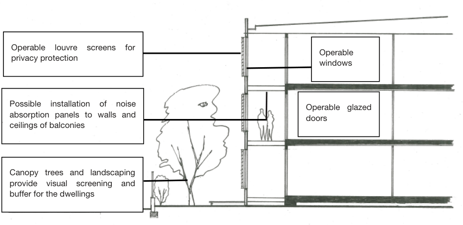

### 6.4. Acoustic privacy

#### Explanation

New developments must be sited and designed to minimise noise transmission between new and adjoining existing dwellings. This includes minimising and managing the potential for noise transmission between different living and sleeping areas of the same development particularly in dual occupancy or semi-detached dwellings with a common wall. Development is also to be sited and designed to minimise impacts from significant external noise sources, such as arterial roads, flight paths, industrial activity and port operations ensuring a high level of residential amenity without relying solely on mechanical ventilation.

#### Objectives

The objectives for acoustic privacy are to:

1\. Ensure a high level of amenity by providing for a reasonable level of acoustic privacy for new dwellings and existing neighbouring properties

2\. Design dwellings so that the occupants enjoy acoustic privacy, whilst maintaining the existing level of privacy of adjoining and nearby properties

3\. Ensure dwellings are designed to minimise impacts from significant exterior noise sources such as arterial roads, flight paths, industries and ports

4\. Design buildings with adequate separation within the development and from adjoining properties.

#### Controls

a) Design the building and internal layouts to minimise noise transmission between buildings and apartment to apartment by:

i. Locating busy, noisy areas (such as living rooms, kitchens) near each other and grouping quiet areas such as bedrooms away from noise sources

ii. Use storage and circulation spaces as acoustic buffers

iii. Minimising the extent of shared party walls

b) Separate quiet areas such as bedrooms from common recreation areas, parking areas, vehicle access ways, plantrooms and AC units and other noise generating activities

c) Incorporate appropriate measures to maximise acoustic privacy such as:

i. Double glazing of windows

ii. Operable screened balconies

iii. Solid courtyard walls

iv. Sealed entry doors.

#### Figure 20: Locate sleeping rooms away from the main living areas

> [Picture on page 66: a picture, saved as a picture (images/part-c2-medium-density-residential-page-66-20.gif, 150 dpi).]

Source: ADG

d) For developments fronting arterial roads or other significant noise sources:

i. Provide noise mitigation measures to ensure an acceptable level of living amenity for the dwelling units is maintained

ii. Submit a noise assessment report prepared by a qualified Acoustic Consultant must be submitted with suitable noise mitigation solutions

iii. Demonstrate the design is to achieve an acceptable level of noise exposure in the interior space, without relying on mechanical ventilation

iv. Adopt design solutions for developments fronting arterial roads such as provision of an enclosed, recessed balcony or loggia to the dwelling units to function as a buffer between the outdoor environment and the interior living space. Note: Fully enclosed balcony spaces count towards the GFA of the building

e) Where unique site conditions exist, or in the case of NSW Pattern Book developments, exceptions may be considered are assessed on merit. Proposals must demonstrate how siting and design mitigate acoustic impacts on the relevant building, room or outdoor terrace/balcony.

Figure 21: Enclosed balconies and loggias may be used to attenuate traffic noise.

> [Picture on page 67: a map, saved as a picture (images/part-c2-medium-density-residential-page-67-16.gif, 150 dpi); the street names and other small labels are on the picture.]
> Words printed on the picture (title and legend, copied from the PDF):
> Operable louvre screens for
> Possible installation of noise
> absorption panels to walls and
> ceilings of balconies
> Canopy trees and landscaping
> provide visual screening and
> buffer for the dwellings

Source: ADG
