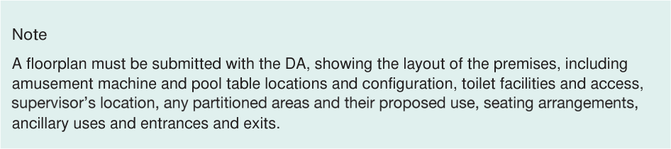

## 2. Location and design requirements

Explanation

This section outlines the location and design requirements for amusement centres to ensure they contribute positively to the surrounding urban environment and maintain a high standard of internal amenity. Amusement centres are defined as premises primarily used for playing billiards, pool, or electronic/mechanical amusement devices such as pinball machines and video games.

Controls

a) Locate amusement centres on the ground floor (at street entry level) of the development

b) Building design and layout must be of an open nature without any visually isolated areas

c) Adequate floor area must be provided to facilitate circulation around gaming machines and pool tables

d) Noise levels generated by the premises must not exceed 5dBA above the background noise measured on the boundary of the premises

e) Where the amusement centre is to be used in conjunction with a food and drink premises, the floor area allocated for seating for the purposes of the consumption of food and beverages is to be a minimum of 20% of the entire floor area.

> [Picture on page 5: a picture, saved as a picture (images/part-c5-amusement-centres-page-5-17.gif, 150 dpi).]
> Words printed on the picture (title and legend, copied from the PDF):
> supervisor’s location, any partitioned areas and their proposed use, seating arrangements,

Note A floorplan must be submitted with the DA, showing the layout of the premises, including amusement machine and pool table locations and configuration, toilet facilities and access,

ancillary uses and entrances and exits.
