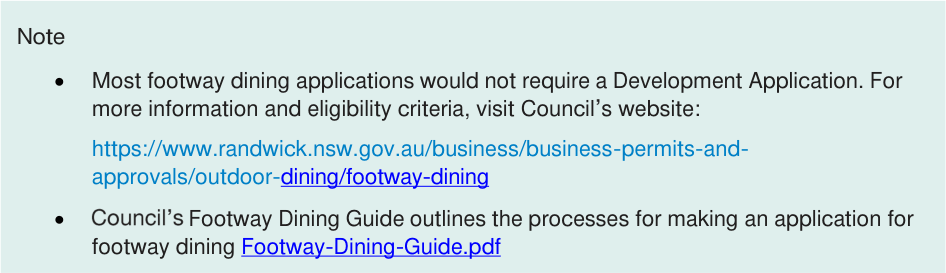

## 1. Introduction

This Development Control Plan (DCP) section provides guidelines and requirements for outdoor dining and trading activities on and over public footpaths, malls and associated public spaces. The intent of this section is to support and provide information to applicants seeking development consent for outdoor dining and trading. The objectives and controls will ensure safe and equitable access to footpaths whilst supporting local businesses.

> [Picture on page 4: a picture, saved as a picture (images/part-c7-footpath-dining-and-trading-page-4-7.gif, 150 dpi).]
> Words printed on the picture (title and legend, copied from the PDF):
> Note
> • Most footway dining applications would not require a Development Application. For
> • Council’s Footway Dining Guide outlines the processes for making an application for
> footway dining Footway-Dining-Guide.pdf

more information and eligibility criteria, visit Council ’s website: https://www.randwick.nsw.gov.au/business/business-permits-and-approvals/outdoor-dining/footway-dining

This section of the DCP should be read in conjunction with:

1\. Part A - Introduction

2\. Part B - General Controls of the DCP

3\. Other sections of the DCP for specific development types, locations or sites, if relevant to the application.

The following documents should also be considered before lodging a Development Application for outdoor dining:

• NSW Food Act 2003 and food safety standards incorporated therein

• Other relevant statutory plans, Council and technical reports, guidelines and other policies.
