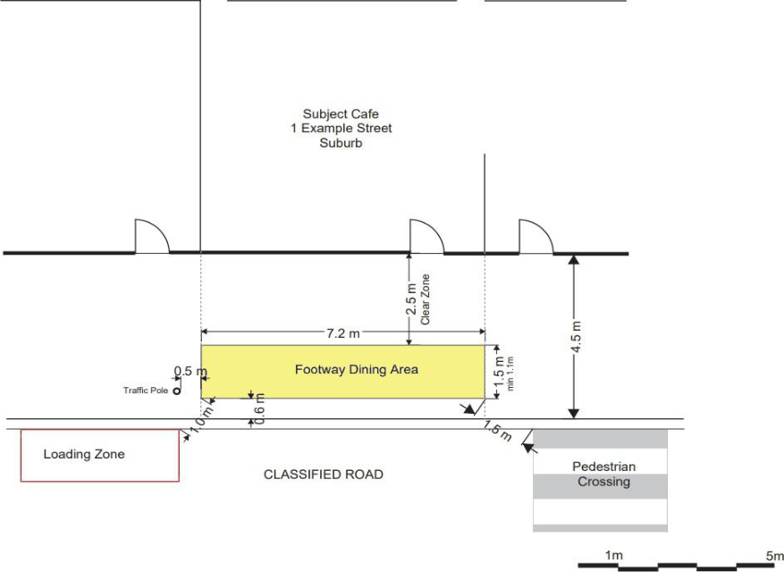
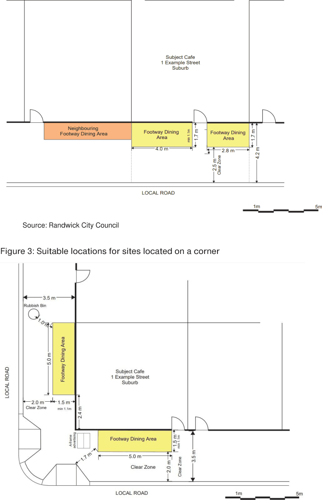

## 2. Use of public footpaths

### 2.1. Footpath dining and trading

Explanation Footpath trading activities, including outdoor dining and the display of goods, may be permitted where it is clearly ancillary to a legally approved indoor business operating within an adjacent building. In the case of outdoor dining these activities must complement the indoor business, contribute positively to the public domain, and not compromise pedestrian access, safety, or amenity.

Note

Approval for Footpath dining and trading adjacent to classified or state roads are to be in accordance with TfNSW requirements for classified roads and signalised intersections.

Objectives The objectives for footpath dining and trading are to:

1\. Ensure footpath dining and trading is ancillary to an approved, indoor premises, and only permitted where development consent has been granted

2\. Preserve the primary function of footpaths as public pedestrian corridors and domains, while supporting opportunities for outdoor dining and other footpath trading activities that enhance street life

3\. Ensure inclusive access for people with disabilities is provided within dining areas and associated facilities

4\. Maintain public safety including unobstructed access to footpaths and adjacent buildings.

Controls

a) For footpaths that are greater than 4m wide and located within an E2 Commercial Centre zone, a footpath dining area must ensure an unobstructed pedestrian zone is provided with a minimum width of 2.0m for general footpaths and 2.5m for locations adjacent to classified roads or busy footpaths

b) A minimum setback of 0.6m is to be provided from the kerb regardless of footpath width with greater setbacks for the following situations:

i. 0.9m adjacent to loading zones

ii. 1.0m adjacent to

“No

Standing” zones

iii. 1.5m adjacent to pedestrian crossings (applies both from kerb and the crossing)

iv. 1.2m adjacent to angle parking

c) If the minimum criteria in a) and b) cannot be achieved, applicants must demonstrate the following:

i. Existing levels of public access and safety will be maintained for the footpath and the adjacent road

ii. No unreasonable impacts on amenity or streetscape

d) Where footpath trading is proposed adjacent to the building line, the applicant must demonstrate consistency with existing footpath trading activities

e) Where trading areas are longer than 10m, a 1.5m break must be provided in the centre of the trading area (excluding doorways and other essential openings)

f) A minimum clearance of 1.0m is required from public utilities including fire hydrants, rubbish bins, seats, telephones, bicycle stands, bus shelters, taxi ranks and parking meters

g) A minimum clearance of 0.5m is required from all other street furniture including bollards, tree pits, street lights and traffic and electricity poles

h) Only that part of the footpath or public place directly in front of a restaurant/cafe may be used for footpath trading

i) Seating may not be located next to the building line and the kerb side at the same time

j) Provide a minimum depth of 1.1m within the footpath trading area for the comfort of patrons

k) Comply with a footpath gradient (crossfall) range of 1:100 to 1:40 (maximum) or demonstrate to Council that suitable access can be provided, if a proposal is located on grades outside of this range

l) Locate the footpath trading area consistent with adjacent footpath trading activities, existing public utilities, landscaped areas and open spaces to provide consistent pedestrian access subject to the minimum setbacks above.

Figure 1: Suitable locations for outdoor dining areas adjacent to the kerb

> [Picture on page 7: a picture, saved as a picture (images/part-c7-footpath-dining-and-trading-page-7-21.gif, 150 dpi).]

Source: Randwick City Council

Figure 2: Suitable locations for outdoor dining areas adjacent to the building line

> [Picture on page 8: a picture, saved as a picture (images/part-c7-footpath-dining-and-trading-page-8-2.gif, 150 dpi).]

Source: Randwick City Council

Figure 3: Suitable locations for sites located on a corner

Source: Randwick City Council
