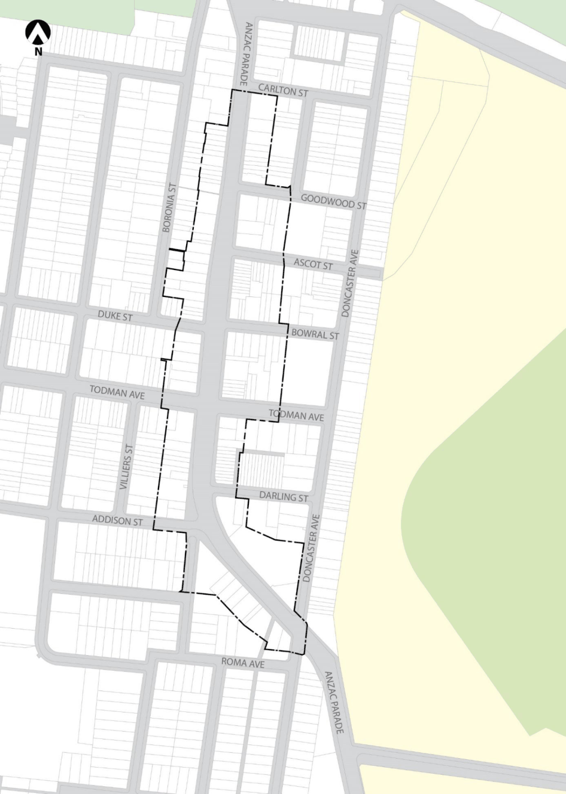
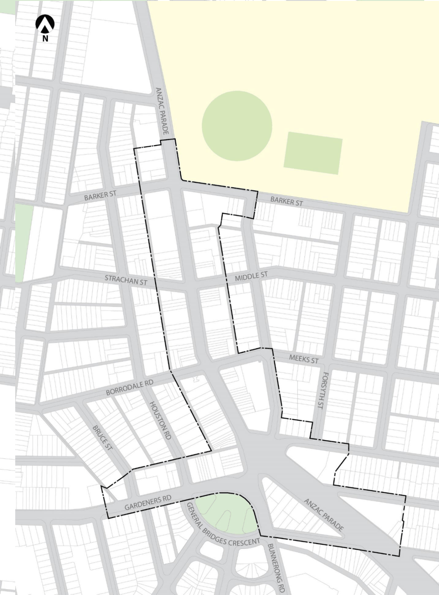

## 1. Introduction

### 1.1. Kensington and Kingsford town centre planning review

The Kensington and Kingsford town centres located along Anzac Parade, comprise an important urban renewal corridor in the Randwick City local government area. The town centres have been subject to a comprehensive planning review undertaken over 2016-2019 to address projected population growth and expected demographic changes, improve the quality of building design and the public realm, and accommodate the Sydney City to South East Light Rail infrastructure along Anzac Parade. The culminating Planning Strategy: Kensington and Kingsford town c

entres (“The Strategy”)

contains a suite of key directions, objectives, strategies and actions to guide the future sustainable growth and development of the town centres. The objectives and controls in this Part of the DCP are based on the extensive site and built form analysis and modelling informing the Strategy for these centres.

### 1.2. Alignment with other planning instruments

This section applies to all new development and alterations and additions to existing development on land situated within the Kensington and Kingsford town centres (Figure 1). The controls supplement the provisions of the Randwick Local Environmental Plan 2012 (RLEP 2012) and aim to deliver high quality building and urban design and to promote a high level of liveability and economic and employment opportunities in the Kensington and Kingsford town centres. In addition to the RLEP 2012, a number of State Environmental Planning Policies (SEPPs) apply to certain types of development within the town centres, depending on the nature of the proposal. The key ones are:

• State Environmental Planning Policy (Housing) 2021 and supplementary Apartment Design Guide (ADG)

• State Environmental Planning Policy (Transport and Infrastructure) 2021 (T&ISEPP)

• State Environmental Planning Policy (Industry and Employment) 2021

In the event of an inconsistency between this DCP and a relevant SEPP, the SEPP prevails to the extent of the inconsistency. This Part of the DCP should be read in conjunction with:

• Part A - Introduction

• Part B - General Controls

• Part C - Land use Controls

• Other Parts of the DCP for specific development types, sites or locations, if relevant to the application.

Figure 1a: The lands to which this DCP applies- Kensington Town Centre

> [Picture on page 7: a picture, saved as a picture (images/part-d1-kensington-and-kingsford-page-7-2.gif, 150 dpi).]

Figure 1b: The lands to which this DCP applies- Kingsford Town Centre

> [Picture on page 8: a picture, saved as a picture (images/part-d1-kensington-and-kingsford-page-8-2.gif, 150 dpi).]
