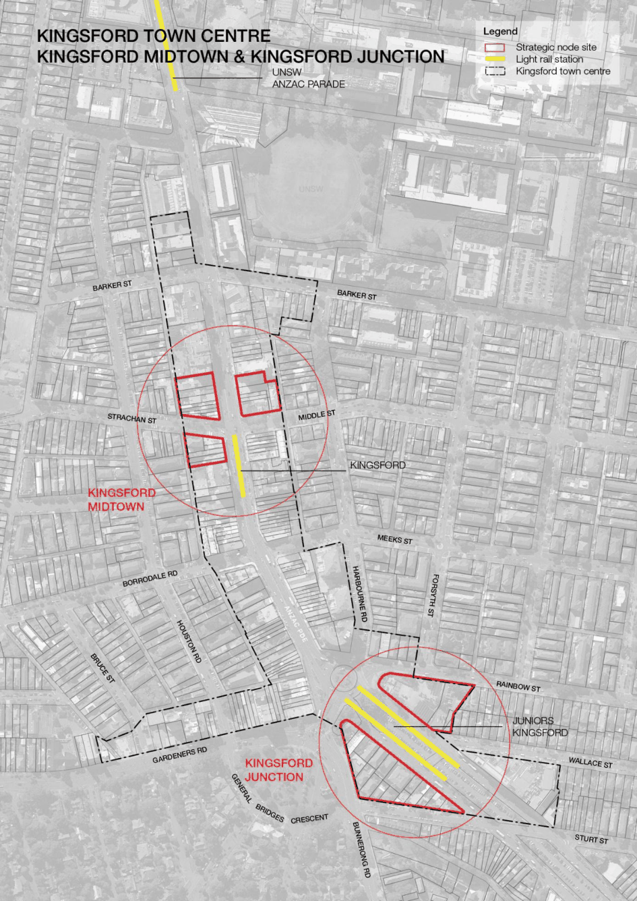
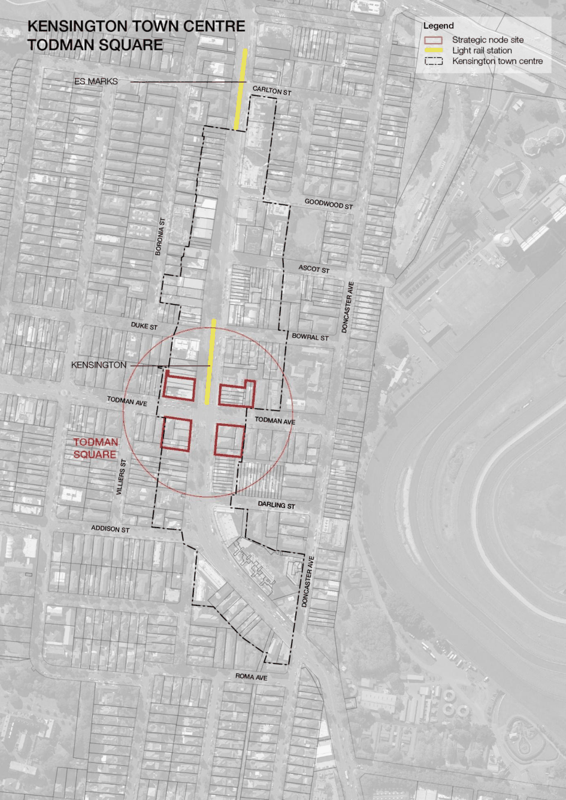

## 3. Desired future character

### 3.1. Kensington and Kingsford town centres

The following desired future character statements for the Kensington and Kingsford town centres establish the directions and key outcomes required to be achieved through development within each precinct. Amendments to the Randwick Local Environmental Plan 2012 (RLEP 2012) will provide the foundations to ensure sustainable growth in housing and employment and public benefits for both Kensington and Kingsford town centres.

Kensington Town Centre: statement of desired future character Kensington is to evolve into a vibrant and dynamic town centre situated along Anzac Parade, Sydney’s finest grand green boulevard. The town centre will be well connected and highly accessible, capitalising on its proximity to key employment hubs including the Randwick Health and Education Super Precinct and the Sydney CBD. Kensington town centre will offer an exciting city apartment lifestyle, with buildings designed to the highest quality and offering excellent amenity to residents. A range of housing types including affordable housing will be woven into the

town centre’s urban fabric to offer housing diversity and choice to a wide range

of people including the elderly, students and families. The integrity of existing heritage and contributory buildings located within and adjoining the town centres will be respected and integrated with high quality and sympathetic contemporary architecture that enhances the character and layering of the urban experience. Kensington town centre will be a focus for creativity and innovation. A gallery/creative space at Todman Square will create a cultural anchor for the town centre, supported by a diverse range of cafes, restaurants and shopping options that attract visitors from across Sydney. Economic and social transformation of the centre will be facilitated by creating a cohesive and attractive streetscape with reduced visual clutter. Innovative status will translate cutting edge research into real world business success. The town centre will have a green identity, setting the bench mark for sustainability within the Local Government Area (LGA) through Ecologically Sustainable Development (ESD) targets, Water Sensitive Urban Design (WSUD) practices, high quality green public places with linkages to nearby parks, and sustainable transport modes such as the light rail, buses, cycling and walking.

Kingsford town centre: statement of desired future character Kingsford will develop into an exciting and dynamic town centre continuing to draw on its rich multi-cultural identity. The centre will strengthen its role in the retail hierarchy through a strong, retail-led core anchored by a full-line supermarket, complemented by a diverse mix of specialty shops, fresh food, cafes and restaurants that can support the daily needs of its large and growing population catchment. These will sit alongside entertainment uses that contribute to a vibrant day and night economy. The town centre will be a safe and inclusive place to live, work and visit. Buildings will be designed to the highest quality incorporating a mix of apartments, laneway mews and affordable housing. Highly connected and accessible, the town centre will foster hubs of activity focused around the terminus at Kingsford Junction and Kingsford Mid- Town, the old heart of Kingsford. Economic and social transformation of the centre will be facilitated by creating a cohesive and attractive streetscape with reduced visual clutter. The town centre will have a green focus, and set a new performance benchmark for sustainability within the LGA through ESD targets, WSUD practices, public places with canopy trees and landscaping and support of sustainable transport modes such as the light rail, buses, cycling and walking. The integrity of existing heritage items, contributory buildings and/or heritage conservation areas within and around the town centres will continue to be respected and integrated, through high quality architectural design.

Innovative business start-

ups will be encouraged to provide a ‘bridge’ between research and

business.

### 3.2. Strategic node sites

The Strategy identifies strategic node sites adjacent to light rail infrastructure which can accommodate additional height and density provided a high standard of design excellence is demonstrated. These strategic node sites will help define the corners through taller landmark buildings and enable a hub of activity where more intensive business floor space and community spaces are achieved. Part B establishes the desired future character, key directions and block by block development outcomes for the following strategic node sites (identified in Figures 2a and 2b) within the Kensington and Kingsford town centres:

• Todman Square Precinct

• Kingsford Midtown Precinct; and

• Kingsford Junction Precinct. Controls

a) Submit a statement with the DA prepared by a suitably qualified architect or urban designer demonstrating how the proposed design meets the desired future character of the relevant town centre, and where applicable, the strategic node site based on the block controls contained in Part B of this chapter of the DCP.

Figure 2a: Location of strategic node sites in Kingsford

> [Picture on page 12: a picture, saved as a picture (images/part-d1-kensington-and-kingsford-page-12-2.gif, 150 dpi).]

Figure 2b: Location of strategic node sites in Kensington

> [Picture on page 13: a picture, saved as a picture (images/part-d1-kensington-and-kingsford-page-13-2.gif, 150 dpi).]
