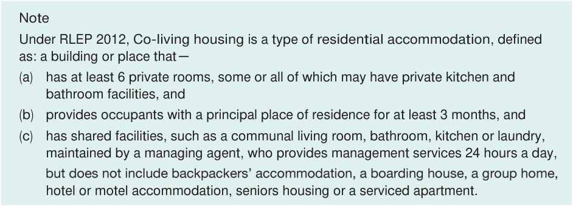

## 5. Floor space ratio

### 5.1. Explanation

Clause 4.4 of the RLEP 2012 provides Floor Space Ratio standards for the Kensington and Kingsford town centres. The maximum FSR that can be achieved on a site is shown on the RLEP 2012 FSR Map. An alternative FSR is applicable in accordance with the RLEP 2012 Alternative FSR Map where the proponent makes an offer to enter into a Voluntary Planning Agreement for either a monetary contribution or the delivery of Community Infrastructure in accordance with the Community Infrastructure Contributions Plan (see Part D of this DCP). In addition, a minimum non-residential FSR is applicable to strategic node sites at the Todman Square, Kingsford Midtown and Kingsford Junction Precincts to ensure there is sufficient floor space available to accommodate employment, retail and commercial services. A concentration of non-residential floor space at these strategic sites would foster vibrant nodes of activity near light rail stops, providing for a mix of shops, hospitality related businesses, creative and innovation spaces and other commercial services to serve the needs of residents, workers and visitors. It would also serve to support the economic development, employment growth and future investment and strengthen relationships within the wider Randwick Collaboration Area. Further information on the Randwick Collaboration Area and Place Strategy is available from the Greater Sydney Commission’s website.

Objectives The objectives for floor space ratio are to:

1\. Support economic growth, job creation, art and cultural uses and innovation within the Kensington and Kingsford town centres

2\. Enhance the day and night-time economies

3\. Ensure sufficient floor space is available to support a mix of business, service, retail, creative, cultural, high-tech industry and recreational uses

4\. Ensure ground floor non-residential floor plates are large enough to support a range of uses, including larger floorplate uses such as supermarkets

5\. Prioritise retail and commercial uses within the E2 Commercial Centre zone to reinforce its role as the centre of business retail, community and cultural activity

6\. Promote convenient access to shops, retail and services

7\. Leverage commercial opportunities to support and align with the Randwick Collaboration Area Place Strategy, including delivery of innovation spaces, co-working hubs, multi-functional creative spaces and health and medical uses.

Note Objective 5 has been included in error and will be reported to a future Council Meeting for consideration.

Controls

a) The maximum FSR that can be achieved on a site is shown on the RLEP 2012 FSR Map. An alternative FSR is applicable in accordance with the RLEP 2012 Alternative FSR Map where the proponent makes an offer to enter a Voluntary Planning Agreement (VPA) for either a monetary contribution and/or the delivery of Community Infrastructure in accordance with the Community Infrastructure Contributions Plan (see Part D of this DCP for details on the Community Infrastructure Contribution)

b) In relation to the Kensington Town centre where an existing FSR Map does not apply, the Alternative FSR Map is applicable for the purposes of calculating the Community Infrastructure Contribution referred to in clause a) for any floor space above the existing height maximum control shown on the RLEP 2012 Height Map

c) A minimum non-residential FSR of 1:1 is to be provided at each strategic node site within the Todman Square, Kingsford Midtown and Kingsford Junction Precincts, in accordance with Clause 4.4 of the RLEP 2012

d) Non-residential floor space must be designed to be accessible, useable and functional for the purposes of commercial, business, entertainment and retail activities and the like

Definition Non-residential floor space ratio means the ratio of the gross floor area of that part of a building used or proposed to be used for any purpose in all buildings within a site to the site area, other than for any of the following purposes:

• Residential accommodation

• Tourist accommodation

• Student housing

• Parking areas, driveways and areas outside of buildings used for outdoor dining

• Roof top open space that is for the exclusive use of building occupants

• Telecommunications facilities.

Minimum commercial premises floorplate on ground floor

e) A minimum Net Lettable Area equivalent to 35% of the site area must comprise commercial premises on the ground floor. Circulation space, plant rooms, storage areas, waste rooms or other non-tenantable spaces are not to be included in the calculation of Net Lettable Area

f) In calculating the minimum commercial premises Net Lettable Area in Control e, any through‑site link or laneway required by this DCP on the site is to be excluded from the site area calculation

g)  In order to prioritise commercial floorplates, uses associated with co-living housing, including common areas, gyms, laundry, study, and workspaces for staff, are not to be provided on the ground floor.

Note Clause e), f), g) have been included in error and will be reported to a future Council Meeting for consideration.

Definition Net Lettable Area of a building means the sum of its whole floor lettable areas. The Net Lettable Area must be measured in accordance with the Property Council of Australia Method of Measurement. https://www.propertycouncil.com.au/wp-content/uploads/2024/11/PCA-Method-of- Measurement-Commercial-2008.pdf

> [Picture on page 18: a picture, saved as a picture (images/part-d1-kensington-and-kingsford-page-18-1.gif, 150 dpi).]
> Words printed on the picture (title and legend, copied from the PDF):
> bathroom facilities, and
> but does not include backpackers’ accommodation, a boarding house, a group home,

Note Under RLEP 2012, Co-living housing is a type of residential accommodation, defined as: a building or place that —

(a) has at least 6 private rooms, some or all of which may have private kitchen and

(b) provides occupants with a principal place of residence for at least 3 months, and

(c) has shared facilities, such as a communal living room, bathroom, kitchen or laundry, maintained by a managing agent, who provides management services 24 hours a day,

hotel or motel accommodation, seniors housing or a serviced apartment.
