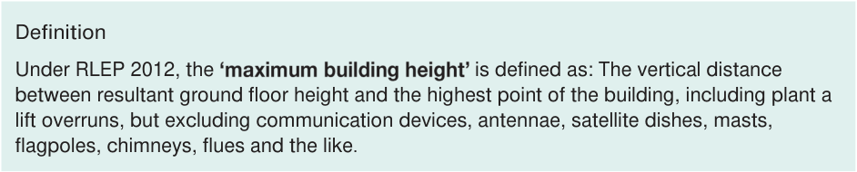
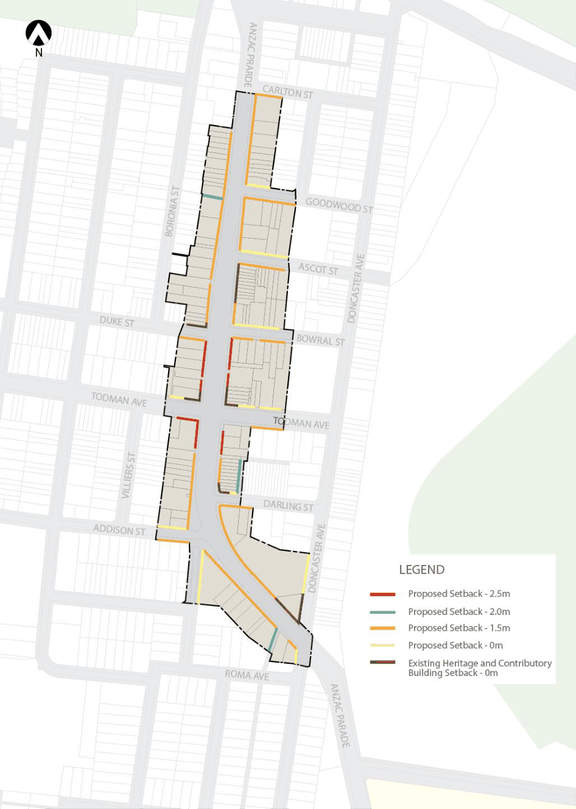
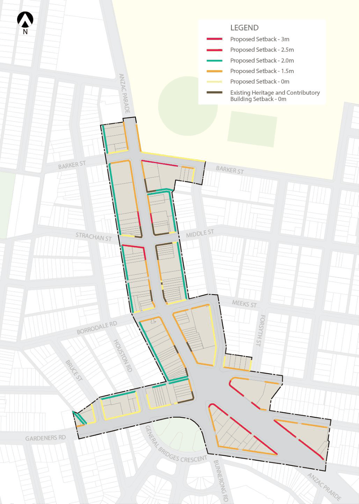

## 6. Built form

### 6.1. Explanation

This section refers to the ‘three dimensional’ appearance of the Kensington and Kingsford town centres including the function, aesthetic quality, shape, scale and configuration of individual buildings, as well as their relationship to streets and the public domain. Controls focus on achieving an appropriate scale for new development so that buildings reinforce a coherent, harmonious and appealing urban environment, and contribute to the enhancement of the public realm. Refer to Part B block controls of this chapter which incorporate built form controls in this section into building envelopes. Objectives The objectives for the built form are to:

1\. Ensure built form is compatible with the desired future character of each centre in terms of building bulk, scale and massing

2\. Ensure coherent and orderly redevelopment of land and avoid isolation of sites

3\. Ensure development reinforces the urban structure and street hierarchy

4\. Ensure development responds to the existing siting, scale, form and character of heritage items, contributory buildings and adjoining properties

5\. Ensure taller buildings are vertically proportioned with a slender form to minimise building bulk

6\. Ensure street walls provide a human scale in the public realm

7\. Achieve a scale transition between buildings within Kensington and Kingsford town centres and surrounding residential areas to protect residential amenity; and

8\. Ensure that development does not unreasonably diminish sunlight and visual amenity to neighbouring properties and public spaces as well as communal spaces within the development site

9\. Ensure that the number of storeys in a development aligns with the maximum permissible height in metres in the RLEP allowing for generous floor to floor heights, reasonable level of internal amenity, adequate height to accommodate structures such as plant rooms or lift overruns above the roof and flexibility for future changes of use

10\. Allow adequate area between floors for the provision of services and noise attenuation

11\. Provide upper level building setback controls to reinforce the desired scale of buildings, minimise overshadowing of the street and other buildings and create a cohesive streetscape environment.

12\. Ensure that ground floor setback areas maintain visual openness, facilitate pedestrian movement, support landscaping, and preserve safety and access requirements.

Controls Lot Amalgamation

a) A minimum street frontage of 20m is to be provided for each development site along Anzac Parade and Gardeners Road

b) When development/redevelopment/amalgamation is proposed, sites between and adjacent to developable properties are not to be limited in their future development potential

c) Where a development proposal results in an isolated site, the applicant must demonstrate that negotiations between the owners of the lots have commenced prior

to the lodgement of the DA to avoid the creation of an isolated site. The following information is to be included with the DA:

i. Evidence of written offer (s) made to the owner of the isolated site* and any responses received

ii. schematic diagrams demonstrating how the isolated site is capable of being redeveloped in accordance with relevant provisions of the RLEP 2012 and this DCP to achieve an appropriate urban form for the location, and an acceptable level of amenity

iii. schematic diagrams showing how the isolated site could potentially be integrated into the development site in the future in accordance with relevant provisions of the RLEP 2012 and this DCP to achieve a coherent built form outcome for the block

d) Where lot consolidation cannot be achieved to comply with the maximum envelopes in the block diagrams, alternative designs may be considered where the proposal exhibits design excellence and can demonstrate consistency with the relevant objectives of the block controls (Part B).

Note A reasonable offer, for the purposes of determining the development application and addressing the planning implications of an isolated lot, is to be based on at least one recent independent valuation and may include other reasonable expenses likely to be incurred by the owner of the isolated property in the sale of the property. To assist in this assessment, applicants are to submit details and diagrams of development for the isolated site, that is of appropriate urban form and amenity. The diagram is to indicate height, setbacks and resultant footprint (both building and basement). This should be schematic but of sufficient detail to understand the relationship between the subject application and the isolated site and the likely impacts of the developments. Important considerations include solar access, deep soil landscaping, privacy impacts for any nearby residential development and the traffic impacts of separate driveways access. The application may need to include a setback greater than the minimum requirement in the relevant planning controls. Or the development potential of both sites may need to be reduced.

Note Development proposals that cannot achieve a minimum frontage of 20m are unlikely to realise the maximum FSR indicated for the site on the RLEP 2012 FSR maps given the application of the Apartment Design Guide and other DCP requirements. Applicants are advised to obtain professional design advice.

Building heights

a) The maximum height that can be achieved on a site is shown on the RLEP 2012 Height Map. An alternative maximum height is applicable in accordance with the RLEP 2012 Alternative Height Map where the proponent makes an offer to enter into a Voluntary Planning Agreement (VPA) for either a monetary contribution or the delivery of Community Infrastructure in accordance with the Community Infrastructure Contributions Plan. (see Part D for details on Community Infrastructure Contribution)

b) The maximum number of storeys on a site is to comply with the following:

i. on sites with a maximum of 16m – 4 storeys

ii. on sites with a maximum of 19m – 5 storeys

iii. on sites with a maximum of 31m – 9 storeys

iv. on sites with a maximum 57m – 17 storeys

v. on sites with a maximum 60m – 18 storeys

Tower forms (strategic node sites)

a) Buildings on strategic node sites are to be designed as slender towers, with a maximum floorplate of 600m2 GFA for the tower form above the podium. A 10% variation on the maximum floor plate may be considered only where the proposal meets design excellence

b) Towers are to be designed with vertical articulation demonstrating design excellence to create defining landmarks for the centres and incorporating a variety of techniques to create visual interest, high quality materials and finishes

c) Tower forms must be well separated from other tower buildings and provide occupants with excellent amenity such as privacy, daylight, outlook and privacy

d) Roof top mechanical equipment shall be sized and located so that it cannot be viewed from the public domain and adjoining buildings

e) Architectural lighting should be designed to enhance key elements of the tower.

> [Picture on page 21: a picture, saved as a picture (images/part-d1-kensington-and-kingsford-page-21-19.gif, 150 dpi).]
> Words printed on the picture (title and legend, copied from the PDF):
> ‘maximum building height’ is defined as: The vertical distance

Definition Under RLEP 2012, the between resultant ground floor height and the highest point of the building, including plant a lift overruns, but excluding communication devices, antennae, satellite dishes, masts, flagpoles, chimneys, flues and the like.

Note Plant lift and overrun and staircase on the roof level are not to be counted as a storey

Street walls

a) Buildings must be designed with a street wall height of 4 storeys

b) On sites with contributory buildings, the consent authority may consider a variation to the four-storey street wall height requirement of between 2 and 6 storeys if the design:

i. Results in an improvement to the contributory building in accordance with established heritage principles to avoid facadism

ii. Meets the objectives of this clause and exhibits design excellence

iii. Retains contributory or heritage elements; and

iv. Provides a transition to neighbouring sites.

Note See Section 9 of this DCP for further requirements for heritage items and contributory buildings. storey

Note Street wall height can be established via podiums, datum lines or other design elements.

Building Setbacks

a) DAs are to comply with the minimum ground floor and upper level setbacks illustrated in the relevant block diagrams in Part B of this DCP

b) Development that results in an exposed party wall on an adjoining building is to incorporate architectural or vertical landscape treatment to improve visual amenity

c) The ground floor setback area along Anzac Parade and side streets is to be devoid of any permanent or temporary structures including but not limited to, built form, blade walls, raised planter boxes and terraces.

Note See Part A Section 9 of this chapter for further requirements for heritage items and contributory buildings.

Building depth

a) The residential component of development fronting Anzac Parade and Gardeners Road is to have a maximum building depth of 22m including balconies.

Definition Building depth refers to the dimension measured from the front to the back of a building's floorplate. It has a significant influence on building circulation and configuration and impacts upon internal residential amenity such as access to light and air. For residential development, narrower building depths generally have a greater potential to achieve optimal natural ventilation and solar access than deeper floor plates.

Figure 3a Kensington building street setbacks

> [Picture on page 23: a picture, saved as a picture (images/part-d1-kensington-and-kingsford-page-23-2.gif, 150 dpi).]

Figure 3b Kingsford building street setbacks

> [Picture on page 24: a picture, saved as a picture (images/part-d1-kensington-and-kingsford-page-24-2.gif, 150 dpi).]
