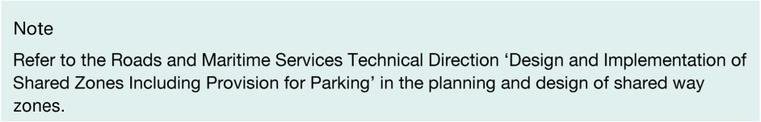

## 8. Laneway/shared way zones

### 8.1. Explanation

Laneways and shared zones contribute to the fine grain character of urban areas and help to enhance walkability and connectivity. They also provide an important service function for waste management as well car parking access to developments. The establishment of laneways/shared zones is important for both Kensington and Kingsford town centres to achieve an appropriate scale transition and separation from surrounding lower scaled neighbourhoods. Laneways and shared zones can improve the permeability of both Kensington and Kingsford town centres, encouraging walking, enhancing social gathering and activities such as outdoor dining, play and art and culture appreciation. Objectives: The objectives for laneway/shared way zones are to:

1\. Establish a network of laneways that encourage pedestrian movements and social gathering spaces

2\. Provide leafy, green and useable laneways

3\. Facilitate vehicular access and servicing to properties fronting Anzac Parade and Gardeners Road.

Controls

a) Laneways and shared zones are to be provided in accordance with the relevant block diagram (see Part B of this chapter)

b) Laneways are to be a minimum of 6 metres wide (for larger developments, a carriageway width greater than 6 metres may be required) and shall provide landscaping, lighting and high quality materials and finishes and opportunities for art to enhance the pedestrian environment

c) Buildings that front lanes shall be articulated to create visual interest and shall incorporate passive surveillance by orienting windows and balconies onto the lane

d) Ground floor uses fronting lanes shall incorporate openings onto the lane so as to contribute to the enjoyment and activation of the lane including outdoor dining

e) Applicants are to negotiate Rights of Carriageway with adjoining property owners where required for access

f) Laneways are to allow visibility along the length of the link and be open to the sky as much as is practicable.

Note Evidence of the attempt to obtain the adjoining property owner’s agreement to the Right of Carriageway is to be submitted as part of the Development Application.

> [Picture on page 26: a picture, saved as a picture (images/part-d1-kensington-and-kingsford-page-26-36.gif, 150 dpi).]
> Words printed on the picture (title and legend, copied from the PDF):
> Note
> Refer to the Roads and Maritime Services Technical Direction ‘Design and Implementation of
> Shared Zones Including Provision for Parking’ in the planning and design of shared way
> zones.
