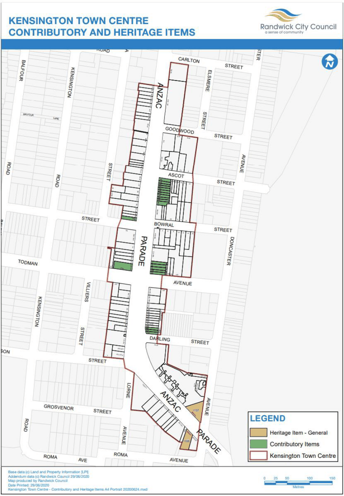
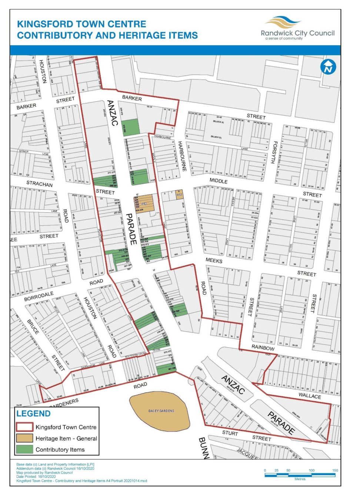

## 9. Heritage conservation

### 9.1. Explanation

The retail and commercial centres of Kensington and Kingsford were established during the early twentieth century. Development generally consisted of fine grain commercial frontages focused to Anzac Parade with some housing to the rear and at upper levels. While many of these buildings no longer exists within the centres, there remains a small number which continue to contribute to the historical ‘main street’ context. Through their architectural style, scale and detailing (particularly above street awning l evel) they attest to the area’s transition during early twentieth century history to commercial focus and allow for this significant historical layer to be interpreted. Some unsympathetic alterations such as infilling of traditional inset verandas, applications of paint or render over face brick or stone have hampered recognition of their aesthetic qualities, however, these buildings should be retained and conserved to ensure a sense of historical continuity and to enhance streetscape character so the town centres remain interpretable over time. Historical context Early development of Kensington town centre The area now encompassed by the suburb of Kensington was, in the nineteenth and early twentieth centuries, a swampland traversed by the Lachlan Stream. A water-powered mill on the bank of the Lachlan Stream near what is now Todman Avenue, produced paper, cloth, and later flour from 1814 until 1832. When emancipist Samuel Terry gained title to the surrounding area in 1819, he called his land the ‘Lachlan Mills Estate’, a name that was retained after he on -sold the land to former convicts Solomon Levey and Daniel Cooper. Daniel Cooper, who in time bought out Levey’s share, encouraged industry on his land, attracting workers and their families to the area. Following the lifting of Sydney Water Reserve restrictions and the stopping of Sydney drawing its water from Lachlan Stream, Samuel Cooper (nephew of former convict Daniel Cooper, and a man who had envisaged a grander future for the land) attracted private capital which formed a syndicate to subdivide the ‘Lachlan Mills Estate’. The winning entry for the best design of the new ‘Model Kensington Suburb’ was ‘ Rus In Urb’ (Country in city) by Vernon, Joseland, Oxley and Mocatte with its principal feature of a main Boulevard for vehicle and foot traffic, and central tramway. The first subdivision of the Kensington Freehold Estate was in April 1891 by the Australian Cities Investment Corporation Ltd and saw the sale of 96 allotments, including 9 along Anzac Parade (and the whole eastern side of Doncaster Avenue). Another public auction in October 1891 saw the offering of the balance of unsold allotments in the Kensington Freehold Estate, including lots fronting Anzac Parade between Bowral Street and Doncaster Ave, and lots fronting Ascot, Bowral, Todman and Darling Streets. The allotment sizes first established in April were maintained. Land on the western side of Anzac Parade, between Salisbury Road and Grosvenor Street was released later, with auctions continuing until at least March 1906. In October 1907, the Centennial Park Lands on the corner of Alison Road and Anzac Parade were submitted for public auction. Substantial development of Kensington occurred within in the 1920s, marking an important stage of development along the recently named Anzac Parade. This was boosted by the rapid increase of residential development, particularly to land within West Kensington (released in 1912).

Shops sprang up on either side of the road, and adjoining the Doncaster Hotel (built 1922-23), the Masonic Temple was built on the south western side of Anzac Parade and became popular for social events, and the Doncaster Theatre was erected between Anzac Parade and Doncaster Avenue. Early development of Kingsford town centre Prior to 1900, the area occupied by South Kensington formed part of the Botany Bay Sands. The earliest tracks across the Botany Sand Beds were originally Aboriginal pathways which had traversed along higher ground, which later evolved to form the earliest roads through the

area.  Bunnerong Road had been an established track providing a connection to Botany Bay. Settlement of the Kingsford area followed the activation of the Nepean Water Supply Scheme in 1887 and the lifting of bans on development around the Lachlan Swamps and Botany Lakes. However, Bunnerong Road remained substantially undeveloped until the early 1900s, with only scattered residences and trades related to the expanding horse racing industry at Randwick and Kensington racetracks. Development of Kingsford substantially accelerated after the turn of the twentieth century and following the extension of the Sydney tram service beyond the junction of Randwick and Alison Roads in December 1901 and running from Kensington to Little Bay.  The first estate subdivisions at South Kensington began in 1904 and subsequent estate sales in the vicinity of the road junction at South Kensington occurred in 1910, 1915 and 1917.  Development was further boosted with the construction of the tramline along Gardeners Road in 1913, as well as the establishment of the Dacey Garden Suburb (the Housing Board estate designed by Sir John Sulman) at the intersection of Bunnerong Road, Gardeners Road and Anzac Parade increasing demand for retail and service buildings within the locality. Entrepreneur and racing identify Jack O’Dea built the first ‘shop residences’ at South Kensington on Bunnerong Road, including O’Deas Corner (424 -436 Anzac Parade) in 1912, and was also responsible for the construction of over 100 houses in South Kensington prior to 1922. Rows of combined shop residences and groups of free standing dwellings were constructed along the ‘village’ section of Bunnerong Road, and many of the early houses fronting Bunnerong Road were later converted to shops during the 1920s as a result of the rapid suburbanisation of surrounding streets. The opening of the Hotel Kensington (1914) designed by Architects, Robertson and Marks, marked the importance of the junction at Bunnerong Road and Rainbow Street and retail frontages further extended around the northern side of the Nine Ways intersection during the 1930s and by the 1940s, Kingsford was characterised by a cohesive setting of retail and commercial frontages defining both sides of Anzac Parade, and returning to the immediate frontages of side streets and cross routes including those to the northern side of the Nine Ways Roundabout. During the mid-twentieth century, Kingsford went through a further process of change in both character and function. This was highlighted with the construction of the University of NSW on the former Kensington Race Course site at the northern end of Kingsford, a decline in retail buildings due to competition from larger centres, the cessation of tram services in 1961, and the burning down of the Kingsford Odeon cinema. The establishment of the Castellorizian Club on its site reflected the change in the demography of Kingsford with increased European migration after World War 2. It was demolished in the early twenty-first century and replaced by a residential apartment complex. Façade alteration and incorporation of new shopfronts to the early twentieth century and Inter-War buildings continues to occur to support the changing nature of the commercial, retail and restaurant services.

Figure 4a: Heritage items and contributory buildings in Kensington town centre

> [Picture on page 29: a picture, saved as a picture (images/part-d1-kensington-and-kingsford-page-29-2.gif, 150 dpi).]

Figure 4b: Heritage items and contributory buildings in Kingsford town centre

> [Picture on page 30: a picture, saved as a picture (images/part-d1-kensington-and-kingsford-page-30-2.gif, 150 dpi).]

Objectives The objectives for heritage conservation are to:

1\. Conserve and enhance the character and heritage significance of heritage items

2\. Retain and conserve distinctive elevations and significant fabric of contributory buildings

3\. Encourage sensitive adaptation of heritage items and contributory buildings

4\. Ensure infill development is designed to respond sympathetically to the historic built form, character and detailing of nearby heritage items and contributory buildings

5\. Ensure that the heritage significance of heritage items and/or conservation areas located in the vicinity of the town centres is considered in the assessment of development applications

Controls All Development

a) All development involving heritage items are to be in accordance with requirements for heritage set out in Part B2 of the Randwick DCP

b) All development involving heritage items and contributory buildings are required to:

i. Adhere to the principles of the Burra Charter

ii. Include the submission of a Heritage Impact Statement (or Heritage Impact Assessment) which considers the heritage significance of the item or contributory building, the impact of the proposal on the heritage significance of the building or heritage items within the vicinity, the rationale for the proposed development, and the compatibility of the development with the objectives and controls, and/or recommended management within relevant conservation management plans, planning instruments or heritage inventories

c) Development located within the vicinity of another local government area requires the preparation of a Heritage Impact Statement to address the potential impact on adjoining or nearby heritage items or heritage conservation areas in the adjoining local government area.

Heritage items and contributory buildings

d) Alterations and additions to heritage items and contributory buildings should conserve original characteristic built form, and not significantly alter the appearance of principal, or historically significant facades, except to remove detracting elements

e) Alterations and additions to heritage items and contributory buildings should:

i. Retain, restore and reinstate (where possible) significant features and building elements to principal elevations, shop fronts and visible side elevations, including, original openings and decorative features such as original doors, windows, sun hoods, awnings, lighting and historic signage

ii. Remove unsympathetic alterations and additions, and building elements where possible

iii. Retain and encourage adaptive re-use of historic shop fronts and avoid unnecessary screening through planting, signage or other works

iv. Retain and conserve the form and articulation of historic street frontages (such as the first structural bay/or first room to preserve inset verandas) and avoid ‘facadism’

v. Include a minimum 6.5m upper level setback for additions to existing contributory buildings at strategic node sites. A minimum 5.5m upper level setback applies to contributory buildings on all other sites

vi. Be designed to be clearly distinguishable as new work when undertaking extensions, alterations, reconstruction or repairs

vii. Incorporate new doors and windows which compatible with the positioning, size and proportions of original windows and doors

viii. Ensure that conservation works including the reinstatement and restoration of historic fabric is appropriately balanced with the impacts of larger development on the site. Restoration works should enhance the quality of finishes, form and detail

ix. Incorporate materials, finishes and colours which are visually compatible with the heritage or contributory building and enhance its appearance

x. Ensure that new services are discretely integrated within and behind retained street frontages and not above awnings

xi. Introduce new signage to be set below, or no higher than street awning level. Signage above the awning detracts from the detail and quality of historic fabric

New development adjacent to heritage items and contributory buildings:

f) Development adjacent to heritage items and contributory buildings (infill development) should:

i. Be designed to respect the historic scale, proportions and articulation of adjacent contributory built forms, including heights, solid to void ratios and alignments of street awnings

ii. Incorporate podiums and framed overlays that reference the principal influence line of historic streetscapes, and are cohesive with the established street frontage

iii. Be designed to incorporate setbacks which retain the profile and massing of exposed side elevations to retained contributory built forms

iv. Ensure new street elevations maintain the vertical articulation and segmented character if historic building groups which provide variety to the streetscape and sense of human scale, and avoid unrelated horizontally emphasised articulation

v. Provide contemporary new signage that compliments the character of the contributory buildings and

vi. Ensure that new finishes to side elevations should not detract from street front detailing and finishes

g) Development should maintain and reinstate the emphasis of street corners and cross routes through reinforcement of historic height lines remaining at, and adjacent to intersections.

### PART B
