## 10. Block controls

### 10.1. Kensington and Kingsford town centre planning review

Explanation

‘

The following section provides block by block envelope controls for Kensington and Kingsford town centres. A building envelope is a three-dimensional space which defines the maximum extent of a building in any direction that is: maximum building height, maximum building length and maximum building depth. Buildings must be designed to fit within the applicable building envelope. Flexible Zones’ shown on the block diagrams allow for alternative design solutions for internal site configurations and adjoining property interface. Built form outcomes are required to be consistent with the ADG and the maximum height control in RLEP 2012, whilst ensuring suitable height transition to existing lower scale adjoining development. The building envelopes have been determined by taking into account localised site characteristics, size and orientation, optimum development potential and surrounding built environment context. They identify the following built form outcomes:

• Distribution of height across each block

• Flexible building zones (shown hatched) for density and height distribution on certain blocks

• Build to lines, ground level setbacks and upper level setbacks

• Active frontages

• Mid-block links and share way/laneways

• Heritage items and contributory buildings

• Preferred vehicular access points (subject to Transport for NSW and Roads and Maritime Services approval); and

• Public domain proposals including plazas. Alternative design solutions may be considered only where it can be suitably demonstrated that the proposal would result in an improved urban design, amenity and sustainability outcome and meets the identified desired future character for the block. These block by block controls should be read with other relevant controls for Kensington and Kingsford town centres in this section of the DCP. A digital 3D Model must be submitted with all DAs in accordance with Council’s 3D Model Submission Requirements. An ‘as built’ 3D Digital Model must be submitted prior to the issue of any Occupation Certificate. A physical model built to a scale of 1:500 shall be submitted with the following types of applications within the K2K corridor and land immediately adjoining the corridor:

i. All development greater than 15m in height

ii. Strategic node sites.

Figure 5a: Block location map Kingsford town centre

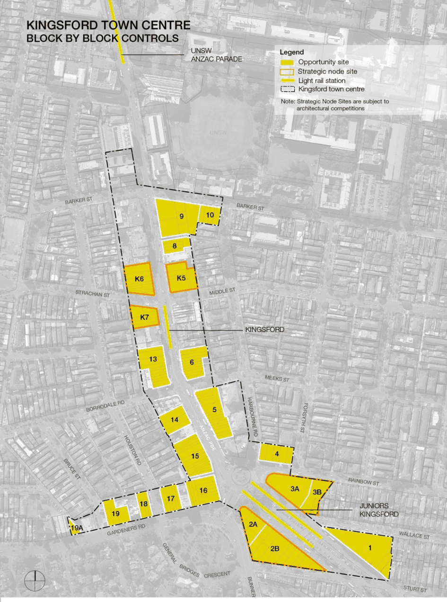

> [Picture on page 34: a picture, saved as a picture (images/part-d1-kensington-and-kingsford-page-34-2.gif, 150 dpi).]

Figure 5b: Block location map Kensington town centre

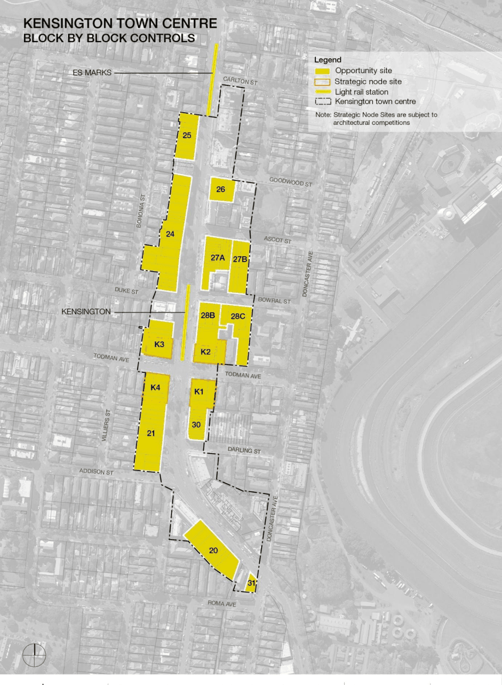

> [Picture on page 35: a picture, saved as a picture (images/part-d1-kensington-and-kingsford-page-35-2.gif, 150 dpi).]

### 10.2. Strategic node sites

Todman Square Precinct, Kensington Desired future character Todman Square Precinct comprises the four strategic node sites referred to as K1, K2, K3 and

K4 which occupy the four corners of the Todman Avenue and Anzac Parade junction, adjacent to the Todman Ave light rail stop. Future redevelopment of the Precinct will form the new ‘heart’ of the Kensington Town Centre. A mix of residential, retail, commercial and cultural uses and activities will be clustered around the Todman Ave Light Rail Stop, leveraging upon excellent accessibility to major employment hubs including the Sydney CBD, and the Randwick Collaboration Area, as well as east-west linkages to surrounding residential areas. The Precinct will have a lively creative arts and innovation focused environment. A new multi-functional creative space at K1 will provide local opportunities for artistic, cultural and creative expression, while improving public accessibility and opportunities for the community to experience the arts.  An innovation space at K3 will accommodate start-ups, co working hubs and incubators with strong synergies to the University of NSW. A variety of arts and non-arts related businesses including cafes, restaurants, small bars, and shops will be clustered around these cultural and innovation anchors. Todman Square will achieve high quality urban design and amenity, with slender taller articulated buildings of up to 18 storeys in height defining the corner sites, reflecting architectural design excellence and emphasising this new landmark location. The Precinct will have a pedestrian focus with integrated public spaces, generous setbacks along Anzac Parade, active ground street frontages and wider footpaths to accommodate increased pedestrian capacity and footpath dining. The Precinct will facilitate permeability with activated mid-block links and shared laneways embellished with public art and greenery, allowing people to easily navigate within a high amenity and safe environment. A new plaza at K1 with public art, landscaping and furniture will provide the opportunity for people to meet, interact and connect. Green linear links to an expanded Kokoda Park and the Randwick Racecourse Urban Forest will further foster the liveability and environmental amenity of this Precinct. Objectives The objectives for strategic node sites are to:

1\. Provide for development that supports and encourages the growth of the Precinct as a hub for arts, innovation, cultural and creative endeavours

2\. Encourage high quality-built form outcomes and achieve design excellence

3\. Ensure new development results in a cohesive urban design outcome and high-quality streetscape across the Todman Square Precinct

4\. Locate mixed use development with good access to retail, public transport, employment, high quality public domain and public transport

5\. Ensure that built form features articulation and an attractive composition of building elements with a strong relationship between buildings and the streetscape

6\. Provide high quality public domain elements, including mid-block links, widened footpaths, public art, street trees, landscaping and a welcoming public plaza

7\. Support a thriving day and night-time economy

8\. Minimise any adverse impacts on the amenity of the adjoining residential area.

Controls

a) Future built form at Todman Square must be consistent with the applicable block envelope controls shown in Figures 6, 7, 8 and 9

b) DAs for strategic node sites are to be undertaken in accordance with the winning design of the architectural design competition

c) A minimum non-residential floor space is to be provided in accordance with Clause 6.17 of the RLEP 2012

d) Buildings are to respond to the site’s context to provide visual interest and minimise and mitigate potential for overshadowing and privacy impacts upon surrounding land uses

e) Buildings are to be well articulated and respond sensitively to nearby heritage and contributory buildings in accordance with the requirements under section 9 Part A of this Chapter of the DCP

f) Buildings are to ensure a cohesive urban design outcome across the Todman Square Precinct in terms of built form, scale and massing and contribute to a high quality streetscape environment

g) Built form within ‘Flexible Zones’ is to be designed to comply with the maximum building height in the RLEP 2012, objectives of this clause and the requirements of the ADG to achieve a suitable transition to adjoining lower scale development

h) Continuous active street frontages on the ground floor and adjacent to laneways are to be provided in accordance with the requirements of section 19 Part C of this chapter of the DCP

i) A multi-functional creative space with a minimum floor area of 200m2 is to be provided at the K1 site and dedicated to Council. Floor area for the creative space is to be excluded from the total gross floor area of the site

j) A public plaza is to be provided immediately north of the K1 site in accordance with Figure 6

k) An innovation hub with a minimum floor area of 200m2 is to be provided at the K3 site and dedicated to Council. Floor area for the innovation hub is to be excluded from the total gross floor area of the site

l) Green walls, roofs and landscaping is to be provided in accordance with section 21 Part C of this chapter of the DCP.

K1 Site Figure 6: K1 Site block controls, Todman Square

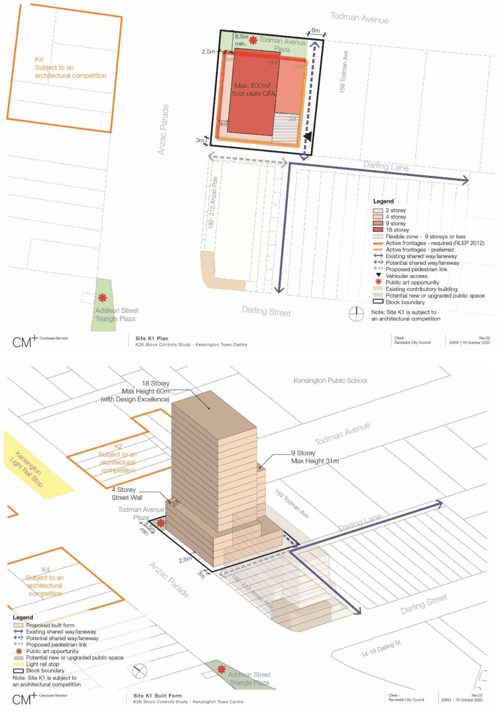

> [Picture on page 38: a picture, saved as a picture (images/part-d1-kensington-and-kingsford-page-38-3.gif, 150 dpi).]

K2 Site Figure 7: K2 Site block controls, Todman Square

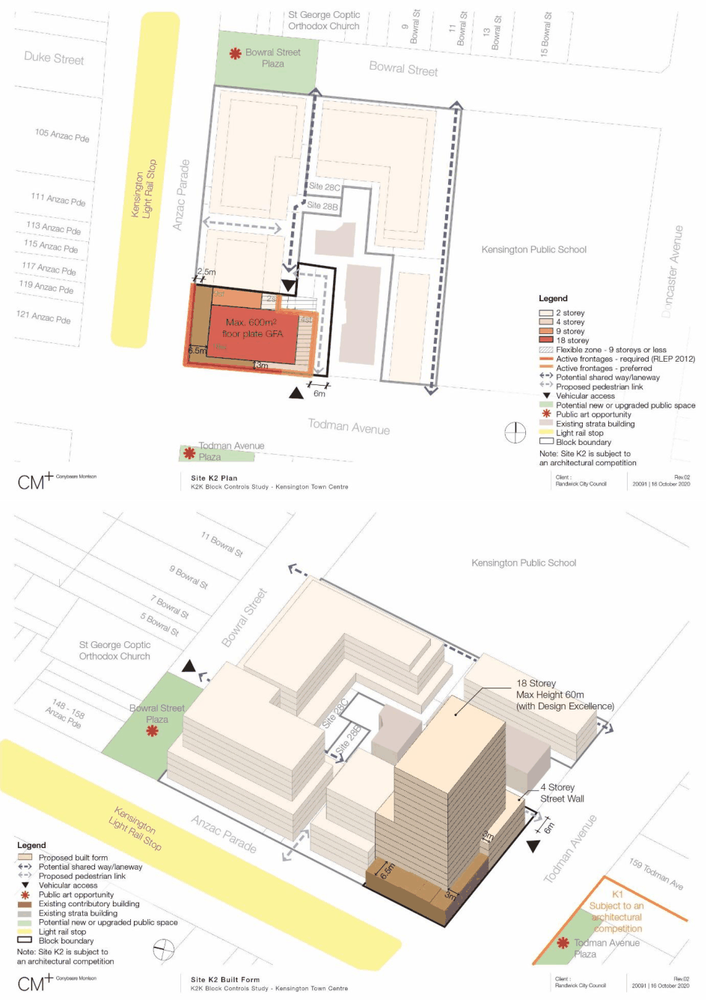

> [Picture on page 39: a picture, saved as a picture (images/part-d1-kensington-and-kingsford-page-39-3.gif, 150 dpi).]

K3 Site Figure 8: K3 Site block controls, Todman Square

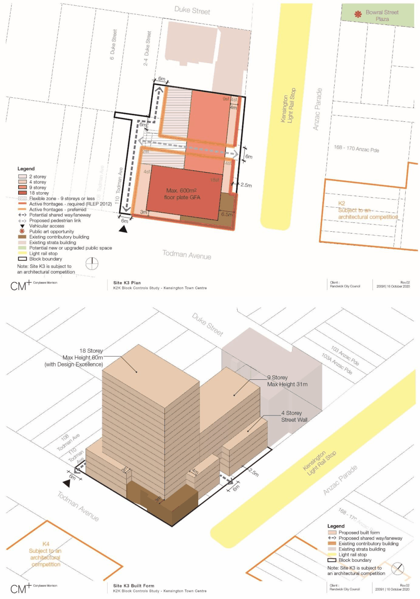

> [Picture on page 40: a picture, saved as a picture (images/part-d1-kensington-and-kingsford-page-40-3.gif, 150 dpi).]

K4 Site Figure 9: K4 Site block controls, Todman Square

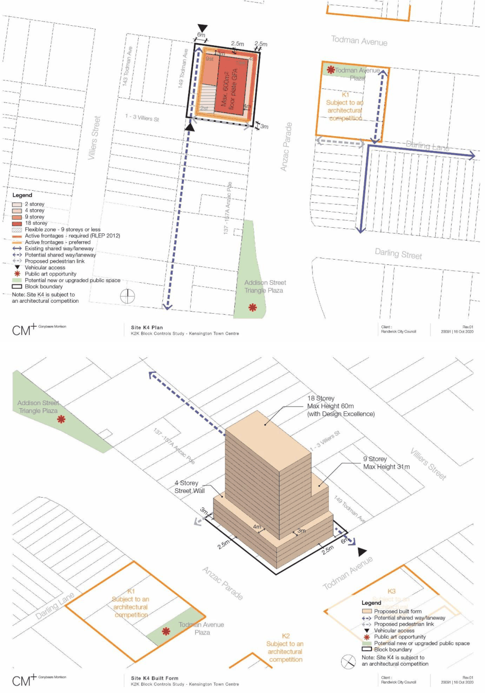

> [Picture on page 41: a picture, saved as a picture (images/part-d1-kensington-and-kingsford-page-41-3.gif, 150 dpi).]

#### Kingsford Junction Precinct

Desired Future Character Kingsford Junction comprises the Kingsford Triangle (2A and 2B) and the Rainbow Street (3A and 3B) sites located on the southern end of the Kingsford Town Centre. The Precinct occupies a prominent location at the convergence of key streets adjacent to the Juniors Kingsford Light Rail Terminus. The Precinct’s triangular geometry provides a significant op portunity to establish a gateway to the Kingsford town centre that is iconic, well connected and activated. Future development of Kingsford Junction is to provide for a variety of residential, commercial, retail and community uses clustered around the light rail terminus, making greater use of the public transport network and high level of accessibility. New development is to respond to the unique landmark setting of Kingsford Junction and focus on establishing active edges and integrating built form with the surrounding context. It also requires a design response that is sensitive to the surrounding heritage context including Dacey Gardens and Daceyville heritage conservation area to the south-

west and contributory buildings at Maloney’s Corner.

The Kingsford Triangle and Rainbow Street sites are large strategic node sites and are expected to accommodate slender articulated landmark tower forms of 17 storeys reflecting architectural design excellence and best practice in sustainability. The building form is to be stepped down from 17 to 9 and 7 storeys at the Kingsford Triangle site, to achieve a scale transition to surrounding residential neighbourhoods and reduce building bulk and overshadowing. A similar scale transition will be achieved on the Rainbow Street site to minimise visual amenity and privacy impacts for surrounding areas. A civic scaled environment will be created through four storey street walls integrated into built form, together with generous setbacks and wider footpaths. A high level of connectivity and permeability through and around the site will be achieved via open air mid-block links which open up public access corridors to surrounding streets. The public realm will be green and inviting through the provision of large canopy trees, public plazas, landscaping, seating and interactive public art. A new public plaza at the Rainbow Street site will provide a focal point for civic pride and community expression, encouraging people to linger, interact and connect. A community hub at the Rainbow Street site will provide a mix of uses such as a ‘one stop shop’ of consolidated office space, community services and facilities as well as public parking. Objectives The objectives for the Kingsford Junction Precinct are to:

1\. Ensure design excellence and provide for redevelopment that addresses the desired future character of the Precinct

2\. Ensure new development responds to the context and visual setting of the Precinct providing a distinct gateway to the Kingsford town centre

3\. Provide tall landmark buildings at the Kingsford Triangle and Rainbow Street sites that define the Precinct and exhibit innovation in design and sustainability

4\. P

rovide a well balanced mix of uses and scales suitable to the site’s location on the southern fringe of Kingsford town centre

5\. S

upport the Precinct’s role as a significant transport interchange in the locality

6\. Provide high quality plazas and civic spaces that encourage community interaction, passive recreation and socialisation

7\. Activate the ground floor public domain to create a vibrant Precinct that is active day and night

8\. Improve site permeability and connectivity via mid-block links and pedestrian accessways

9\. Enhance the public realm through generous setbacks, landscaping, mature trees, and footpath verges incorporating water sensitive urban design

10\. Respect and protect the amenity of existing uses on the block that are unlikely to change

11\. Minimise any potential adverse impacts on nearby heritage uses, in particular Dacey Gardens and Daceyville heritage conservation area

12\. Establish a community hub for the delivery of social, cultural, and educational services and programs.

Controls

a) Future built form at Kingsford Junction must be consistent with the applicable block envelope controls shown in figures 10 and 11, including heights, setbacks, street walls, and mid-block links

b) DAs for strategic node sites are to be undertaken in accordance with an architectural design competition

c) A minimum non-residential floor space is to be provided in accordance with clause (to be inserted) in the RLEP 2012

d) Buildings are to respond to the context to provide visual interest and minimise and mitigate potential for overshadowing and privacy impacts upon surrounding land uses

e) Built form within ‘Flexible Zones’ is to be designed to comply with the maximum building height in the RLEP 2012, objectives of this clause and the requirements of the ADG to achieve transition to adjoining lower scale development

f) New development is to be well articulated and respond sympathetically to Dacey Gardens, Daceyville heritage conservation area and nearby contributory facades, particularly in terms of curtilage, views and setting

g) Continuous active street frontages on the ground floor and adjacent to mid-block links are required in accordance with section 19 Part C of this chapter of the DCP

h) Development must demonstrate interface solutions to the Kingsford Light Rail Terminus including generous setbacks to increase pedestrian carrying capacity

i) A plaza is to be provided at the Rainbow Street site incorporating the following design features:

– a minimum area of 1500m2

– a scale and configuration that complements the streetscape and is well integrated with development on the site

– bordered by active frontages and easily accessible for all members of the public

– outdoor seating, public art, quality landscape and creative lighting elements

– water sensitive urban design that integrates with landscaping to capture and manage stormwater

i) A multi-functional community hub with a minimum gross floor area of 200m2 is to be provided at the Rainbow Street site, preferably on the ground floor accessible from the public space/plaza. The multi-functional community hub is to be dedicated to Council.

Site 2A/2B Kingsford triangle block Figure 10: Kingsford Triangle block controls, Kingsford Junction

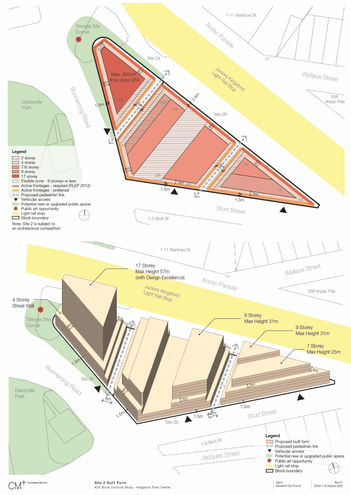

> [Picture on page 44: a picture, saved as a picture (images/part-d1-kensington-and-kingsford-page-44-3.gif, 150 dpi).]

Site 3A/3B Rainbow Street block Figure 11: Rainbow Street block controls, Kingsford Junction

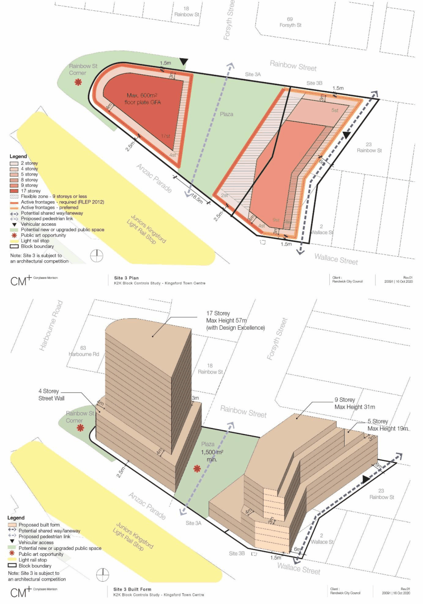

> [Picture on page 45: a picture, saved as a picture (images/part-d1-kensington-and-kingsford-page-45-3.gif, 150 dpi).]

#### Kingsford midtown precinct

Desired future character The Kingsford Mid-Town Precinct is located in the old heart of Kingsford town centre and comprises the strategic node sites referred to as K5, K6 and K7. Built form and building heights in this precinct will be carefully considered to achieve good amenity and respond to surrounding historic buildings, while ensuring a fine grain character is retained. Tall, slender well-articulated buildings at K5, K6 and K7 will be generally up to 18 storeys in height, exhibiting design excellence and emphasising the mid-town role of this Precinct. Buildings on the eastern and western edge of the Precinct will be scaled down to 5 storeys in conjunction with a 2m ground floor building setback to encourage mews style development and achieve a height transition to adjoining lower scale neighbourhoods. New development will reinforce a four-storey street wall along Anzac Parade to facilitate a fine grain civic scale. A minimum 2.5m building setback along Anzac Parade will create a comfortable pedestrian environment enhanced by awnings, street trees, landscaping, lighting and street furniture. The historic fabric of the Precinct will be respected and celebrated with new built form designed to achieve a harmonious relationship with historic buildings, including O’Deas Corner , and nearby contributory buildings in terms of scale, form and detailing. An upper level setback of 6.5m for contributory buildings will maintain the form and articulation of historic frontages. Kingsford Midtown will be a focus for innovation, cutting edge design and sustainability. The provision of an innovation hub at K5 will accommodate start-ups, incubators and creative industries, fostering strong synergies with the University of NSW nearby. The Precinct will continue to maintain the strong convenience retail and dining role of the wider Kingsford Town centre, reflected by a diverse range of shops, cafes and restaurants. Active uses on the ground floor of buildings along Anzac Parade and Strachan Street will increase the vibrancy of the Precinct and wider town centre. The precinct will have a vibrant evening economy, building up upon its distinct Asian dining character with active shop fronts, high quality public realm and street life that encourages people to mingle and meet. Footpath dining will be encouraged along Strachan Street with footpath widening and street trees providing a high level of amenity. The greening of this Precinct with boulevard trees, landscaping and linear links to Kensington Park will contribute to the liveability of this Precinct, making it a place where people want to live, work and visit. Objectives The objectives for the Kingsford midtown precinct are to:

1\. Ensure design excellence and provide for redevelopment that addresses the desired future character and cohesiveness of the precinct

2\. Provide taller landmark buildings that respond sensitively to the scale, proportions, form and detailing of nearby heritage, contributory buildings and other properties

3\. Provide for high quality development comprising a mix of uses including commercial, residential, innovation spaces, retail and cultural facilities

4\. Ensure the Anzac Parade façade retains a human scale with strong vertical articulation and fine grain character

5\. Provide excellent pedestrian amenity through continuous awnings and high quality well landscaped public domain.

Controls

a) Future built form at Kingsford Midtown must be consistent with the block envelope controls shown in figures 12, 13 and 14, including heights, setbacks, street walls, and mid-block links

b) DAs for strategic node sites are to be undertaken in accordance with an architectural design competition

c) Buildings are to respond to the context to provide visual interest and minimise and mitigate potential for overshadowing and privacy impacts upon surrounding land uses

d) Built form is to respond sensitively to O’Deas Corner , and other contributory buildings in accordance with the requirements outlined in section 9 Part A of this chapter of the DCP

e) Built form within ‘Flexible Zones’ is to be designed to comply with the maximum building height in the RLEP 2012, objectives of this clause and the requirements of the ADG to achieve transition to adjoining lower scale development

f) An innovation hub with a minimum area of 200m2 is to be provided at the K5 site, either on the ground or first floor and dedicated to Council

g) A minimum non-residential floor space is to be provided in accordance with clause (to be inserted) of RLEP 2012

h) Green walls, roofs and landscaping is to be provided in accordance with the requirements outlined under section 20 Part C of this chapter of the DCP

i) Continuous active street frontages on the ground floor and adjacent to laneways are to be provided in accordance with section 19 Part C of this chapter of the DCP

j) Buildings are to ensure a cohesive urban design outcome across the Kingsford Mid-Town Precinct in terms of built form, scale and massing and contribute to a high quality streetscape environment.

Site K5: Kingsford Midtown Figure 12: K5 Site block controls, Kingsford Midtown

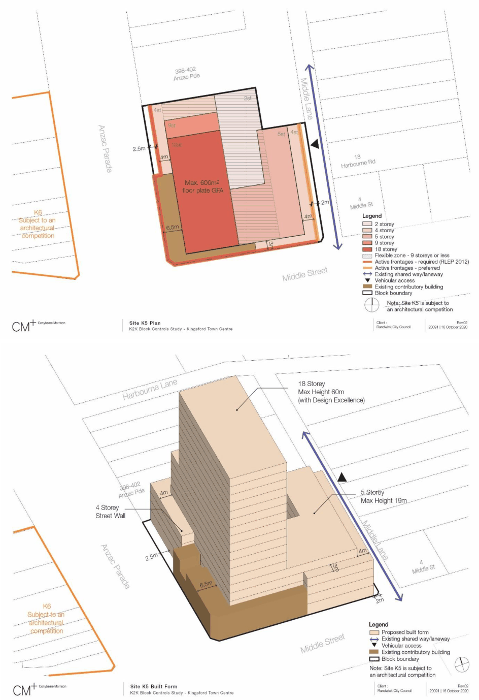

> [Picture on page 48: a picture, saved as a picture (images/part-d1-kensington-and-kingsford-page-48-3.gif, 150 dpi).]

Site K6: Kingsford Midtown Figure 13: K6 Site block controls, Kingsford Midtown

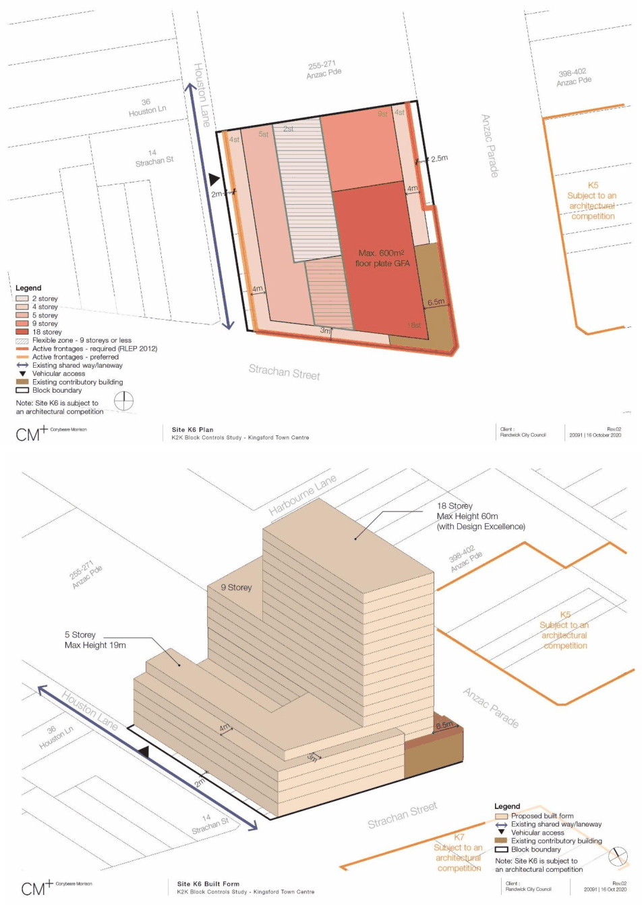

> [Picture on page 49: a picture, saved as a picture (images/part-d1-kensington-and-kingsford-page-49-3.gif, 150 dpi).]

Site K7: Kingsford Midtown Figure 14: K7 Site block controls, Kingsford Midtown

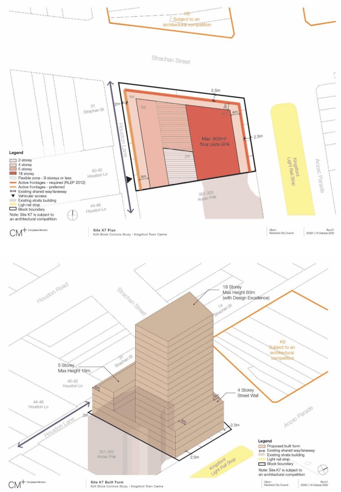

> [Picture on page 50: a picture, saved as a picture (images/part-d1-kensington-and-kingsford-page-50-3.gif, 150 dpi).]

### 10.3. Block by block controls - other sites

The following section contains general objectives and block envelope controls for other sites within the Kensington and Kingsford town centre. It should be read in conjunction with the objectives and controls relating to the wider Kensington and Kingsford town centres and other parts of the Randwick City DCP. If there is an inconsistency between this part of the DCP and other parts of the Randwick City DCP, this part of the DCP will prevail. Objectives The objectives for block by block controls are to:

1\. Provide a mix of uses that support the economic prosperity and liveability of the Kensington and Kingsford town centres

2\. Facilitate high quality built form outcomes that demonstrate design excellence and amenity

3\. Establish an appropriate scale, dimensions, form and separation of buildings

4\. Protect and enhance amenity between adjoining developments in terms of solar access and privacy

5\. Create a height transition between the centre and the surrounding residential area.

6\. Improve connectivity and permeability within the block structure

7\. Ensure new development presents a human scale urban edge to the public realm. Controls

a) Development must be consistent with the relevant block envelope controls including heights, setbacks, street walls, mid-block links and laneways

b) Built form within ‘Flexible Zones’ is to be designed to comply with the maximum building height in the RLEP 2012, objectives of this clause and the requirements of the ADG to achieve transition to adjoining lower scale development.

Kingsford Town Centre Block 1 Figure 15a: Block 1

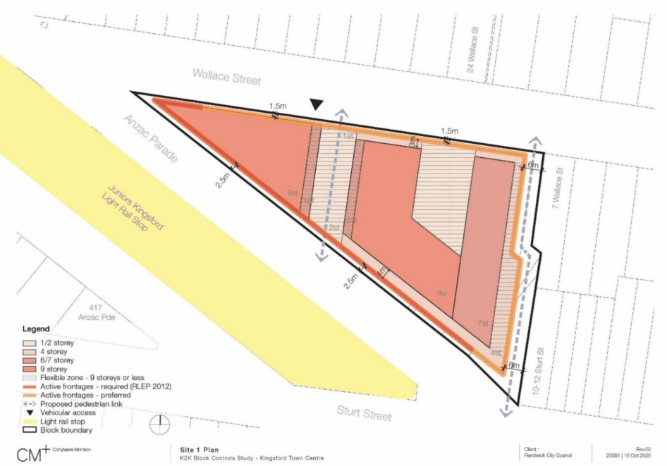

> [Picture on page 52: a picture, saved as a picture (images/part-d1-kensington-and-kingsford-page-52-4.gif, 150 dpi).]

Desired future character This triangular shaped block occupies a prominent location adjacent to the Kingsford Light Rail Terminus (Juniors Kingsford Stop) south east of the Kingsford Junction Precinct. It currently contains the South’s Junior’s Club (4 storey development) and a sm

all row of 2 storey multi

business properties. To the east is a 2 storey residential flat building situated on the Stuart Street frontage. The preferred outcome for the block is to ensure buildings address both Anzac Parade and Wallace Streets. The site’s geometry, change in topography between Wallace Street and Anzac Parade and strategic location provides the opportunity to establish a distinctive built form outcome at the corner of Anzac Parade and Wallace Street utilising strong vertical emphasis, façade articulation and architectural roof features. A mid-block pedestrian link is required given the length of this block to provide convenient access to the light rail stop. The mid-block pedestrian link is to be either open to the sky or under a building (greater than 3 storeys high). The location of the mid-block link is flexible and is to be resolved as part of the overall design across the whole block with active shop frontages along its length on both sides. Height will be distributed across the block, stepping down from 9 storeys at the Anzac Parade/Wallace Street corner to 9 and 7 storeys to achieve a scale transition from the mixed use character of the town centre to the residential development along Wallace and Stuart Streets. Increased ground floor building setbacks along the Anzac Parade frontage will improve the carrying capacity of the footpaths close to the Light Rail Terminus, and together with active street frontages and a 4 storey street wall will enhance the civic scale to the precinct. A laneway at the eastern boundary of the block will provide pedestrian access to the block as well as separation from the lower scaled residential neighbourhood to the east.

Figure 15b: Block 1

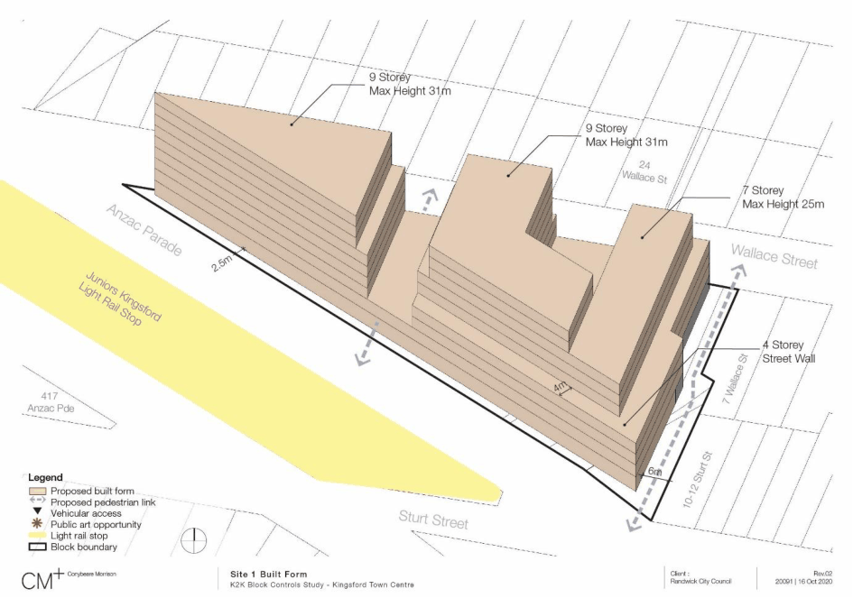

> [Picture on page 53: a picture, saved as a picture (images/part-d1-kensington-and-kingsford-page-53-2.gif, 150 dpi).]

Block 2

Note Refer to Kingsford triangle site (2A/2B) provisions

Block 3

Note Refer to Rainbow Street site (3A/3B) provisions

Block 4 Figure 16a: Block 4

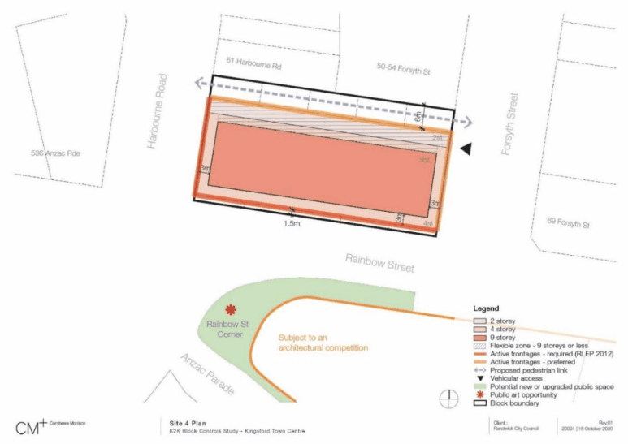

> [Picture on page 54: a picture, saved as a picture (images/part-d1-kensington-and-kingsford-page-54-3.gif, 150 dpi).]

Desire future character The block is located in a prominent position bounded by Harbourne Road, Forsyth Street and Rainbow Street, north-east of the Kingsford Junction. It is currently occupied by 3 residential flat buildings ranging from 2- 4 storeys and a commercial building. The preferred outcome for the block is a single building envelope that has a strong visual connection to the Rainbow Street strategic node site across the road to the south and the wider Kingsford Junction Precinct. A pedestrian link on the northern boundary will provide a connection between Forsyth Street and Harbourne Road. A flexible zone is provided on the northern side to enable built form to be suitably distributed across the site. The block will present as 9 storeys to the Rainbow Street, Harbourne Road and Forsyth Street frontages, stepping down to provide an appropriate scale transition to the pedestrian link to the north. The building will have active street frontages to contribute to the thriving retail, commercial and dining character of the Kingsford town centre. The block will maintain a fine grain urban structure through appropriate modulation and articulation to ensure it has a cohesive relationship with the smaller shop fronts along the southern part of Kingsford town centre.

Figure 16b: Block 4

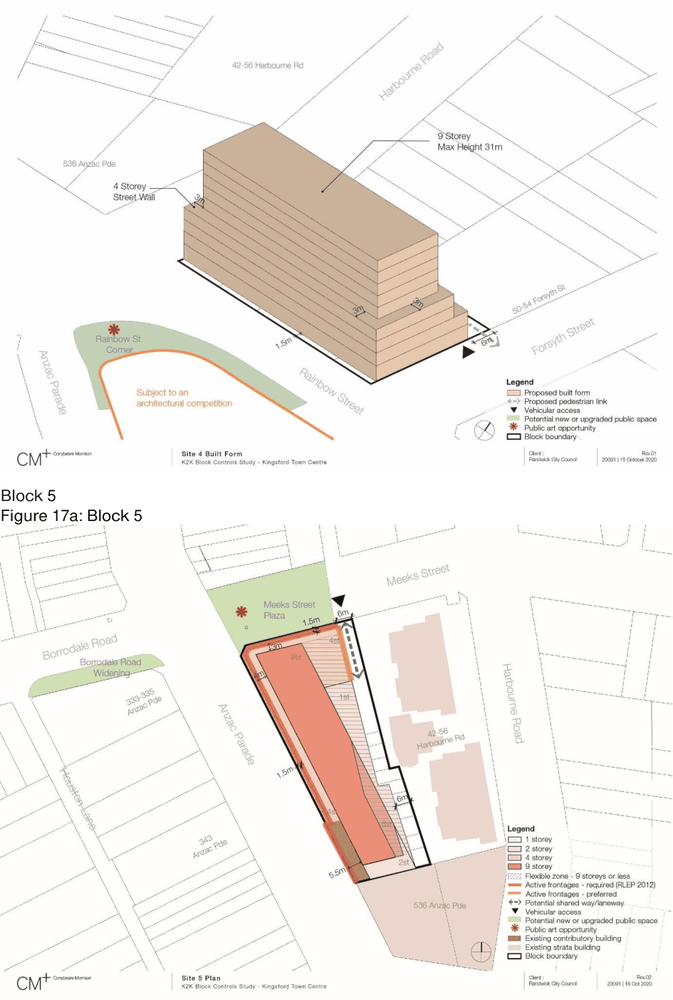

> [Picture on page 55: a picture, saved as a picture (images/part-d1-kensington-and-kingsford-page-55-2.gif, 150 dpi).]

Block 5 Figure 17a: Block 5

Desired future character The block is presently occupied by a row of relatively uniform fine grain 2 storey shop fronts offering a mix of retail, restaurants and café services.  A contributory building is located on the south western corner, abutting the Churchills development to the south. To the north is Meeks Street Plaza which is a key focal point within the town centre and subject to an upgrade to improve its useability and amenity. The preferred outcome for the block is an amalgamated mid-rise building oriented to Anzac Parade with façade articulation to complement the existing fine grain streetscape. Built form is to step down to four storeys fronting Meeks St Plaza.  A flexible zone is provided along the eastern boundary to enable distribution of density across the site. Vehicle access is to be provided at the rear through a shareway/laneway off Meeks Street. A 1.5m ground floor setback is to be provided off Meeks Street Plaza to improve the public domain. The development fronting Anzac Parade is to complement the heritage streetscape character of the Kingsford town centre and reinforce the street edge with a 4 storey street wall. New development must incorporate proportions and rhythm that is sympathetic to the contributory building. A 4m upper level setback to Anzac Parade and 5.5m upper level setback to the Churchills development will reinforce the historic visual appearance of the contributory building, allowing its primary building form and articulation to be retained. The southern and eastern interfaces between this block and the adjoining development should be carefully designed and resolved to coordinate with existing window openings to ensure adequate amenity and separation is achieved. A flexible zone provides for built form to be suitably distributed to ensure compliance with the ADG. Active frontages along Anzac Parade and Meeks Street adjacent to the plaza will provide a positive interface with street life and reinforce Kingsford town centre as a retail and dining destination. Figure 17b: Block 5

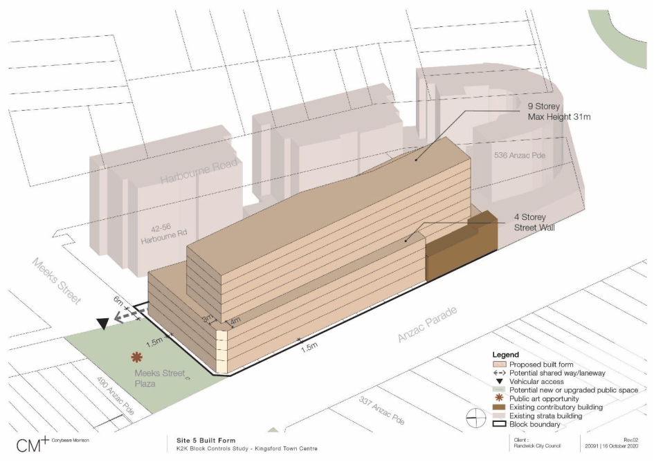

> [Picture on page 56: a picture, saved as a picture (images/part-d1-kensington-and-kingsford-page-56-26.gif, 150 dpi).]

Block 6 Figure 18a: Block 6

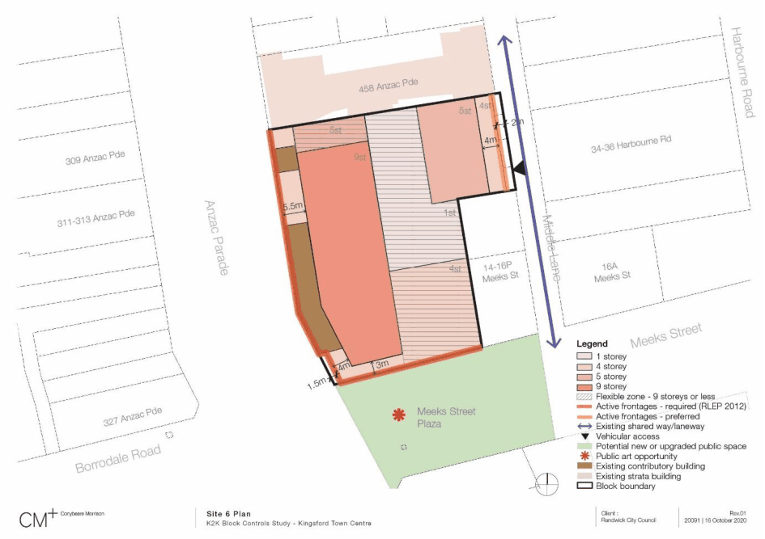

> [Picture on page 57: a picture, saved as a picture (images/part-d1-kensington-and-kingsford-page-57-3.gif, 150 dpi).]

Desired future character The block comprises a row of contributory building shop fronts containing mostly restaurants, cafes and some convenience retail. The block is located in the heart of the dining strip in the Kingsford town centre and has a thriving night-time economy. Meeks Street Plaza and Council car park adjoins the block to the south and east.  A contemporary mixed-use development is situated to the north, at 458 Anzac Parade. The preferred outcome for the block is a mid-rise building form of 9 storeys stepped down to 5 storeys along the Middle Lane frontage to provide a mews style development that takes advantage of Middle Lane at the rear which facilitates shared access. A 2m ground floor setback is to be provided off Middle Lane. A flexible zone is included across the middle and northern edge to enable built form to be designed to transition across the block and address existing development to the north at 458 Anzac Parade. Sensitive design will integrate contemporary elements with historic fabric. A 5.5m upper level setback above the contributory buildings will help to ensure that historic form, proportions, and articulation is retained in the redevelopment of the block. Built form on the southern and eastern edge must actively address Meeks Street Plaza and car park with design elements that provide a high-quality presentation, passive surveillance and visual connections between the building and public realm. Future development opportunities that support the dining destination character of the precinct are encouraged.

Figure 18b: Block 6

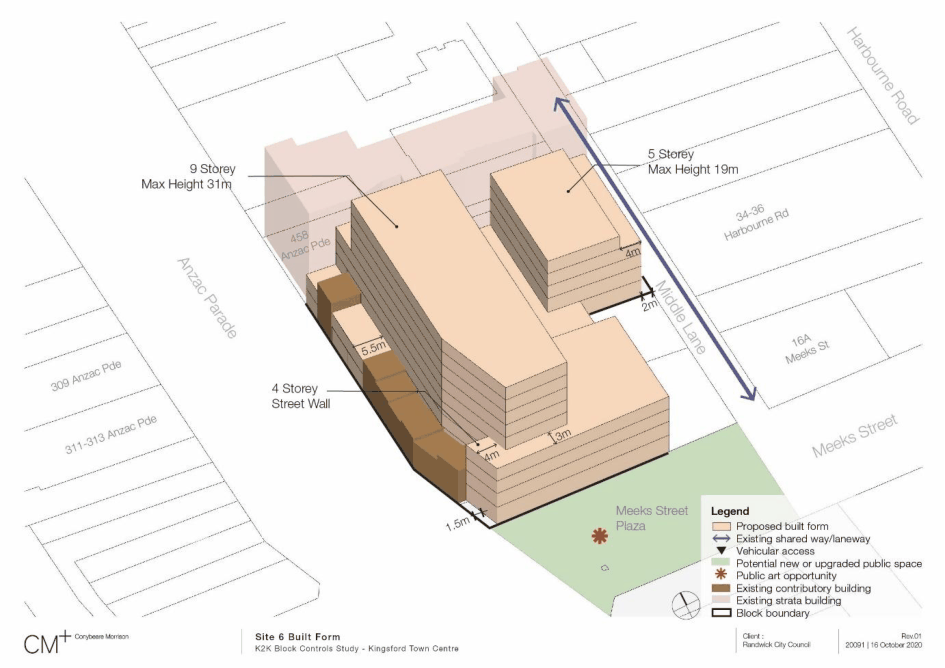

> [Picture on page 58: a picture, saved as a picture (images/part-d1-kensington-and-kingsford-page-58-2.gif, 150 dpi).]

Block 7

Note Refer to Kingsford midtown provisions (K5, K6 and K7)

Block 8 Figure 19a: Block 8

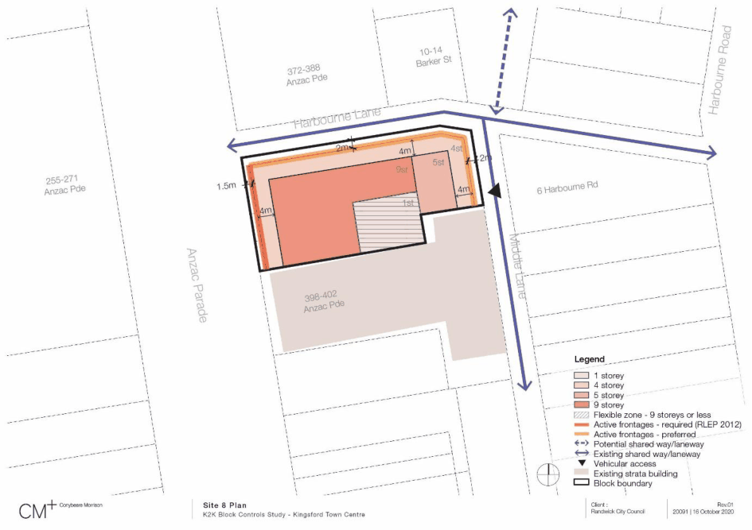

> [Picture on page 59: a picture, saved as a picture (images/part-d1-kensington-and-kingsford-page-59-3.gif, 150 dpi).]

Desired future character The compact block is located at the corner of Anzac Parade and Harbourne Lane. It is presently occupied by three single storey shop fronts along Anzac Parade and an automotive services business fronting Harbourne Lane. To the south at 398-402 Anzac Parade is a tall multi storey mixed use development. The preferred built form outcome for the site is for a building aligned to Anzac Parade, Middle Lane and Harbourne Lane. Development is to maintain the prevalent mid-rise building typology desired for the town centre, stepping down to 5 storeys at the rear towards Middle Lane. Vertical built form and roof top elements would emphasise the corner of Anzac Parade and Harbourne Lane. A flexible zone is provided on the southern side which enables creation of either an internal courtyard or common space for residents or an alternative design response that meets the ADG. Active frontages along Anzac Parade and Harbourne Lane are required to contribute to the vitality of the streetscape and the wider town centre. A setback of 2m on the Harbourne Lane frontage will create opportunities for landscaping, footpath dining and activation of this laneway.

Figure 19b: Block 8

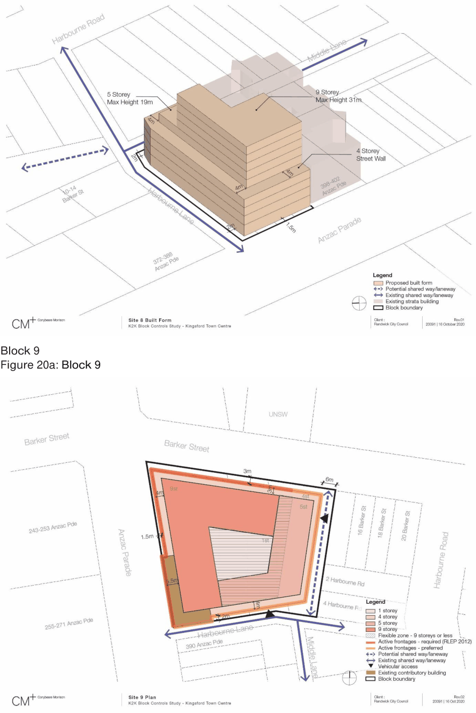

> [Picture on page 60: a picture, saved as a picture (images/part-d1-kensington-and-kingsford-page-60-2.gif, 150 dpi).]

Block 9 Figure 20a: Block 9

Desired Future Character Block 9 is located on the corner of Anzac Parade and Barker Street and is currently occupied by a McDonald’s Restaurant and BP Service Station. The site is opposite UNSW Campus and experiences high pedestrian and vehicular traffic volumes. The site has excellent access via its 2 main street frontages and Harbourne Lane. The preferred development outcome for the block is to enable adequate building setback of 3m on the northern boundary to Barker Street to provide for future widening of traffic lanes as well as pedestrian movements. This would provide for a significant improvement to the public domain at this key intersection. Future development on this site should focus the higher 9 storey component onto Anzac Parade and Barker Street behind a 4 storey street wall. The development requires a design response that is sensitive to the historic form and fabric of the existing contributory building. Upper level setbacks of 4m are required around the perimeter of the block.   A flexible zone is included through the centre and eastern side to enable built form to be suitably distributed across the site in response to ADG requirements for separation and amenity. A north-south shareway is to be provided connecting Barker Street with Harbourne Lane. The fine grain proportions of existing shop fronts will be interpreted through a well articulated built form particularly on the Anzac Parade frontage to contribute towards a cohesive streetscape within the Kingsford town centre. Continuous active frontages are to be provided along Anzac Parade through appropriate location of uses such as shops, cafes, and restaurants, to facilitate a visual connection between the building and public realm and support a thriving economy.

Figure 20b: Block 9

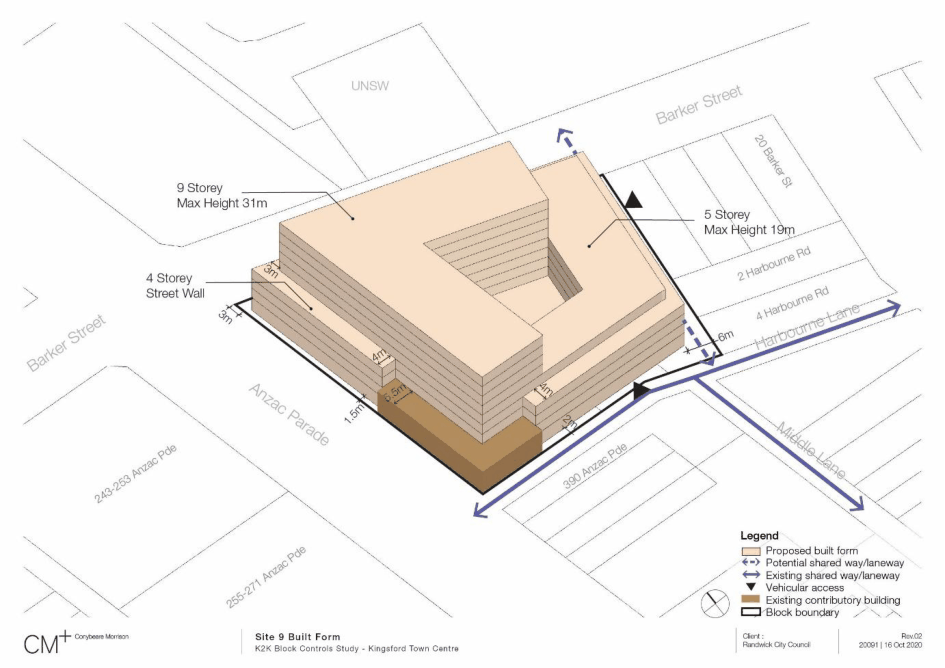

> [Picture on page 61: a picture, saved as a picture (images/part-d1-kensington-and-kingsford-page-61-24.gif, 150 dpi).]

Block 10 Figure 21a: Block 10

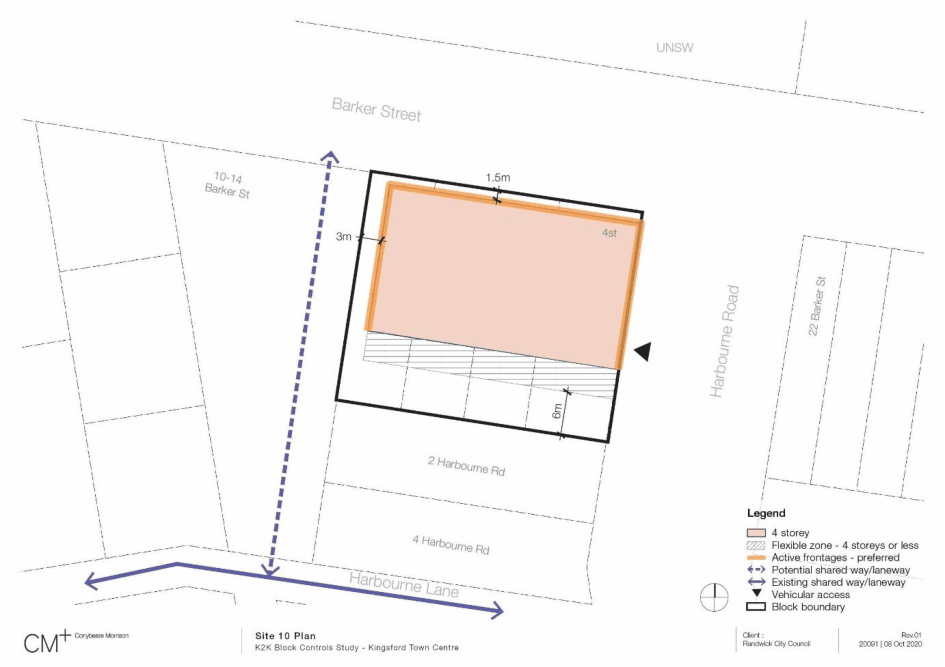

> [Picture on page 62: a picture, saved as a picture (images/part-d1-kensington-and-kingsford-page-62-3.gif, 150 dpi).]

Desired future character Block 10 is located on the corner of Barker Street and Harbourne Road opposite the UNSW Campus and adjoining the McDonald’s Restaurant on the western boundary. The block comprises 3 lots and contains two single storey dwellings and a 4 storey residential flat building with 6 units. The site is opposite UNSW Campus and experiences high pedestrian and vehicular traffic volumes. The site provides good access via its 2 main street frontages and vehicular access from Harbourne Road. Harbourne Road is residential in nature and has varied building heights ranging from 1 to 4 storeys, with consistent front setbacks, boundary fences and architecture styles. Adjoining the block to the south is a residential flat building at No. 2 Harbourne Road and a single storey dwelling at No.4 Harbourne Road. The preferred development outcome for the block is for a four storey building fronting Barker Street that provides for active ground floor retail and business activities that wrap around three street frontages. A 1.5m front building setback would facilitate a continuous footpath widening extending from this site to the intersection with Anzac Parade. A 3m building setback is to be provided along the western side. Development on the site is to respect the lower scale residential development to the south by providing a minimum 6m rear building from the boundary. A flexible zone is included on the southern side to enable built form to be distributed and transitioned across the site towards the residential area fronting Harbourne Road.

Figure 21b: Block 10

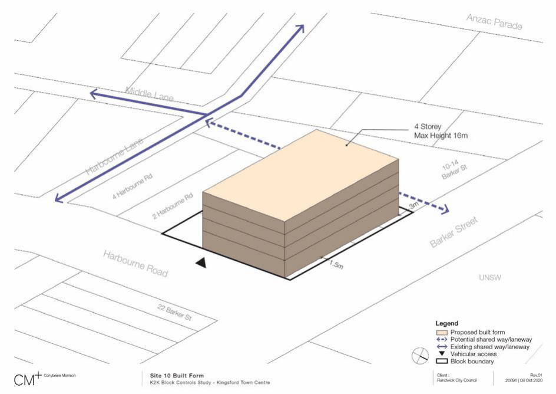

> [Picture on page 63: a picture, saved as a picture (images/part-d1-kensington-and-kingsford-page-63-2.gif, 150 dpi).]

Blocks 11 and 12

Note Refer to Kingsford Junction Block Provisions

Block 13 Figure 22a: Block 13

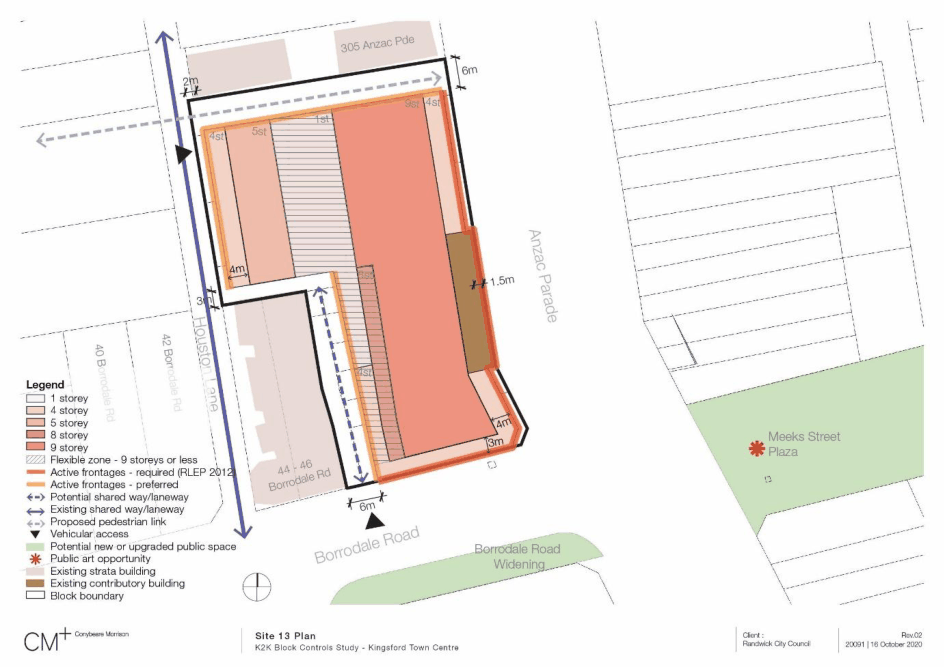

> [Picture on page 64: a picture, saved as a picture (images/part-d1-kensington-and-kingsford-page-64-3.gif, 150 dpi).]

Desired future character The block is bounded by Anzac Parade, Borrodale Road and Houston Lane on the western side of Kensington town centre. It is currently occupied by a row of mainly two storey shop fronts featuring restaurants, retail and other uses. A multi-level mixed use development is located immediately north of the block at 305 Anzac Parade which is unlikely to be redeveloped in the immediate future. The preferred development outcome for the block is to achieve a quality designed building that responds to the site’s context, respects existing contributory buildings whereby with height transitions from Anzac Parade to Houston Lane.  A 2m setback off Houston Lane is to be provided. A 4 storey street wall together with a 1.5m ground floor setback from Anzac Parade (with the exception of the contributory building) is required to allow widening of the footpath to improve the quality of the public domain surrounding the block. A 4m upper level setback is to be provided along Anzac Parade and a 3m upper level setback is to be provided along Borrodale Road. A pedestrian link at the northern boundary to 305 Anzac Parade will improve permeability between Anzac Parade and Houston Lane. Development is to be built to the boundary on the southern frontage along Borrodale Road. A shared way is to be provided off Borrodale Road to enable pedestrian and service access to the block. A flexible zone is included within the middle of the block to enable built form to be suitably distributed across the site and designed to respond to ADG requirements for setback and amenity. The fine grain proportions of existing shop fronts will be interpreted through a well articulated built form particularly on the Anzac Parade frontage to contribute towards a cohesive streetscape within the Kensington town centre.

Continuous active frontages are to be provided along Anzac Parade and Borrodale Road through appropriate location of uses such as shops, cafes, and restaurants, to facilitate a visual connection between the building and public realm and support a thriving economy. A well-designed corner treatment is to be provided at the intersection of Borrodale Road and Anzac Parade.

Figure 22b: Block 13

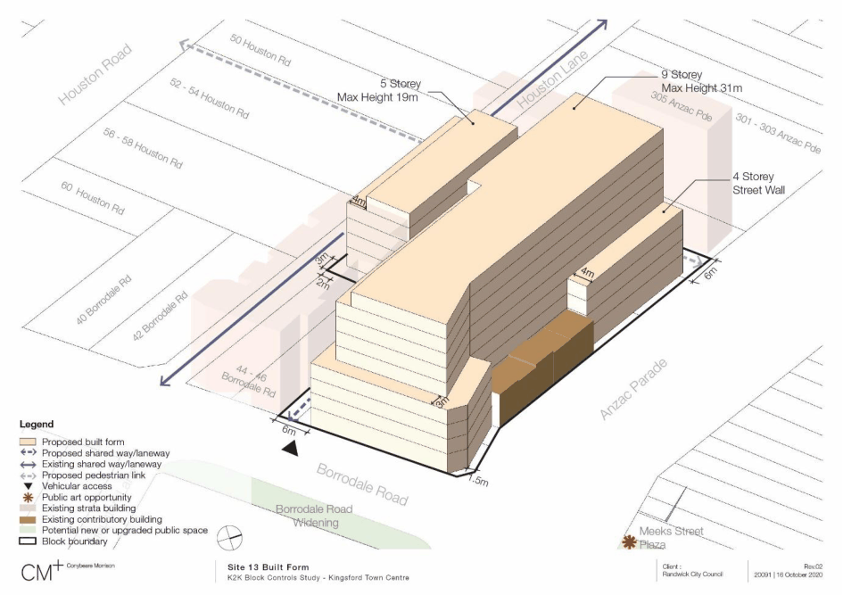

> [Picture on page 65: a picture, saved as a picture (images/part-d1-kensington-and-kingsford-page-65-7.gif, 150 dpi).]

Block 14 Figure 23a: Block 14

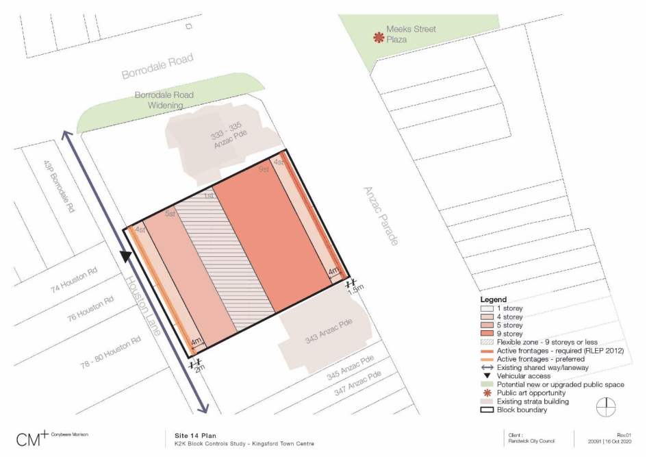

> [Picture on page 66: a picture, saved as a picture (images/part-d1-kensington-and-kingsford-page-66-3.gif, 150 dpi).]

Desired future character The block is located on the western side of Kingsford town centre, bounded by Anzac Parade and Houston Lane. On the southern side of the block are mixed use multi storey developments at 343 Anzac Parade and 333-335 Anzac Parade, that are unlikely to be redeveloped.  The existing building typology within the block is mostly 2 storey shop fronts featuring a mix of business uses. These are generally underutilised sites that provide the opportunity for a new mixed use development and improved public domain. The preferred development outcome is a mid rise building fronting Anzac Parade, stepping down to 5 and 4 storeys along the Houston Lane frontage which will help to manage solar access and privacy for adjoining residential areas and provide for architectural modulation. A flexible zone across the middle of the site provides an opportunity to either create private common open space for residents or an alternative design response that enables the built form to be suitably configured in response to the ADG separation and amenity requirements as well as bulk and scale impacts to the residential areas on the western side. A 1.5m building setback to Anzac Parade will allow for footpath widening to improve the carrying capacity of public realm and landscaping. Active frontages are required along Anzac Parade to maintain a cohesive and engaging streetscape. A 4 storey street wall and 4m upper level setback is required along Anzac Parade to create a consistent streetscape and human scale façade. A 2m building setback is required off Houston Lane to provide for landscaping and street activation.

Figure 23b: Block 14

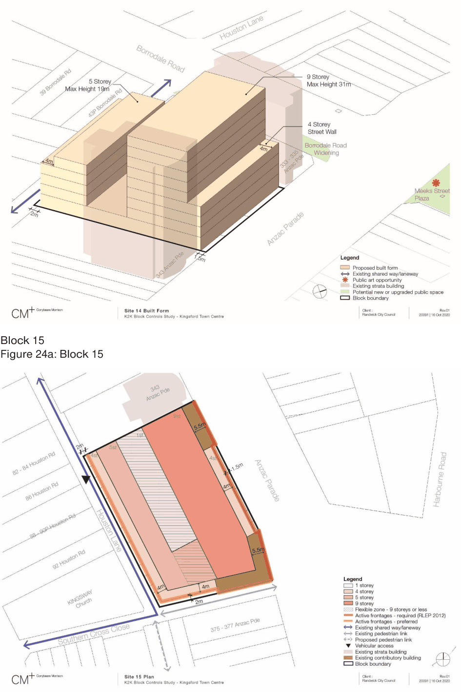

> [Picture on page 67: a picture, saved as a picture (images/part-d1-kensington-and-kingsford-page-67-2.gif, 150 dpi).]

Block 15 Figure 24a: Block 15

Desired future character The block is located on the western side of Kingsford town centre, bounded by Anzac Parade and Houston Lane. The Southern Close pedestrian link is located on the southern boundary of the block which is an iconic connection between Anzac Parade and Houston Lane. The block currently contains 2 storey shop front buildings with a mix of uses and a number of contributory buildings. The public realm features narrow often cluttered footpaths on Anzac Parade. Buildings within this block are underutilised sites that have the opportunity to accommodate a new amalgamated contemporary mixed-use development and improved public domain. The preferred development option is for a distribution of heights across the block from a taller mid-rise built form on Anzac Parade to a lower scale on the Houston Lane frontage. A flexible building zone is provided through the middle of the block to enable a suitable built form design response that meets the ADG requirements for separation and height transition towards the

lane. A 2m building setback is to be provided from Southern Cross Close and Houston Lane to improve the amenity of these important laneways within the Kingsford Town Centre. New development should be designed and sited to appropriately address Anzac Parade and the Southern Close pedestrian link to provide activation and casual surveillance. A 5.5m upper level setback is to be provided to the contributory buildings and a 1.5m building setback is required along Anzac Parade for new development and a nil setback is to be maintained for the contributory buildings. A 4m setback is required from the 4 storey podium to the 5th storey adjacent to Southern Cross Close to reduce visual bulk and optimise sunlight access to the lane. Active frontages along Anzac Parade will support the economic role of the town centre with preferred ground floor uses being restaurants, cafes, small bars and retail.

Figure 24b: Block 15

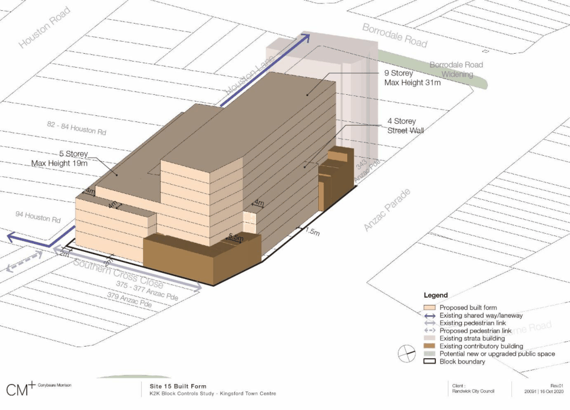

> [Picture on page 68: a picture, saved as a picture (images/part-d1-kensington-and-kingsford-page-68-24.gif, 150 dpi).]

Block 16 Figure 25a: Block 16

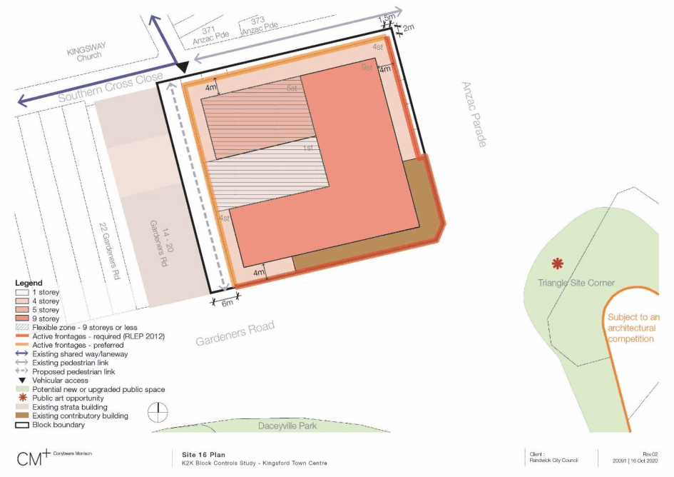

> [Picture on page 69: a picture, saved as a picture (images/part-d1-kensington-and-kingsford-page-69-3.gif, 150 dpi).]

Desired future character The block occupies a prominent position at the corner of Anzac Parade and Gardeners Road to the north west of Kingsford Junction in close walking proximity to the Kingsford Light Rail Terminus. The Dacey Gardens heritage conservation area in the Bayside Local Government Area is located across the road south of the Block. Southern Cross Close abuts the block to the north. The contributory building sweeping around the corner of Anzac Parade and Gardener’s Road (Maloney’s Corner) is a visually prominent inter -war development constructed in the 1930s that is representative of commercial expansion at the southern end of Kingsford during that period. The preferred option for the block is a high quality iconic mixed use development that responds to its unique setting at the gateway to Kingsford town centre adjacent to the Kingsford Light Rail Terminus. The development requires a design response that is sensitive to the historic form and fabric of the existing contributory building as well as Dacey Gardens across the road. It must also have a visual connection with the taller towers proposed at the Kingsford Junction Strategic Precinct. Future built form must be designed to achieve a harmonious relationship with the existing contributory building, integrating historic fabric into contemporary design. A 4m upper level setback from Gardeners Road and 5.5m upper level setback from Anzac Parade would retain the principal building form, articulation and distinct features of the building and ensure it continues to reflect the historic continuity of the streetscape. A building setback of 1.5m off Anzac Parade is to be provided for new development and a nil setback is to be maintained for the contributory building.

Heights will be distributed across the site to control bulk and scale and a flexible zone is incorporated within the built form to allow sensitive distribution of building bulk along the western side. An internal podium providing private open space opportunities to residents is to be incorporated within the development. Building setback from Southern Cross Close is to be a minimum of 2m to provide opportunities to enhance and further activate this important laneway within the Kingsford Town Centre. Redevelopment of the block should establish active edges for the ground level including retailing, cafes, shops and other non-residential uses. A new shared way on the western of the block would facilitate connectivity between Gardeners Road and Houston Lane.  A four storey street wall and upper floor setback would contribute to the cohesive civic scale within the Kingsford town centre.

Figure 25b: Block 16

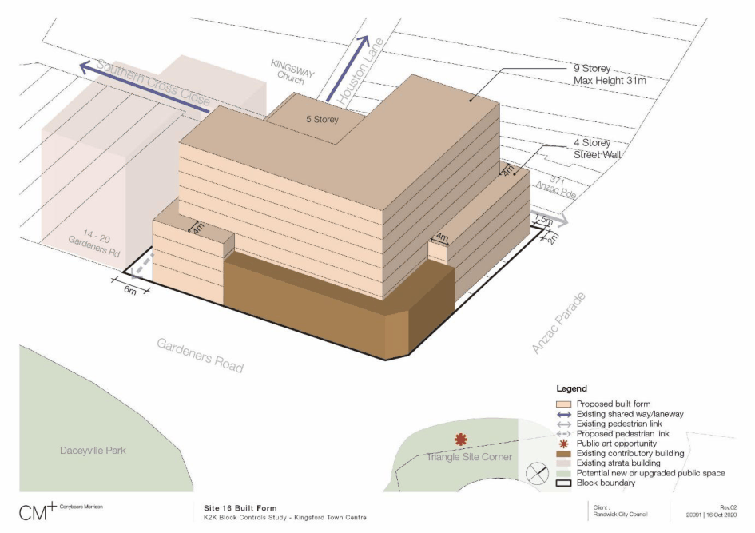

> [Picture on page 70: a picture, saved as a picture (images/part-d1-kensington-and-kingsford-page-70-13.gif, 150 dpi).]

Block 17 Figure 26a: Block 17

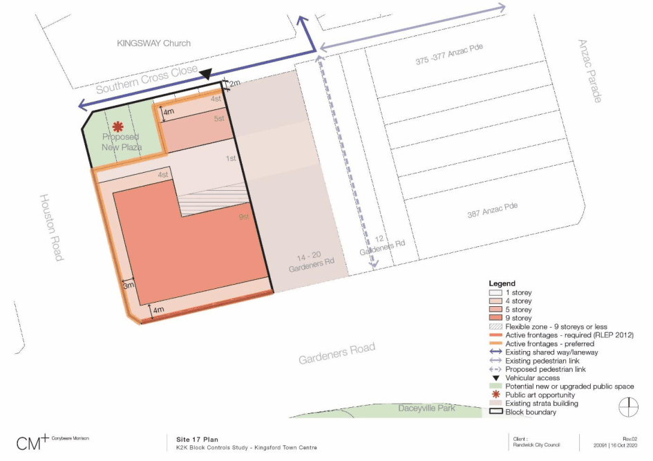

> [Picture on page 71: a picture, saved as a picture (images/part-d1-kensington-and-kingsford-page-71-3.gif, 150 dpi).]

Desired future character The block is located at the corner of Gardeners Road and Houston Road and is presently occupied by 2 storey shops. An 8 storey boarding house (student accommodation) at 14-20 Gardeners Road Kingsford adjoins the eastern boundary of the site.  The heritage listed Dacey Gardens is located directly across Gardeners Road. The preferred development outcome for the block is for a high quality mixed use development that is designed and articulated to address Gardeners Road and Houston Road as well as a proposed public open space/plaza north west of the site. A 2m setback is to be provided off Southern Cross Close to improve the public domain within the lane, provide landscape opportunities and connectivity to the proposed plaza and activation of the lane. Built form is to step down from 5 storeys to 4 storeys along the lane. Heights are to be distributed across the block with building form to the east of the public open space lower in height to optimise solar access. A flexible zone is included within the central part of the site to enable built form to be suitably designed to align the with the central courtyard of the adjoining development to the east. A four storey podium along Gardeners Road together with a 4m upper level setback to the higher built form component would create a human scale response and frame the street environment. New development is to include substantial modulation to the façade to reduce visual bulk and present a civic scale to the proposed public open space and to Southern Cross Close. A four storey street wall and 3m upper level setback along Houston Road is to be provided. The redevelopment of the block should establish active ground floor edges to both Gardeners Road, Houston Road and Southern cross Close. The corner of Gardeners Road and Houston Road will require a distinctive architectural treatment address both streets through the use of

articulation, splayed treatments or other means. The overall design requires a sensitive response to address the curtilage and setting of Dacey Gardens.

Figure 26b: Block 17

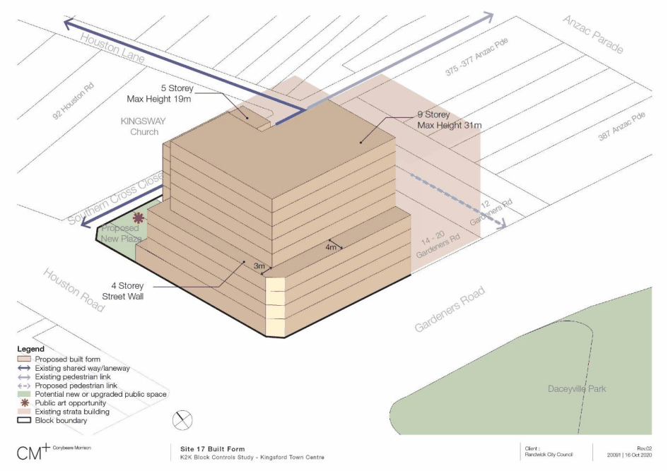

> [Picture on page 72: a picture, saved as a picture (images/part-d1-kensington-and-kingsford-page-72-4.gif, 150 dpi).]

Block 18 Figure 27a: Block 18

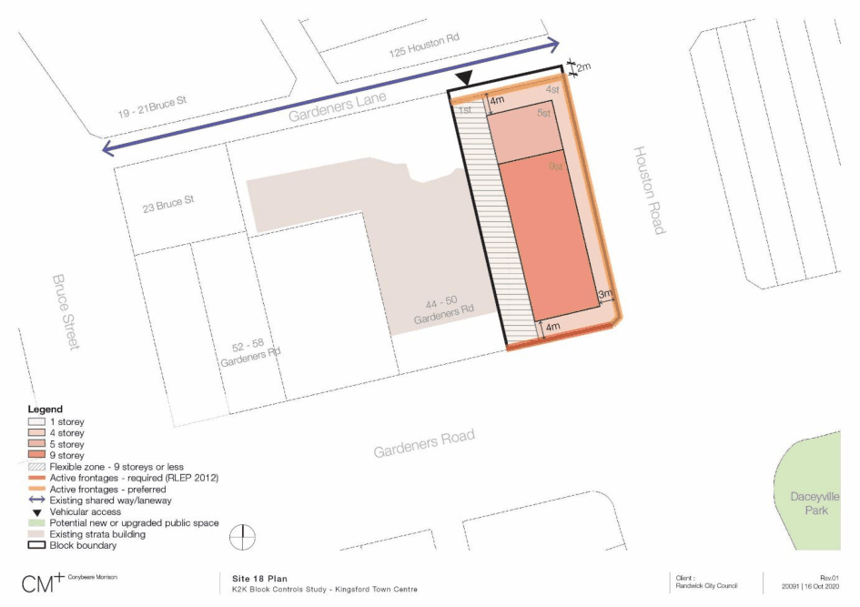

> [Picture on page 73: a picture, saved as a picture (images/part-d1-kensington-and-kingsford-page-73-3.gif, 150 dpi).]

Desired future character The block is bounded by Gardeners Road and Houston Road, directly opposite Dacey Gardens. The preferred option for the block is a high quality compact mixed use development that addresses the corner location and responds sensitively to the views, setting and curtilage of Dacey Gardens. Heights are to be distributed across the site with a higher form on the corner scaled down to enable a scale transition to development to the north. Upper level setbacks will help reduce the visual bulk and scale of development and facilitate visual separation from Dacey Gardens. A 4m upper level setback is too be provided along Gardeners Road and a 3m upper level setback is to be provided off Houston Road. A flexible zone is provided on the western side of the block to enable built form to be suitably distributed and ensure separation and solar access to the adjoining development at 44-50 Gardeners Road. The interface between this block and the adjoining development at 44-50 Gardeners Road should be carefully designed. New development is to be of civic scale with strong vertical articulation and fine grain. Active frontages along Gardeners Road, Houston Road and Gardeners Lane that support a variety of non-residential uses would contribute to the commercial character of the town centre. A nil setback is to be provided along Gardeners Road and a 2m building setback is to be provided off Gardeners Lane. Vehicular access is to be provided off Gardeners Lane.

Figure 27b: Block 18

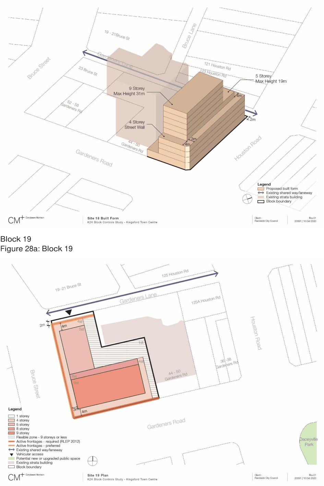

> [Picture on page 74: a picture, saved as a picture (images/part-d1-kensington-and-kingsford-page-74-2.gif, 150 dpi).]

Block 19 Figure 28a: Block 19

Desired future character The block has a corner L-shape form bounded by Gardeners Road, Bruce Street and Gardeners lane, currently occupied by a petrol service station and associated buildings. The preferred development outcome for the block is a building oriented towards Gardeners Road stepping down to 5 storeys and 4 storeys along Bruce Street to minimise visual bulk and scale and to optimise solar access to the development.  The corner site has three street frontages, with two driveways on Gardeners Road, a single driveway onto Bruce Street and driveway access at the rear off Gardeners Lane. The site adjoins 1-2 storey scale residential development in Bruce Street and a part 7, part 12 storey residential flat building at 44-50 Gardeners Road with ground floor business uses. The interface between this block and the adjoining development at 44-50 Gardeners Road should be carefully designed and resolved to coordinate with existing window openings to ensure adequate amenity and separation is achieved. A flexible zone is included on the eastern side to enable built form to be distributed across the site and suitable design response for this irregular site. New development is to have a strong corner presence with a nil setback to Gardeners Road. A 4 storey street wall is to address the key street frontages, with a 4m upper level setback. New development fronting the lane is to have a 4 storey scale, stepping up to 5 storeys.  Vehicular access is to be provided off Gardeners Lane. New development is to be of civic scale with strong vertical articulation and fine grain. Active frontages along Gardeners Road, Bruce Street and Gardeners Lane are to support a variety of non-residential uses and contribute to the commercial character of the town centre. A 2m building setback off Gardeners Lane is required. New development is also to respond sensitively to the Daceyville heritage conservation area located opposite.

Figure 28b: Block 19

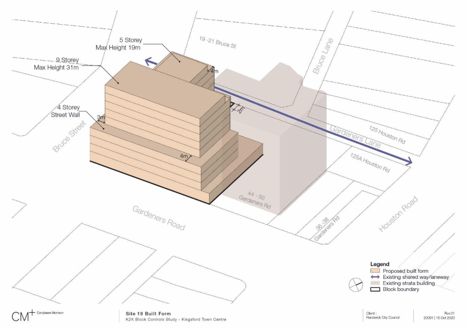

> [Picture on page 75: a picture, saved as a picture (images/part-d1-kensington-and-kingsford-page-75-25.gif, 150 dpi).]

Block 19A Figure 29a: Block 19a

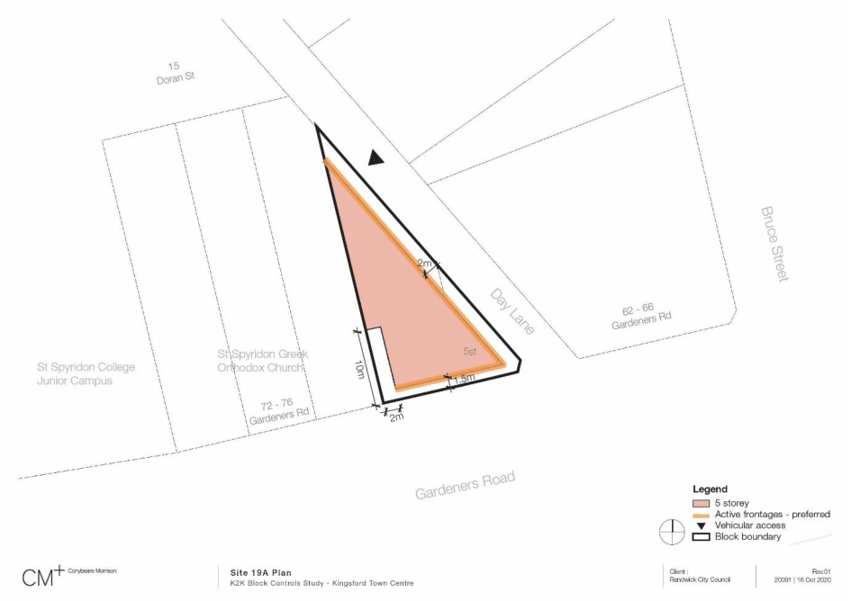

> [Picture on page 76: a picture, saved as a picture (images/part-d1-kensington-and-kingsford-page-76-3.gif, 150 dpi).]

Desired future character This triangular shaped block is located on the corner of Day Lane and Gardeners Road currently occupied by two single storey retail uses, built to the street boundary. This tight block adjoins the large scale Greek orthodox Church of St Spyridon completed in 1975 which is listed as a heritage item in RLEP 2012. New development is to maintain views of the twin towers of the Church building. Building setbacks of 2m off Day Lane are to provide safe pedestrian movements and vehicular access to the building. A 1.5m building setback off Anzac Parade is required to improve the amenity of the public domain and pedestrian movements to and from the Church site. A maximum five storey height is appropriate for the block given its location next to a heritage item and the tight nature of the site. New development is to provide a 4 storey street wall along Gardeners Road with ground floor active retail frontages wrapping around the Day Lane frontage. Vehicular access is to be provided from Day Lane. A 2m setback on the western boundary with the Church (for the front 10m of the building) is to be sensitively designed to integrate with the forecourt of the Church. The design should have a strong corner presence.

Figure 29b: Block 19a

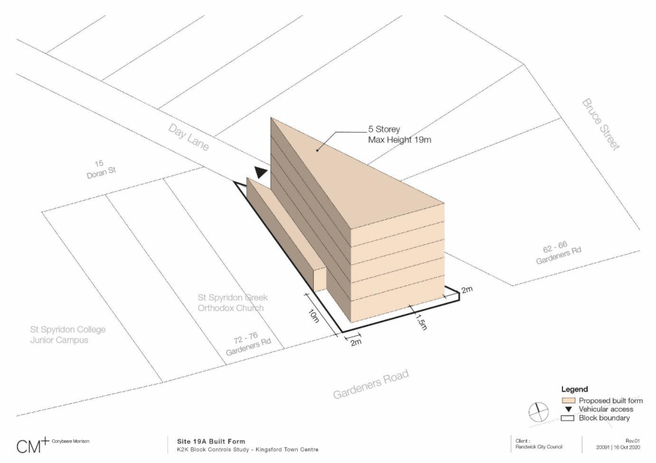

> [Picture on page 77: a picture, saved as a picture (images/part-d1-kensington-and-kingsford-page-77-2.gif, 150 dpi).]

### Kensington town centre

Block 20 Figure 30a: Block 20

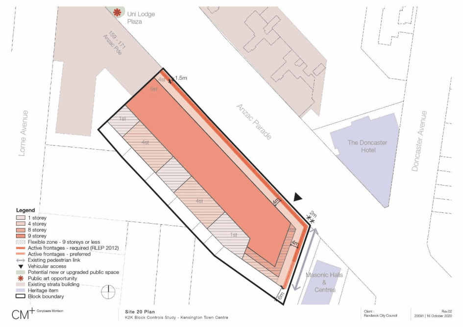

> [Picture on page 78: a picture, saved as a picture (images/part-d1-kensington-and-kingsford-page-78-4.gif, 150 dpi).]

Desired future character The block occupies a prominent location at the southern end of Kensington Town Centre along the curve of Anzac Parade. It is sited immediately south of the Uni Lodge student housing development and across the road from heritage listed Doncaster Hotel. The block is presently occupied by 1- 3 storey development including residential flat buildings, a boarding house, dual occupancy and commercial buildings.  The heritage listed Masonic Hall lies immediately south of the block on the other side of a pedestrian laneway. The site enjoys excellent accessibility to the University of New South Wales which is in close walkable proximity. Site amalgamation will achieve a 9-storey building envelope, set back 1.5m from Anzac Parade with an upper level setback of 4m. A flexible zone is included on the western side to enable built form to be suitably distributed across the site whilst achieving ADG requirements for building separation. A four storey street wall to Anzac Parade wrapping around the southern boundary to the lane will provide a civic scale/human scale and contribute towards a cohesive Anzac Parade streetscape. Building height is to be stepped down at the rear in conjunction a generous setback to facilitate an appropriate separation (at least 6m) and scale transition to surrounding residential neighbourhoods to the south west. A 2m building setback is to be provided off the pedestrian lane. New development is expected to achieve a distinctive built form that recognises the importance of the road curvature to the streetscape of Kensington town centre and which marks the termination of the important vista south along Anzac Parade. Vehicular access may be provided from the existing driveway off Anzac Parade subject to RMS/NSW Transport approval. The new built form is to scale proportionally to the Uni Lodge development to the north and provide

appropriate articulation and modulation to enhance visual and environmental amenity. Ground floor activation on Anzac Parade will accommodate a variety of commercial, retail, office and creative uses.

Figure 30b: Block 20

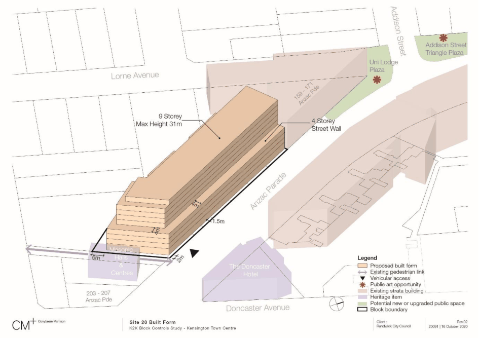

> [Picture on page 79: a picture, saved as a picture (images/part-d1-kensington-and-kingsford-page-79-5.gif, 150 dpi).]

Block 21 Figure 31a: Block 21

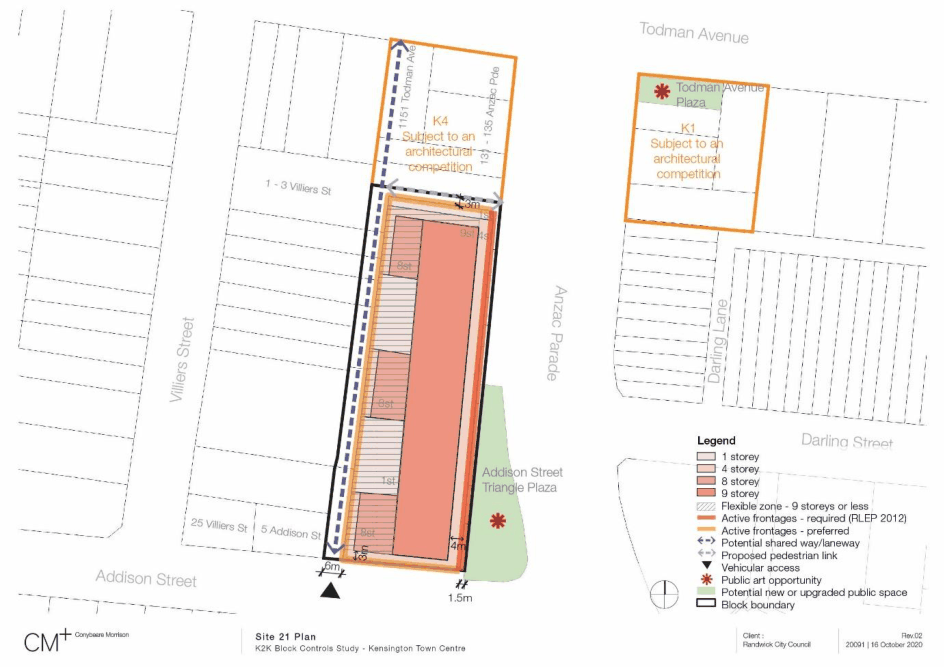

> [Picture on page 80: a picture, saved as a picture (images/part-d1-kensington-and-kingsford-page-80-3.gif, 150 dpi).]

Desired future character Block 21 is straddled between 131-135 Anzac Parade (Todman Square K4 strategic node site) to the north and Addison Road to the south. The block is presently occupied by a variety of building typologies including 3-4 storey strata titled residential flat buildings, and 2 storey commercial tenancies. Addison on Anzac is a 5 storey motel that currently dominates the streetscape with lift overruns and other roof top structures highly visible on the roof. The corner of Addison Street and Anzac Parade features a small Council owned carpark with a landscaped street edge. The site follows the curvature of Anzac Parade and will benefit from a new public space proposed at the south-eastern corner (Addison Street Triangle Plaza). Redevelopment of the block will reinforce a 9 storey cohesive built form outcome envisaged for the town centre with a four storey street wall providing a civic scale to both Anzac Parade and Addison Street. A flexible zone is included on the western side to enable built form to be suitably distributed across the site whilst achieving ADG requirements for building separation to the residential areas and minimising amenity, bulk and scale impacts. An increased upper level setback is to be provided above the 4 storey podium on the southern elevation to reduce potential overshadowing of the Uni Lodge Plaza which lies across the road at the corner of Lorne Ave and Addison St. A 3m building setback to the northern boundary will help achieve built form separation to 131-135 Anzac Parade including a proposed pedestrian link on that site. Ground floor active frontages are required around the entire perimeter of the building. A share way/laneway is to be provided at the rear of the site which will facilitate a direct connection from Todman Ave to Addison St once the K4 site is developed. Vehicular access is to be provided for the block off Addison Street from the proposed shared way.

Figure 31b: Block 21

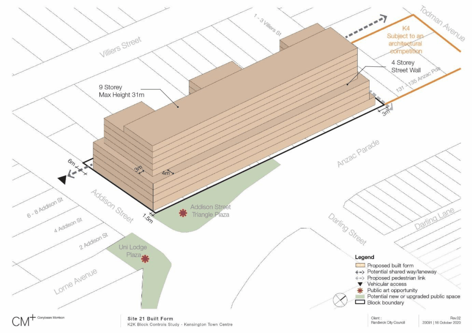

> [Picture on page 81: a picture, saved as a picture (images/part-d1-kensington-and-kingsford-page-81-2.gif, 150 dpi).]

Blocks 22 and 23

Note Refer to Strategic Node Site: Todman Square Precinct Block Diagrams

Block 24 Figure 32a: Block 24

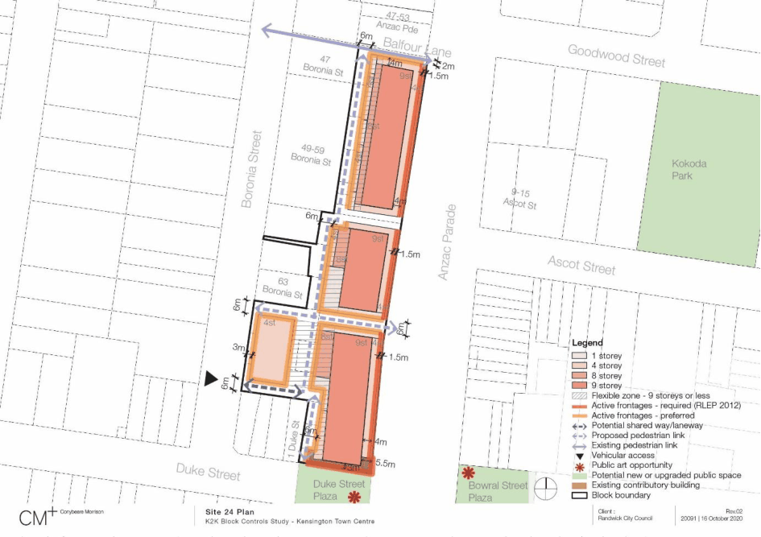

> [Picture on page 82: a picture, saved as a picture (images/part-d1-kensington-and-kingsford-page-82-3.gif, 150 dpi).]

Desired future character The block is bounded by Duke Street, Anzac Parade and Balfour Lane which is a narrow pedestrian link connecting Anzac Parade with Balfour Street. It is presently occupied by Peters of Kensington retail store which extends across a large section of the block, a strip of 2 storey commercial shopfronts and a contributory building at the corner of Duke Street and Anzac Parade. Duke Street Plaza lies immediately south of the block.  The block directly abuts a row of residential development to the rear on Boronia Street with no separation between the B2 zoned town centre and the residential area to the west.  Four dwelling houses are situated on the south west of the site along Duke Street. Redevelopment of the site is expected to achieve three distinctive built forms.  Well-articulated buildings fronting Anzac Parade will have a 9 storey envelope and 4 storey street wall to create a human scale pedestrian environment consistent with the rest of Kensington town centre. A minimum setback of 1.5m is to be achieved to Anzac Parade to provide for wider footpaths and improve pedestrian amenity. A 2m setback is to be provided from Balfour Lane to enhance the pedestrian environment and activate the public space. A stand alone building of 4 storeys is to be located towards the south-western corner of the block fronting Boronia Street, with generous setbacks to minimise visual bulk and provide a transition to surrounding residential areas, particularly the four residential dwellings along Duke Street. A flexible zone is provided along the western part of the block to enable built form to be suitably distributed across the site allowing the design to address building layout, servicing, connectivity and scale transition. An east-west pedestrian connection is to be provided from Boronia Street to Anzac Parade, adjoining the northern side of the 4 storey built form. Given topographical challenges, vehicular access to the middle and northern built form may be

provided from either existing driveway access from Anzac Parade subject to RMS/TfNSW or resolved as part of future site redevelopment of the block. A 4m upper level setback must be provided above the podium fronting the mid-block link and Balfour Lane to reduce the visual bulk and scale of development. The contributory building at the corner of Duke and Anzac Parade will help define the corner location and create the opportunity for visual connections between Duke Street and Anzac Parade. A 5.5m (Anzac Parade) and 3m (Duke Street) upper level setback is to be provided at the contributory building to retain the elevation, roof form and overall modelling of the historic built form. Anzac Parade and Balfour Lane must present active ground floor street frontages to provide greater engagement with pedestrian and street life. Active frontages are also to be provided to western side of buildings to encourage connectivity and access from Boronia Street to Anzac Parade.

Figure 32b: Block 24

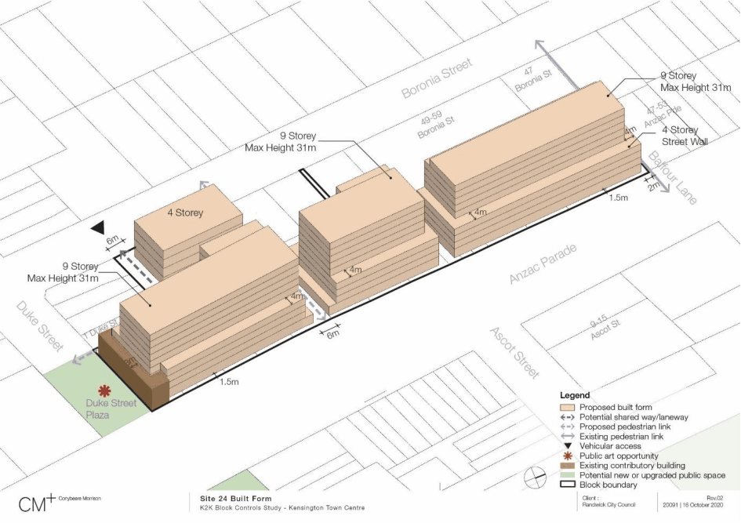

> [Picture on page 83: a picture, saved as a picture (images/part-d1-kensington-and-kingsford-page-83-15.gif, 150 dpi).]

Block 25 Figure 33a: Block 25

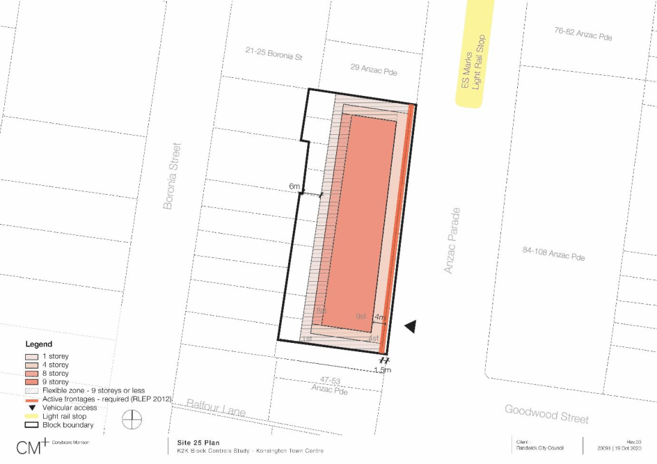

> [Picture on page 84: a picture, saved as a picture (images/part-d1-kensington-and-kingsford-page-84-3.gif, 150 dpi).]

Desired future character Block 25 is situated between 47-53 Anzac Parade and 29 Anzac Parade at the northern boundary of the Kensington town centre. The block presently contains a 4 storey residential flat building and a row of single dwelling houses located in an elevated position on the north-western edge of the town centre. Redevelopment of the block into a mixed use development will enable the revitalisation of the northern fringe of Kensington town centre and reinforce it as a destination for retail, employment and apartment living. Upper level setbacks of 4m to Anzac Parade would help reduce visual bulk and provide for a cohesive streetscape and human scale along Anzac Parade. A transition in scale is required from Anzac Parade to lower scale residential buildings on the periphery by stepping down from 9 storeys to 8 storeys at the rear. A flexible zone is provided on the western edge to enable suitable distribution of floor space across the site whilst ensuring required separation from adjoining residential development and compliance with the ADG. Active frontages are required along Anzac Parade to provide for continuous business or retail uses that open directly onto the footpath. Given significant topographical changes between Anzac Parade and Boronia Street, vehicular access may be provided from Anzac Parade subject to approval from TfNSW and RMS.

Figure 33b: Block 25

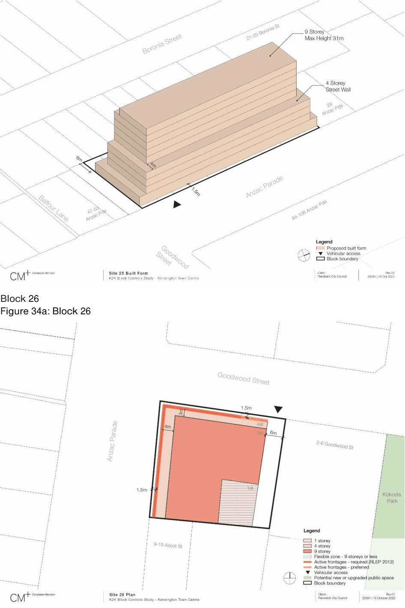

> [Picture on page 85: a picture, saved as a picture (images/part-d1-kensington-and-kingsford-page-85-2.gif, 150 dpi).]

Block 26 Figure 34a: Block 26

Desired future character Block 26 is a compact site presently occupied by a petrol station at the corner of Goodwood Street and Anzac Parade at the northern boundary of the Kensington town centre. Immediately south at 9-15 Anzac Parade is a recently constructed mixed use development with some balconies overlooking the south eastern boundary of the subject site. To the east is a recently constructed mixed residential building with ground floor commercial at 2-6 Goodwood Street which adjoins Kokoda Park. Redevelopment of Block 26 should emphasise its corner location and be well presented to both the Anzac Parade and Goodwood Street frontages. A 9 storey built form stepping down on the south eastern corner of the block would allow adequate solar access to the north facing balconies of 9-15 Anzac Parade. A 4m upper level setback is to be provided along Anzac Parade and a 3m upper level setback is to be provided along Goodwood Street. Future development is to provide for a strong corner treatment of the façade. Vehicular access is to be provided via Goodwood Street on the eastern side of the block adjacent which will also create separation from 2-6 Goodwood Street.  Future development should complement and transition to adjoining recently constructed development. A flexible zone is included on the southern side to enable the built form to be suitably distributed across the site whilst ensuring compliance with ADG separation and amenity to the adjoining mixed use developments. A 1.5m setback is to be provided along the Anzac Parade and Goodwood Street frontages. Active frontages are to be provided along Anzac Parade and Goodwood Street to contribute to street vitality and pedestrian interest within the town centre.

Figure 34b: Block 26

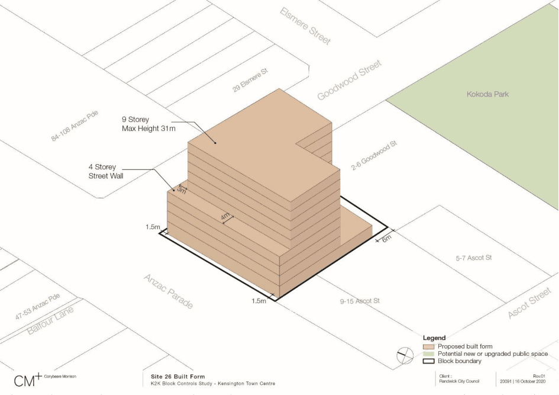

> [Picture on page 86: a picture, saved as a picture (images/part-d1-kensington-and-kingsford-page-86-23.gif, 150 dpi).]

Block 27 Figure 35a: Block 27

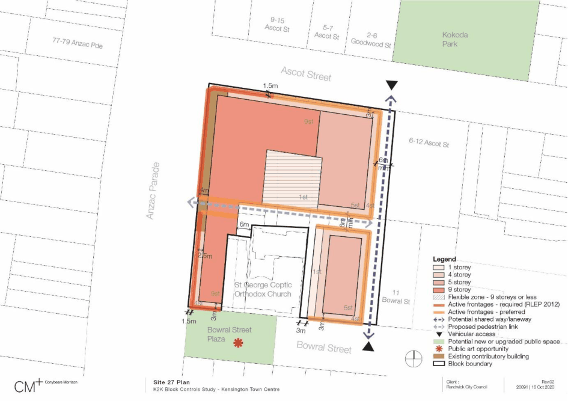

> [Picture on page 87: a picture, saved as a picture (images/part-d1-kensington-and-kingsford-page-87-3.gif, 150 dpi).]

Desired future character The Block is bounded by Ascot Street to the North, Anzac Parade to the East and Bowral Street to the south. It comprises a row of 2 storey interwar period contributory shop fronts which make up much of the Anzac Parade frontage. On the Bowral Street frontage lies a stand-alone Victorian style dwelling house (7 Bowral Street) and the St George Coptic Orthodox Church. The block provides the opportunity for distinctive urban design outcome that integrates historic fabric with contemporary design particularly on the Anzac Parade frontage. Built form is to respond to the existing siting, scale, form and character of the contributory buildings along Anzac Parade, the Church site and surrounding residential areas. Height will be distributed across the block having regard to orientation, overshadowing, and privacy of the site and adjoining properties. A statement building at the junction of Ascot Street and Anzac Parade will emphasise the corner location. Buildings on the east and south of the corner will be lower in height to optimise solar access, allow view corridors to the contributory buildings and facilitate a scale transition to the Church and surrounding residential buildings to the east. A flexible zone is incorporated within the block to enable future built form to be suitably spread across the site whilst ensuring low scale development to the north of the Church site. A 1.5m building setback with active frontages is to be provided along Ascot Street. A sensitive response to the row of contributory shopfront buildings is required including a generous upper level setback to ensure that historic building form, articulation, and detailing is

retained and interpreted in the overall design scheme. Development should facilitate visual connections with the Chapel at the rear of the Coptic Church. Permeability of the block structure is to be achieved via a generous pedestrian links presenting an active pedestrian focused frontage. A new public plaza at Bowral Street will contribute to the network of public spaces throughout the Kensington Town Centre. Active street frontages are also required along Anzac Parade, Bowral and Ascot Streets to increase the vibrancy of the overall precinct.

Figure 35b: Block 27

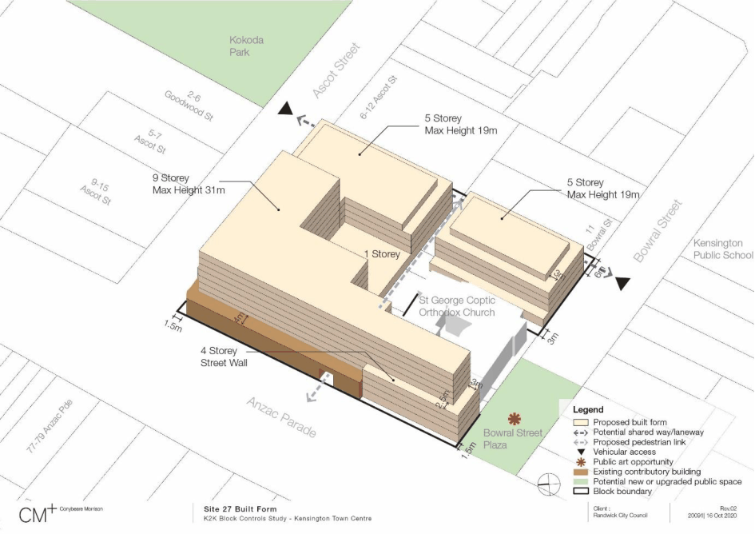

> [Picture on page 88: a picture, saved as a picture (images/part-d1-kensington-and-kingsford-page-88-9.gif, 150 dpi).]

Blocks 28B and 28C Figure 36a: Block 28B and 28C

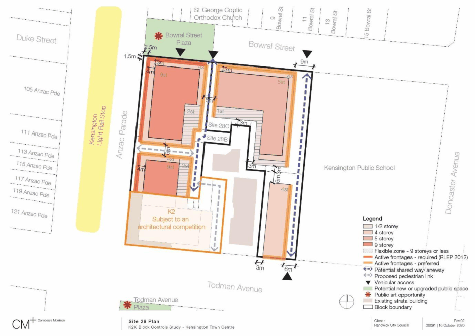

> [Picture on page 89: a picture, saved as a picture (images/part-d1-kensington-and-kingsford-page-89-3.gif, 150 dpi).]

Desired future character Block 28B is located at the corner of Bowral Street and Anzac Parade south of the proposed Bowral Street Plaza and immediately west of Block 28C. Existing development within Block 28B includes 2 storey commercial development along Anzac Parade. The south- western corner of the block at the corner of Todman Ave and Anzac Parade is the K2 site which forms part of the Todman Square Precinct (see Todman Square Precinct block controls which is subject to a design competition). Block 28B provides the opportunity for two distinct built forms that address Bowral Street and Anzac Parade.  Future built form is to interrelate and enhance the proposed Bowral Street Plaza through strong visual and physical connections, generous setbacks and active frontages. Future plaza design will resolve competing demands of outdoor dining and pedestrian movements in this location. A 2.5m building setback is to be provided along Anzac parade and 1.5m setback is to be provided off Bowral Street. The built form will remain cohesive with the rest of the town centre, with a strong visual relationship established in form and facade to the taller tower at the K2 site. A mid-block link will increase site permeability and provide pedestrian connections from Anzac Parade and Bowral Street Plaza. The link is to be suitably landscaped with mature trees and footpath verges incorporating water sensitive urban design. An upper floor setback above the podium will help reduce visual bulk while enabling solar access to the pedestrian link.   A flexible zone is included on the southern and eastern sides to enable the built form to be suitably distributed across the site whilst ensuring compliance with ADG separation and amenity to the adjoining developments. Vehicular access is to be provided from Bowral Street and Todman Avenue.

Block 28C lies to the east of Block 28B, with its eastern edge abutting the Kensington Public School. The block presently contains a row of single dwelling houses and semis, the majority from the late Victorian period. Redevelopment of this block will achieve two building envelopes that are scaled down to transition between the higher building forms on Block 28B and the Kensington Public School. Building separation and setbacks are to be embedded into the overall block design to facilitate solar access and manage privacy. A minimum 9m side setback is to be provided between the built form fronting Bowral Street and the Kensington Public School to minimise potential overshadowing and overlooking into the school grounds. Tree planting and landscaping along the eastern boundary adjoining the Kensington Public School will further enhance privacy to the School playground spaces. A shared way will be established on the eastern edge of the block to connect Todman Avenue and Bowral Street at the north, while also providing for vehicle access. Active frontages along Bowral Street and Todman Avenue are required to facilitate engagement between ground floor businesses and street life.

Figure 36a: Block 28B and 28C

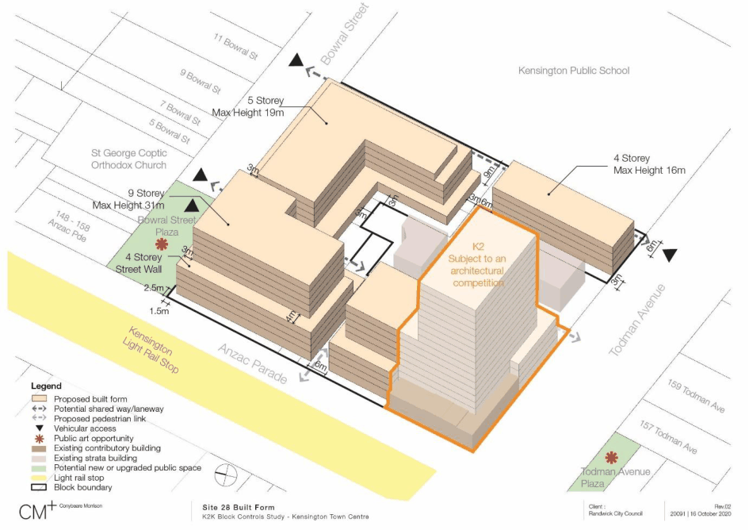

> [Picture on page 90: a picture, saved as a picture (images/part-d1-kensington-and-kingsford-page-90-17.gif, 150 dpi).]

Block 29

Note See Todman square precinct provisions

Block 30 Figure 37a: Block 30

> [Picture on page 91: a picture, saved as a picture (images/part-d1-kensington-and-kingsford-page-91-3.gif, 150 dpi).]

Desired future character The block lies between Darling Street, Anzac Parade and Darling Lane, south of the K1 site which forms part of the Todman Square Precinct (see Todman Square Precinct block controls which is subject to a design competition). Contributory buildings are located at the corner of Darling Street and Anzac Parade. The Block provides the opportunity to integrate the contributory buildings within a contemporary setting, with a 5.5m upper level setback allowing the historic form and articulation to be retained. A flexible zone is included on the western side to enable the built form to be suitably distributed across the site whilst ensuring compliance with ADG separation and amenity to the adjoining mixed use developments. New development will provide the opportunity to widen and activate Darling Lane by requiring buildings to be set back off the lane. A public pedestrian and visual through-link will provide connections between Darling Street and Anzac Parade, as well as separation to the taller built form elements on the K1 site to the north. The proposed east-west pedestrian link will also provide connection to Todman Avenue along the eastern side of the K1 site.

Figure 37b: Block 30

> [Picture on page 92: a picture, saved as a picture (images/part-d1-kensington-and-kingsford-page-92-2.gif, 150 dpi).]

Block 31 Figure 38a: Block 31

Desired future character The block presently contains a small cluster of 2 storey shop fronts located immediately to the south east of the Masonic Hall and across the road from the Doncaster Hotel. The block occupies a prominent corner location. The preferred option is a 6 storey built form to provide a scale transition with the heritage listed Masonic Hall and the 4 storey residential flat building to the south (113 Doncaster Ave). Future development is to incorporate a distinctive built form that highlights the corner location, marks the southern boundary of the town centre and is sympathetic to adjoining and opposite heritage listed properties. A 3m setback above the first floor is required to provide adequate separation with the Masonic Hall as well as the residential flat building. A 4 storey street wall together with a 1.5m building setback along Anzac Parade will contribute to the cohesiveness of the public realm. A 3m setback is required on the southern edge to ensure a future building minimises impacts on the adjoining residential development. A 4m upper level setback is required along Anzac Parade to maintain view lines to the masonic Hall and ensure a cohesive streetscape. Active frontages along the Anzac Parade and Doncaster Ave will provide visual interest for pedestrians and contribute to liveliness within the Kensington town centre.

Figure 38b: Block 31

> [Picture on page 93: a picture, saved as a picture (images/part-d1-kensington-and-kingsford-page-93-19.gif, 150 dpi).]

### PART C
