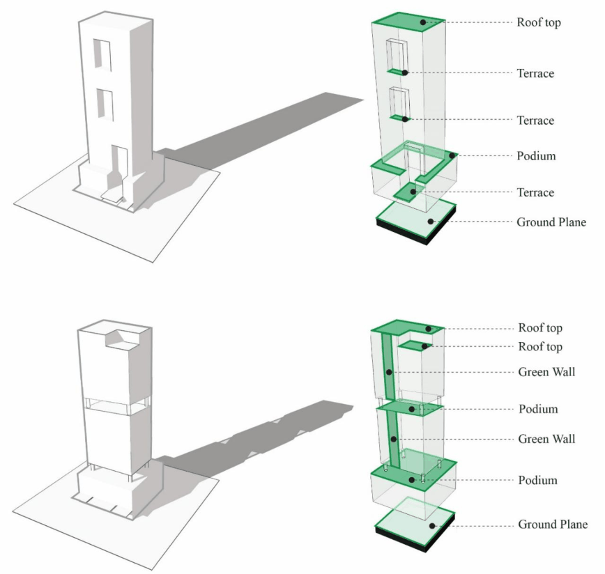

## 20. Landscaped area

### 20.1. Explanation

High quality landscaping and the creation of a green boulevard along Anzac Parade is a key outcome of the K2K Strategy. Well-designed landscaping of open spaces and buildings can contribute significantly to our quality of life and overall well-being. It can also help reduce the heat-island effect, maintain a comfortable winter environment and reduce stormwater run-off. Beautifully designed landscaping that is integrated into a development during the design-stage will have long-lasting benefits to its occupants and the wider precinct, by encouraging people to visit an area and to stay longer. Refer to Part C2 - ‘Medium Density Residential’ and B4 - Landscaping and biodiversity of this DCP for further explanation of landscaped area requirements.

Objectives The objectives for landscaping are to:

1\. Enhance the quality of life and attractiveness of the town centres by providing landscaped spaces for relief and social connection

2\. Ensure that high-quality, long-lasting landscaping is provided throughout a site both vertically and horizontally

3\. Bring about environmental benefits such as mitigating the urban island heat effect, reducing flooding impacts and improving the air quality.

Controls

a) The total gross landscaped area to be provided on a site is to be at least 100% of the total site area, spread throughout the site and building as shown in Figure 16.

b) Landscaped open space requirements of Part C2 (Medium Density Residential) do not apply to land within the Kingsford and Kensington Town Centres other than clauses relating to deep soil areas and private and communal open space

c) Landscaping must be suitable to the building orientation aspect, wind and other relevant environmental factors

d) A minimum of 40% of the total gross landscaped area including communal open space is to include areas with sufficient soil depth and structure to accommodate mature trees and planting.  A combination of trees, shrubs and ground cover is encouraged to make the landscaping more attractive and long lasting

e) A minimum of 25% of the ground plane and share-ways are to be landscaped sufficient in size and dimensions to accommodate trees and significant planting

f) Green walls can only contribute up to 20% of the total gross landscaped area and will be assessed on the merits of the proposal in terms of quality of green infrastructure and verification from a qualified landscape architect

g) Roof tops can only contribute up to 30% of the total gross landscape area and the area is to be designed to maximise visibility of planting from the public domain. Rooftops may include communal food farms and food production areas

h) Technical, structural and ongoing maintenance arrangements of proposed roof top gardens and green walls are to be documented by a qualified landscape architect and incorporated into the development proposal

i) The area dedicated to roof top solar (PV infrastructure) is not to be counted as part of the total gross landscape area

j) Where green roofs and green walls are provided, these shall comply with requirements contained in Part B4 of the Randwick DCP

k) Despite the provision of a green wall, all facades are to meet design excellence requirements including building articulation and modulation specified in Section 16 of this DCP.

l) In addition to the requirements of Part B4 of the Randwick DCP all DAs for sites within the Kensington and Kingsford town centres must submit a landscape plan prepared by a registered architect or landscape architect addressing the following requirements:

i. quantity of landscaping provided on site

ii. scaled drawings of all areas

iii. how landscaping would complement the architectural style of building and assists in its presentation to the streetscape and high visibility

iv. rainwater harvesting and other irrigation methods proposed

v. full construction details of soil profile, method of attachment to the building, and drainage/waterproofing

vi. engineering certification confirming building can withstand planting and associated structures.

Definition Ground plane refers to spaces between buildings on the ground level providing for landscaping, pedestrian access and physical connections to the street.

Definition Gross Landscape Area refers to the sum of all landscaped areas within a development and may include (but is not limited to) ground plane, gardens, outdoor terraces, planter boxes, sky gardens, roof terraces, and green walls.

Figure 39: Landscaped area components

> [Picture on page 109: a picture, saved as a picture (images/part-d1-kensington-and-kingsford-page-109-21.gif, 150 dpi).]
