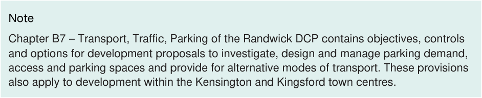

## 21. Transport, traffic, parking & access

### 21.1. Explanation

The Planning Strategy for Kensington and Kingsford has a strategic goal of increasing sustainable transport use, including walking, cycling, the use of public transport and car sharing initiatives.  An increase in sustainable transport use would decrease reliance on private vehicles, improve health and well-being outcomes and importantly reduce environmental impacts associated with greenhouse emissions and congestion. Kensington and Kingsford town centres are both well connected by the City to South East Light Rail, bus, road and cycle networks. New development can support and encourage sustainable transport through reduced parking requirements, provision of car share, bicycle and end of trip facilities as well as developing travel plans.

> [Picture on page 110: a picture, saved as a picture (images/part-d1-kensington-and-kingsford-page-110-12.gif, 150 dpi).]

Note Chapter B7 – Transport, Traffic, Parking of the Randwick DCP contains objectives, controls and options for development proposals to investigate, design and manage parking demand, access and parking spaces and provide for alternative modes of transport. These provisions also apply to development within the Kensington and Kingsford town centres.
