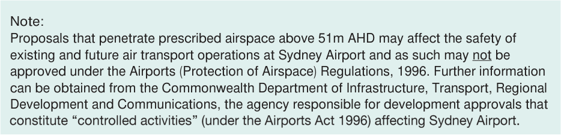

## 24. Aircraft operations

### 24.1. Explanation

The proximity of Sydney’s Kingsford Smith Airport to the Kensington and Kingsford town centres results in a high frequency of aircraft movements over the area and triggers the need for development to consider aircraft safety. Whilst noise controls are contained in Part C12- Sydney Airport of this DCP, this section relates specifically to the protection of airspace, also referred to as “prescribed airspace” under Commonwealth legislation. Commonwealth approval is required for any proposal within the corridor that exceeds “prescribed airspace”. Development on land within the Kingsford town centre is limited to 51m AHD.

Note: For controls relating to Aircraft operations, please refer to Part C11 – Sydney Airport DCP.

> [Picture on page 114: a picture, saved as a picture (images/part-d1-kensington-and-kingsford-page-114-12.gif, 150 dpi).]
> Words printed on the picture (title and legend, copied from the PDF):
> constitute “controlled activities” (under the Airports Act 1996) affecting Sydney Airport.

Note: Proposals that penetrate prescribed airspace above 51m AHD may affect the safety of existing and future air transport operations at Sydney Airport and as such may not be approved under the Airports (Protection of Airspace) Regulations, 1996. Further information can be obtained from the Commonwealth Department of Infrastructure, Transport, Regional Development and Communications, the agency responsible for development approvals that
