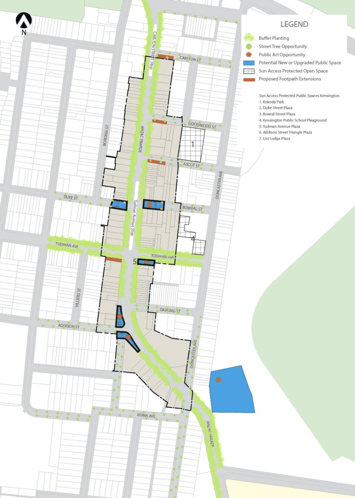
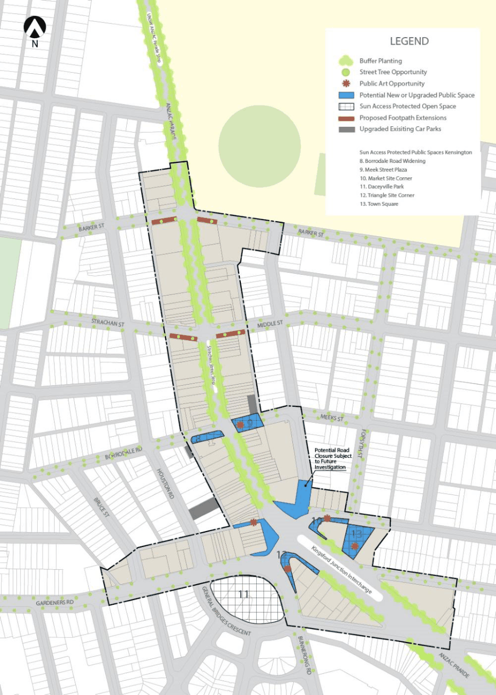

## 26. Solar access - public open space

### 26.1. Explanation

Sun light access is vital for the health and well-being of the community and the health of our ecosystem. As population grows, it is important to ensure the amenity of public places such as parks and plazas are protected and enhanced so that these spaces continue to be attractive and comfortable particularly during winter months. Sun access protection provisions will ensure that new development in the town centres is designed to protect these important public spaces. Objectives The objectives for sun access are to:

1\. Ensure that new development does not unreasonably impact the amenity, environmental quality and enjoyment of public spaces by casting significant overshadowing of public spaces

2\. Ensure that new buildings and substantial alterations to existing buildings do not result in a net loss of solar access to specified public spaces in accordance with the controls in this section.

Controls

a) New buildings and alterations and additions to existing buildings are to be designed to ensure that that the following locations shown on Figures 40a and 40b are not overshadowed by more than 10% in mid-winter (June 22nd) between the hours of 12noon and 2pm:

- Kensington Public School

- Duke St Plaza

- Bowral St Plaza

- Uni Lodge Plaza

- Addison St Plaza

- Kokoda Park

- Todman Ave Plaza

- Meeks St Plaza

- Borrodale Road widening

- Town Square Plaza

- Market Site corner

- Triangle site corner

- Dacey Gardens

b) New buildings and alterations to existing buildings are to retain solar access to a minimum of 50% of the site area of key public places identified in a) and shown on Figures 40a and 40b for a minimum of 3 hours in mid-winter (June 22nd).

Figure 40a: Kensington Public Realm

> [Picture on page 117: a picture, saved as a picture (images/part-d1-kensington-and-kingsford-page-117-2.gif, 150 dpi).]

Figure 40b: Kingsford public realm

> [Picture on page 118: a picture, saved as a picture (images/part-d1-kensington-and-kingsford-page-118-2.gif, 150 dpi).]
