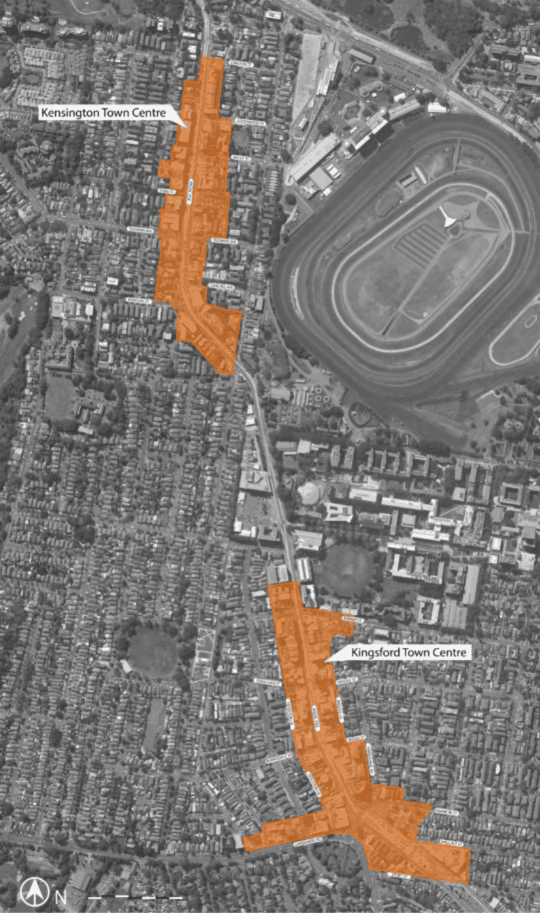

## 29. Affordable housing

### 29.1. Explanation

All new development within the Kensington and Kingsford town centres is required to make a contribution towards affordable housing to cater for a mix of income groups including very low, low and middle income households. This is to be undertaken via an inclusionary zoning approach whereby a percentage of total residential floor space within a development (including student housing) is allocated as affordable housing and dedicated to Council. A cash contribution applies to cover any shortfall where a full affordable housing apartment cannot be provided. Objectives The objectives for affordable housing are to:

1\. Increase the amount of affordable rental housing for very low, low and moderate income households

2\. Encourage housing diversity and choice

3\. Help retain very low, low and middle income households in the local area including key workers and students.

Controls evelopment within the ‘Kensington and Kingsford Town Centres Affordable Housing

a) D Contributions Area’ (Figure 41) must contribute towards the provision of affordable housing based on the rates

outlined on Council’s website

https://www.randwick.nsw.gov.au/planning-and-building/planning-strategies-and-control/planning-contributions-and-agreements

b) Affordable Housing contributions are to be provided in accordance with the Affordable Housing Plan 2019 for the Kensington and Kingsford Town Centres

c) The affordable housing contribution rate is to apply to the total residential floor area component of the development

d) Contributions towards affordable housing are to be provided through a dedication of completed units with any remainder paid as a monetary contribution in accordable with the affordable housing contributions table referred to in clause a).

Figure 41:  Kensington and Kingsford town centres affordable rental housing contributions scheme map

> [Picture on page 122: a picture, saved as a picture (images/part-d1-kensington-and-kingsford-page-122-3.gif, 150 dpi).]
