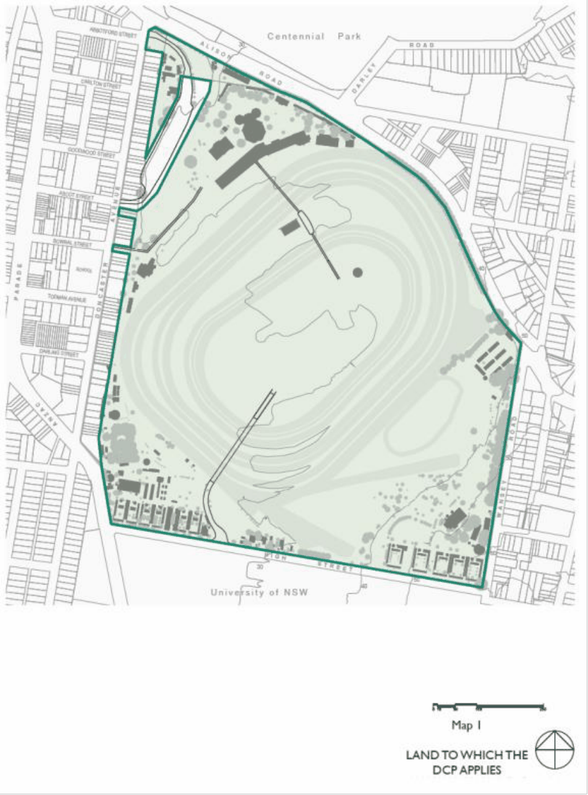

### 1.1. Objectives

1\. Provide planning and design objectives and controls which will optimise:

i. Royal Randwick Racecourse as a thoroughbred racing, training and spectator facility of highest quality

ii. Royal Randwick Racecourse as an economic and tourism destination

iii. The physical, recreational and environmental quality of the racecourse, particularly the site's capacity and the spectator experience while respecting its heritage significance and landscape character

iv. The role of the racecourse within its metropolitan and Randwick City context and its compatibility with adjoining lands

v. The racecourse's role as an open space recreation facility.

Figure 1: Land to which the DCP applies

> [Picture on page 5: a picture, saved as a picture (images/part-d10-royal-randwick-racecourse-page-5-2.gif, 150 dpi).]

Source: Randwick City Council
