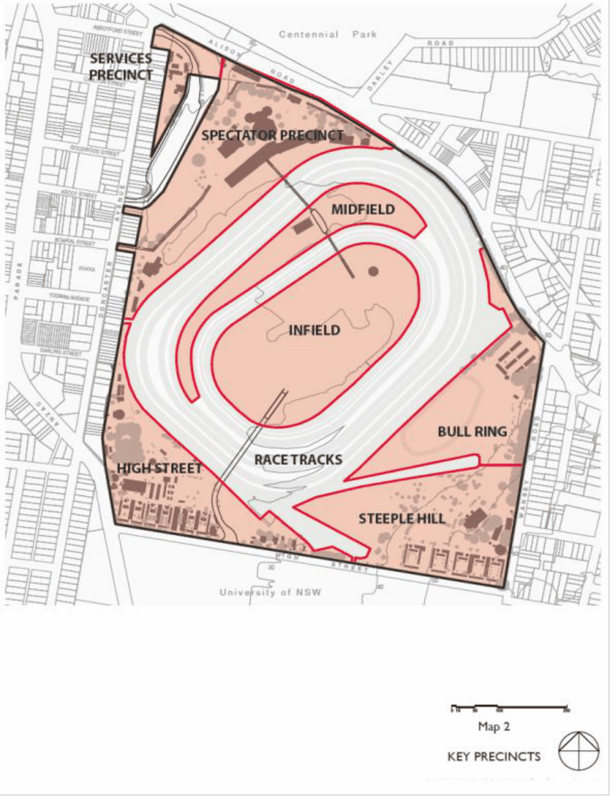

## 3. Development controls for racecourse site

### 3.1. Uses

Objectives The objectives for the racecourses’ uses are to:

1\. Ensure the long term operational and financial viability of the racecourse by improving the thoroughbred racing, training and spectator uses of the site

2\. Promote diversification of uses that are not incompatible with a major racing and entertainment venue and are permissible within the open space zone and parklands context

3\. Ensure that uses are appropriately sited, and are of appropriate character, form and scale, to avoid conflicts with each other and with the surrounding uses

4\. Conserve the heritage significance of the site as a racecourse and associated elements.

Controls

a) The general pattern of land uses across the site as indicated on Figure 2 is to be maintained. In particular:

i. Spectator Precinct: concentration of race day, ATC management and entertainment uses

ii. High Street Precinct: stabling and training

iii. Steeple Hill Precinct: stabling and training

iv. Bull Ring Precinct: stabling and training

v. Race Tracks: racing and training

vi. Infield Precinct: training, car parking, new race day spectator facilities, and irregular non-racing recreation and entertainment

vii. Midfield Precinct: new race day spectator facilities and irregular non-racing recreation and  entertainment

viii. Services Precinct: services and maintenance offices, workshops and parking

Note The services precinct now incorporates the Light Rail Stabling Yard and is no longer included in this DCP.

b) Member, corporate and club facilities are to be expanded and improved within the Spectator Precinct (Refer to Section 4 of this DCP)

c) Opportunities for new recreation and support uses across the site that are not incompatible with thoroughbred racing and stabling are to be allowed

d) The intensity of uses is to be limited by the traffic capacity of surrounding streets as determined as part of a traffic study and the transport strategies devised for the site

e) Modern stabling and training facilities are to be concentrated in the Steeple Hill and Bull Ring Precincts

f) Demonstrate that the amenity of adjacent land uses is to be maintained through the appropriate location and management of facilities and patrons

g) The ATC is to prepare a Plan of Management to deal with anti-social behaviour on the site and within the surrounding neighbourhood. Such a plan, which is to be prepared in

liaison with the NSW Police, licensing authorities, Randwick City Council and Transport for NSW, is to deal with, at least, the responsible service of alcohol, after-race entertainment, crowd management, safety and behaviour. The plan is to be in place prior to the occupation of new facilities within the Spectator Precinct. The Plan shall nominate a key contact to liaise with stakeholders and to respond to complaints relating to disturbance from the public during major events.

Figure 2: Key precincts

> [Picture on page 9: a picture, saved as a picture (images/part-d10-royal-randwick-racecourse-page-9-8.gif, 150 dpi).]

Source: Randwick City Council
