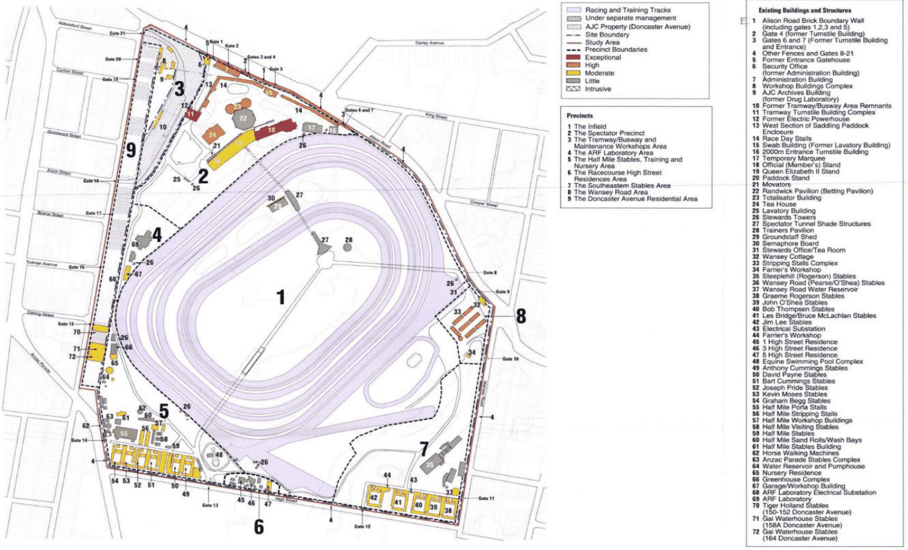
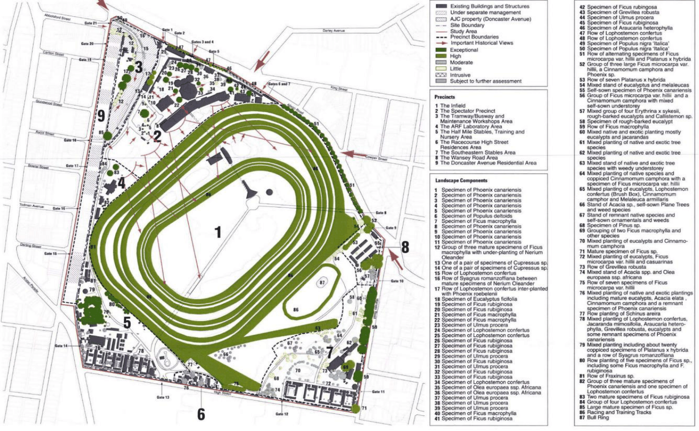

### 3.2. Heritage conservation

Objectives The objectives for heritage conservation are to:

1\. Conserve, manage and interpret the heritage significance of the Racecourse as a place of State heritage significance as set out below:

i. “Metropolitan Sydney's oldest and longest continually operating racecourse. It has unique historic, associative, aesthetic and social links to the development of horseracing in Sydney and New South Wales. It is a unique cultural landscape with landmark qualities and a distinctive architectural composition that reflects a traditional approach to racecourse design and development, serviced by substantial public transport infrastructure ”

2\. Manage built, landscape and archaeological components, historic views and spaces in accordance with their assessed significance

3\. Ensure that new development respects, enhances and contributes to the heritage significance of the site and its setting

4\. Ensure conservation requirements are maintained within the evolving operational activities and facilities of the racecourse and with any proposed development

5\. Proactively manage the cultural landscape of the racecourse

6\. Manage and respect the archaeological values of the site

7\. Actively promote and interpret the heritage values of the site.

Controls

a) Heritage components as identified in Figures 3 and 4 are to be conserved and managed in accordance with the policies in the Conservation Management Plan (CMP), any subsequent Specific Elements Conservation Policies and heritage impact statements, based on their assessed tolerance for change. (See also Section 4.3 in relation to certain heritage components within the Spectator Precinct)

b) Development must be guided by contemporary heritage and design principles including those outlined in the CMP, relevant national, State and local heritage guidelines and the Burra Charter

c) Design responses should demonstrate sensitivity to the site’s context through a Heritage Impact Assessment, contextual and place-based design approaches, and adherence to best practice in documentation, interpretation, and adaptive reuse

d) Conservation principles are to be incorporated into ATC site management and operational practices and in development planning

e) A Landscape Concept Plan is to be developed and implemented for the site

f) Identified and potential Aboriginal sites are to be managed and conserved in accordance with the NSW National Parks and Wildlife Act 1974. Consultation with Aboriginal groups is to be part of developing an understanding of the Aboriginal significance of the site. Such consultation is to occur prior to any major development application on land identified as "high Aboriginal sensitivity" in the vicinity of High Street and Wansey Road (see CMP)

g) An Interpretation Plan for the site is to be developed and implemented prior to any major development. Specific measures to interpret the site are to be incorporated into conservation and development proposals as they arise

h) Adverse impacts on significant built, landscape and archaeological heritage components are to be minimised. The requirements and processes of the Heritage Act apply in relation to archaeology.

Note In addition to the objectives and controls of this Section, all development must comply with Part B2 Heritage of the DCP.

Figure 3: Relative significance of built elements

> [Picture on page 12: a picture, saved as a picture (images/part-d10-royal-randwick-racecourse-page-12-2.gif, 150 dpi).]

Source: Randwick City Council

Figure 4: Relative significance of landscape elements

> [Picture on page 13: a picture, saved as a picture (images/part-d10-royal-randwick-racecourse-page-13-2.gif, 150 dpi).]

Source: Randwick City Council
