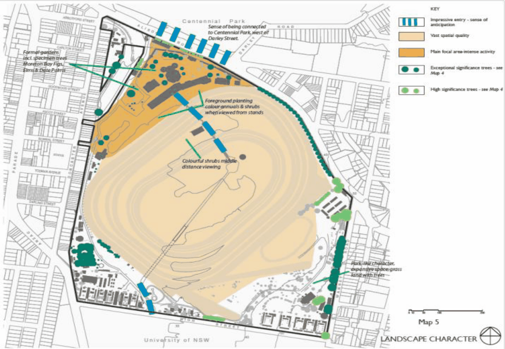
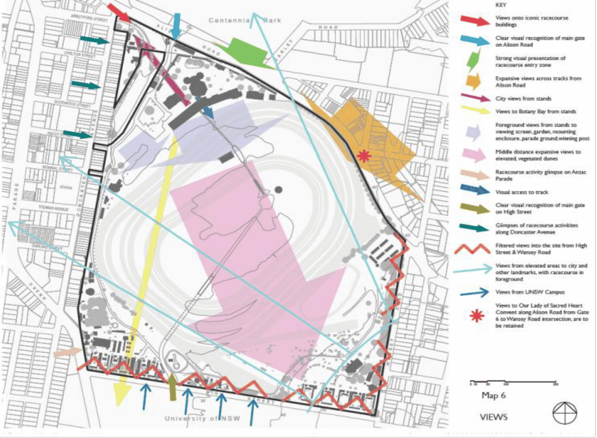

### 3.4. Built form

Objectives The objectives for built form are to:

1\. Continue the existing built form pattern which comprises a concentration of large scale spectator facilities set back from Alison Road and fronting the racetrack, the dominance of the open landscape, and concentrations of smaller freestanding buildings around the rest of the site

2\. Create a built form which serves the needs of the racing industry and which responds to the constraints and opportunities of the site, particularly its heritage significance, landscape characters, drainage requirements, views and vistas, and adjoining public domain

3\. Establish a built form that supports clear arrival points, safe and efficient access and the on-site circulation system, ensuring permeability, legibility, and identity of the racecourse

4\. Integrate new buildings consistent with the siting, form, scale, character, materials and colours of existing heritage components and their setting

5\. Achieve design excellence in new buildings including the principles of Environmentally Sensitive Design (ESD), Crime Prevention through Environmental Design (CPTED) and universal access

6\. Conserve and respond to the heritage value and significance of the racecourse and its significant components.

Controls

a) New development is to comply with the following planning and design guidelines for each precinct.

Spectator Precinct

b) See Section 4 of this DCP for development controls for the Spectator Precinct. Training Areas (High Street, Steeple Hill and Bull Ring Precincts)

c) Buildings are to be set back from street boundaries by sufficient distance to protect major trees along the boundaries within the site

d) Buildings are not to exceed two storeys unless specific functional requirements exist and an urban design precinct plan demonstrates that the height is appropriate in terms of siting, immediate context and avoiding adverse impacts on adjoining development

e) Any new buildings in the Steeple Hill and Bull Ring Precincts are to respect the views and landscape elements identified in Figures 3 to 6

f) Horse stabling and training is to comply with any relevant health and building regulations.

Infield Precinct

g) Permanent buildings are prohibited other than necessary low scale shelters for training, racing, services, entrance structures and the like.

h) The open field area is to be used as the main car park for race days and for irregular recreation and entertainment events.

i) Structures are to optimise sight lines to racing from the grandstands and seating areas in the Spectator Precinct.

Midfield Precinct

j) Permanent buildings are prohibited other than necessary low scale shelters for training, racing, services, entrance structures and the like.

k) New spectator facilities are to be provided as low scale temporary marquees etc or simple service structures.

l) Structures are to optimise sight lines to racing from the grandstands and seating areas in the Spectator Precinct.

m) In conjunction with new spectator facilities, landscaping which enhances the utility of new facilities and implements the storm water strategy (e.g. any required flood paths and compensatory storm water detention structures) is to be provided

n) Building heights are to:

a. Be limited to the height indicated for the relevant precinct,

b. Respond to detailed functional requirements, built form objectives, siting and immediate context, and

c. Avoid adverse impacts on adjoining development.

o) New buildings are to maximise amenity and optimise views of the racecourse and/or Centennial Park. The height and scale of new buildings are to retain significant views to, from, through and within the racecourse

p) Façades and roof forms are to be modulated and articulated to:

a. Add interest to the building when viewed from public places,

b. Reduce apparent bulk,

c. Relate to built or landscape heritage components where appropriate, and

d. Achieve design excellence.

q) Materials, colours and detailing are to be selected to relate to heritage components and their setting where appropriate and provide visual interest when viewed from public places

r) Entry awnings, canopies and balconies are to be incorporated to provide sun and rain protection where appropriate

s) A scale model is to accompany development applications for buildings greater than four storeys (15m).

Figure 5: Activity areas and trees

> [Picture on page 17: a picture, saved as a picture (images/part-d10-royal-randwick-racecourse-page-17-2.gif, 150 dpi).]

Source: Randwick City Council

Figure 6: Randwick racecourse views

> [Picture on page 18: a picture, saved as a picture (images/part-d10-royal-randwick-racecourse-page-18-2.gif, 150 dpi).]

Source: Randwick City Council
