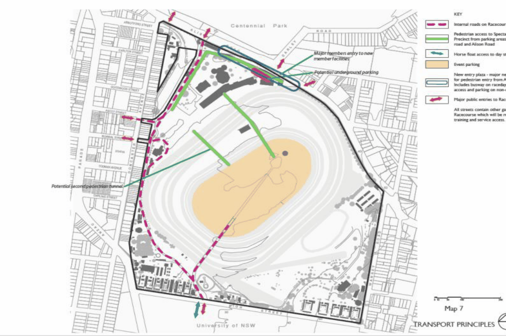
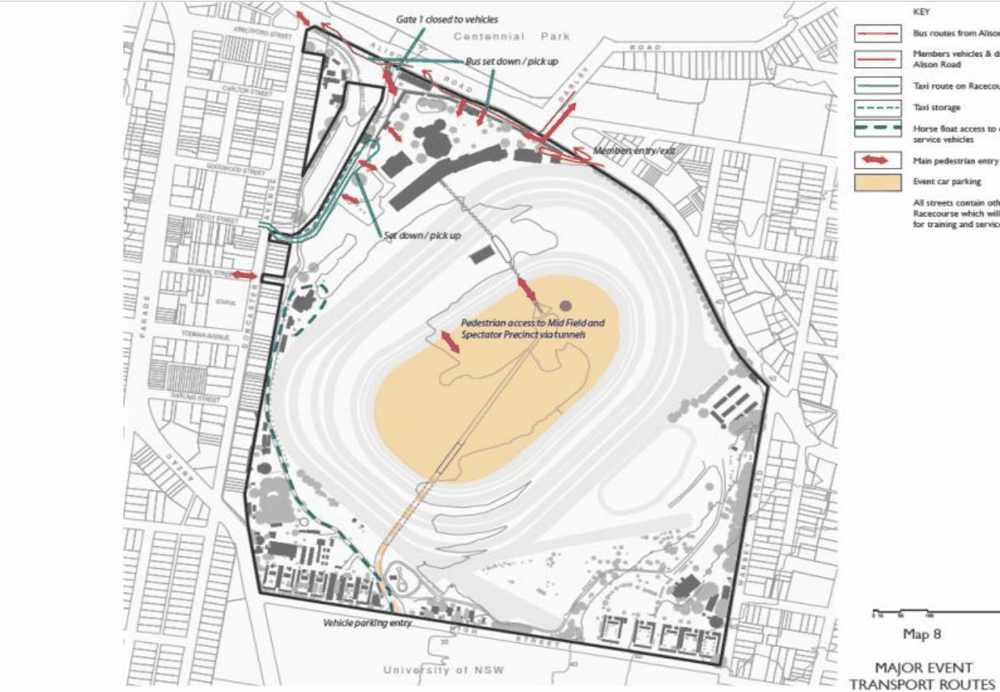

### 3.5. Transport, circulation and parking

Objectives The objectives for transport, circulation and parking are to:

1\. Establish transport management policies, plans and practices which manage the site's transport needs in a manner that is:

i. Consistent with regional and local services and capacities

ii. Promotes non-private vehicular trips to the site

iii. Enables growth of spectator numbers at major events

iv. Caters for the transport needs of other non-racing users of facilities on the site

v. Minimises the impact on surrounding and adjacent streets during construction and major events.

2\. Improve efficiency, capacity, safety and amenity on race days, by separating as much as possible the movement of private vehicles, buses, taxis, pedestrians, service vehicles, horse floats and horses

3\. Establish an on-site movement system which provides for:

i. Efficient operation during normal days and events of varying sizes

ii. Optimum pedestrian movements

iii. Management of public and members

iv. Vehicular access, egress and parking

v. Service vehicles

vi. Disabled access

vii. Safety and security.

4\. Provide designated parking consistent with the site's needs, location and capacity, and Sydney's transport planning policies.

Controls

a) Provide a new internal road with egress onto Doncaster Avenue. This road is to be consistent with the routes detailed on Figures 7 and 8, while minimising impact to the conservation area. It is to incorporate:

i. Provision for vehicles to u-turn in Ascot Street prior to entering ATC owned land by providing a facility such as, but not limited to, a mini roundabout, and

ii. Differentiation of pavement type at the boundary of the public road in Ascot Street and the ATC owned land to highlight the public road boundary.

b) An alternative access/egress may be considered subject to demonstration of its merit in minimising impacts to the surrounding locality

c) Improve the access points on Alison Road, High St, Wansey Rd and Doncaster Ave where necessary in line with their function and Conservation Principles and Policies set out in the Conservation Management Plan

d) On-site parking is to be provided in both formal and informal (temporary) arrangements in locations indicated on Figures 7 and 8

e) Any formal car parking areas are to be designed in accordance with the Australian Standard for Off-Street Car Parking Facilities (AS 2890.1). Car parking areas are to be appropriately landscaped and incorporate permeable treatments where appropriate

f) The relevant Randwick cycle routes are to be provided for and secure bicycle parking and "End of trip facilities" for staff and visitors

g) The ATC, in liaison with Randwick City Council, NSW Police Force and transport service providers is to prepare a Transport Management and Accessibility Plan following NSW Government guidelines for major events at the site. Opportunities to coordinate with the

University of New South Wales to augment transportation management and accessibility shall be explored

h) For travel other than major events, the ATC is to prepare a Transport Access Guide, following NSW Government guidelines, for use by staff and site users to assist in making informed transport choices

i) The ATC shall liaise with Kensington Public School's Administration to minimise traffic impacts along Doncaster Ave for major events within the Racecourse and regarding proposed traffic management measures

j) The ATC shall actively invest in programmes to increase public transport use on race days and, where possible, to encourage drivers to utilise existing on site parking

k) Road areas internal to the site should, where possible, minimise road surface in preference for soft landscaping and road treatments shall be water permeable

l) A Transport Management Plan shall be prepared for the site detailing measures to manage transport into, through and within the site, programmes to increase public transport use on race days (for instance integrated ticketing), encourage drivers to park within designed parking areas within the site and ensure that as part of the operation of heavy diesel-run engine vehicles do not adversely affect local air quality

m) As part of proposed construction, a Works Management Plan shall be prepared ensuring there is minimal disruption to adjacent streets and land uses.

Figure 7: Transport principles

> [Picture on page 21: a picture, saved as a picture (images/part-d10-royal-randwick-racecourse-page-21-2.gif, 150 dpi).]

Source: Randwick City Council

Figure 8: Major event transport routes

> [Picture on page 22: a picture, saved as a picture (images/part-d10-royal-randwick-racecourse-page-22-2.gif, 150 dpi).]

Source: Randwick City Council
