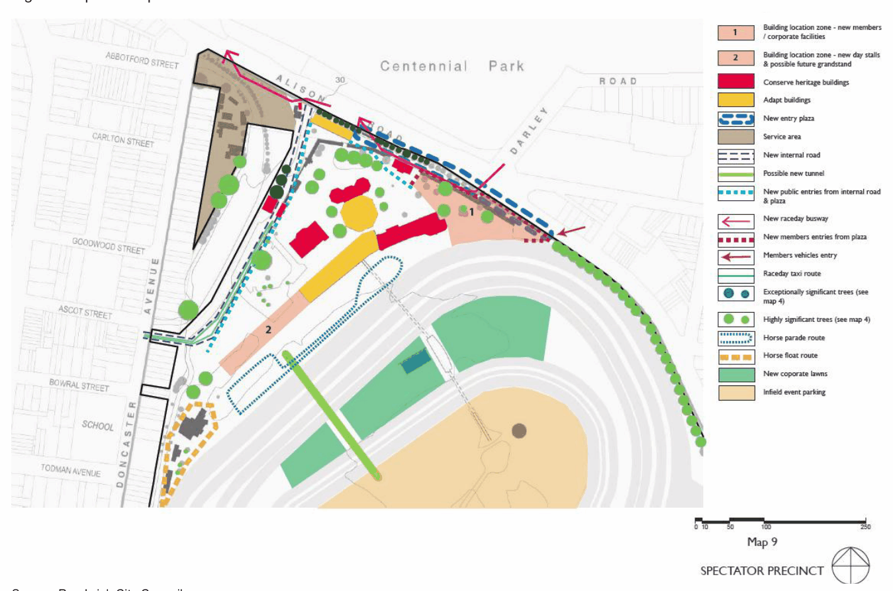

### 4.3. Controls

In addition to the controls contained in the general sections of this DCP, new development is to comply with the development concepts for the Precinct shown on Figure 9. The concept includes the following elements and qualities.

a) A new shared entry plaza and interface with the public domain of Alison Road is to comprise new pedestrian entrances, a busway for race days and other major events, member vehicle access, member and guest parking areas on non-race days, and high quality landscaping

b) To achieve the new infrastructure, crowd management, landscaping and building works, the following components of heritage significance to the racecourse may need to be adapted (in whole or in part), reconstructed or removed and interpreted (in whole or in part):

i. The Alison Road boundary wall, turnstiles and gateways

ii. The Swab Building

iii. The day stalls, and

iv. Various trees and landscape components.

c) A Specific Element Conservation Policy shall be prepared for the Alison Road boundary wall and surrounding area (prior to lodgement of a development application) to assess the heritage impact of the proposed entry plaza and the building location zones, and to investigate and inform options for access and new buildings in this area

d) The detailed design of pedestrian areas, bus and vehicle access and egress, site and entry definition, security, crowd management and landscaping is to implement the conservation principles outlined in Section 4.2 of this DCP

e) The entry plaza is to retain trees of 'Exceptional' and 'High' heritage significance where possible and where they are healthy specimens. New trees consistent with access

requirements, a refined landscape approach and heritage significance are to be established in the plaza area, where appropriate, along the continuous length of the Alison Road frontage

f) New buildings are to be located within the "Building Location Zones" documented on Figure

9 and an urban design study for the “zone” adjoining Alison Road to be prepared

by a suitably qualified urban designer. The study and resultant built form concept is to include identification of appropriate:

i. Floor areas for the building/s

ii. Building frontages

iii. Building depths

iv. Building separations, including an opening into the site in the building mass that aligns with Darley Road

v. Building articulation and massing

vi. Relationships to trees that are being retained

vii. Scaled ground floor levels to enable visual permeability between Alison Road and the Racecourse

viii. Consideration of the relationship of the height of the proposed building/s to the Official Stand and Alison Road incorporating where appropriate a stepping in heights.

g) A new building for member and corporate facilities is to address the new entry plaza. Its design is to achieve the recommendations of the above study

h) A new member's car park may be built below the new building and entry plaza. Its design is to:

i. Not cause the removal of or adversely affect the growth potential of any healthy trees of high/exceptional heritage or landscape significance, and

ii. Incorporate vehicle access and egress which does not adversely affect the amenity of pedestrian movements and entries, and the traffic performance of Alison Road and the busway.

i) A new service tunnel may be built below ground to allow servicing of the new building and existing stands and other facilities. Its design where practicable is to:

i. Retain healthy and ensure the ongoing health of trees of high/exceptional heritage significance, and

ii. Manage the delivery function consistent with the new traffic arrangements.

j) The existing Official Stand, Tea House, Totalisator and Betting Pavilion are to be conserved and adapted in line with their heritage significance to incorporate new or improved member and corporate facilities

k) Existing spectator stands are be adapted or rebuilt within similar envelopes to provide new or improved member, corporate and public facilities

l) Day stalls are to be built south of the existing stands, serviced by vehicle access from High Street, and linked to the existing Mounting Yard by a new horse parade route in front of the stands

m) A new internal link road is to provide for vehicle access from Doncaster Avenue to Alison Road. Its design is to:

i. Retain the heritage significance of the Tramway Turnstile Building and the Entry Gateway on Alison Road

ii. Provide for a new taxi, limousine and authorised private car arrival and pick up during race days and other major events

iii. Retain and ensure the ongoing health of high/exceptional trees of heritage or landscape significance in the vicinity where possible, and

iv. Provide a new entrance and landscape frontage to the racecourse compatible with heritage significance and character of the grounds

v. The new road construction shall, where practicable, incorporate a water permeable surface.

n) Links between the Spectator Precinct and the Midfield and Infield Precincts are to be enhanced by improving the existing tunnel and providing a second tunnel when necessary

o) A Stormwater Management Study for the Spectator Precinct is to be prepared as basic input to the design of works within the precinct. Development in the Spectator Precinct is to implement the findings of the study (See also Section 3.6 of this DCP).

Figure 9: Spectator precinct

> [Picture on page 31: a picture, saved as a picture (images/part-d10-royal-randwick-racecourse-page-31-2.gif, 150 dpi).]

Source: Randwick City Council
