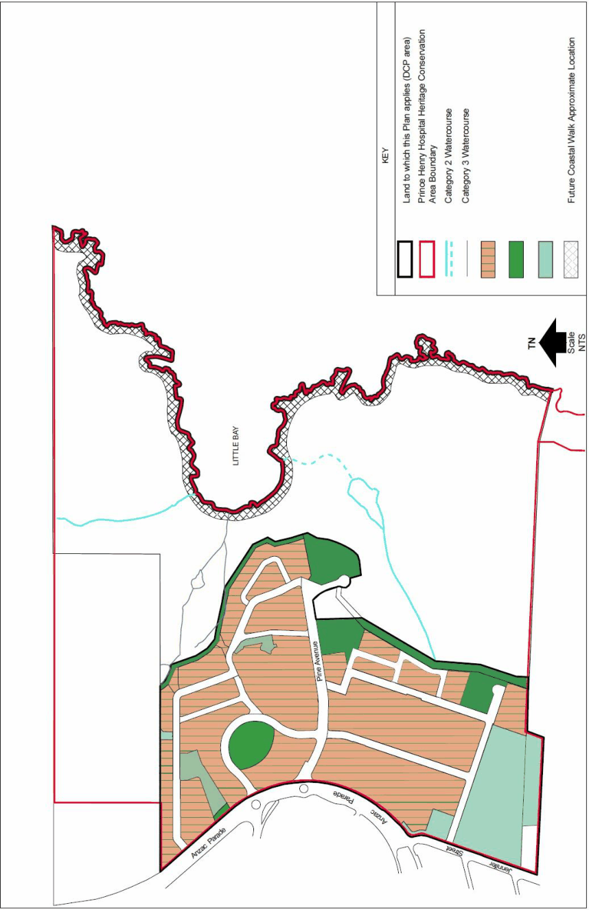
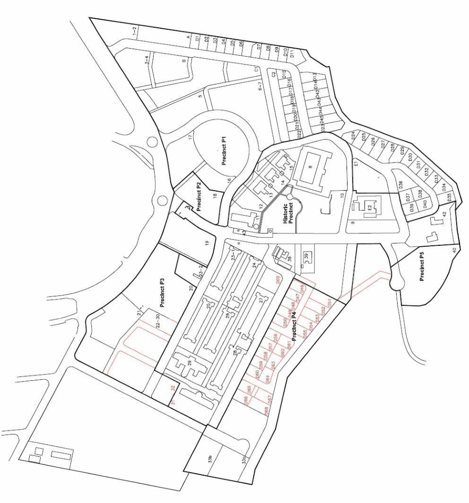
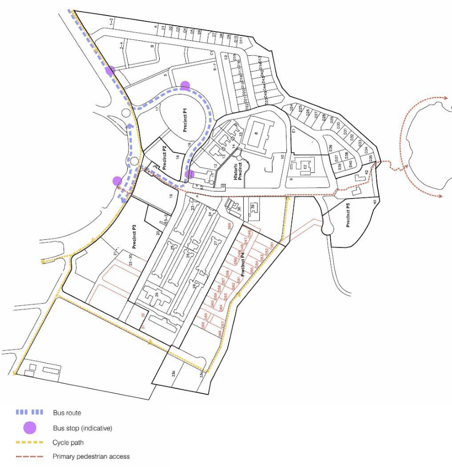
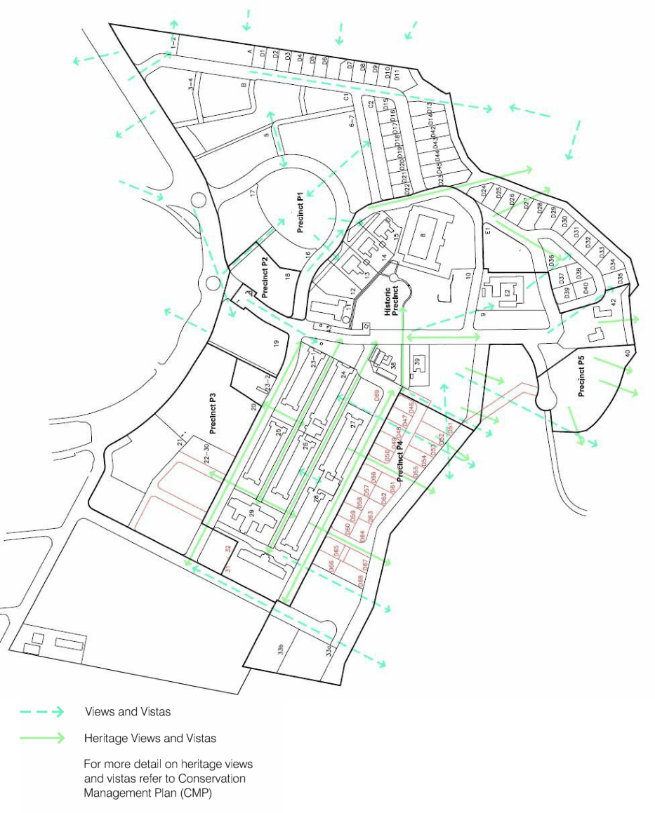
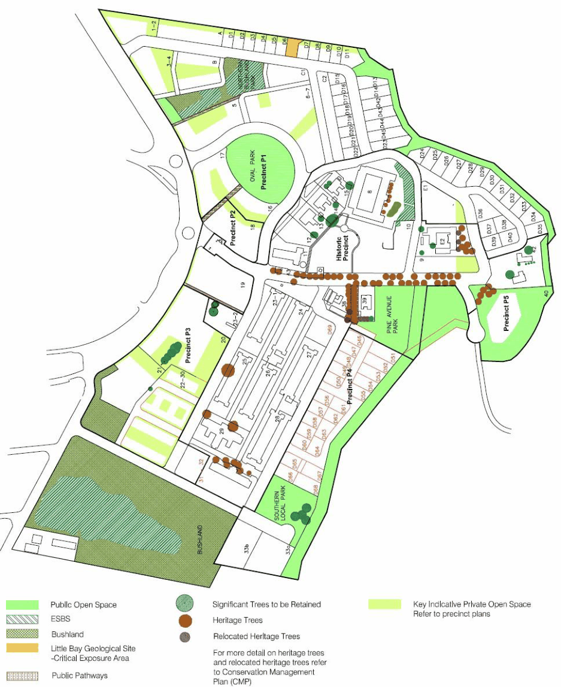
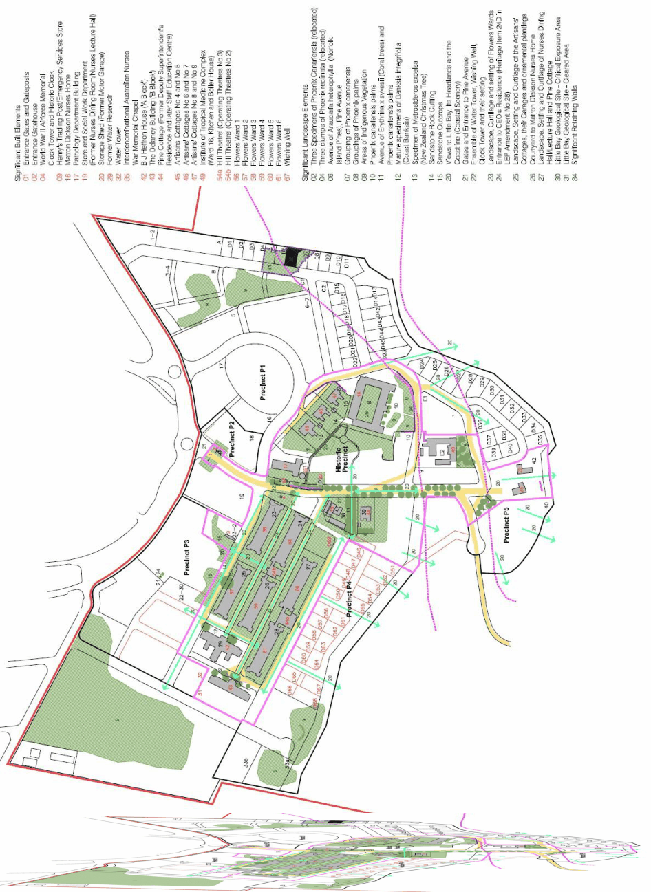
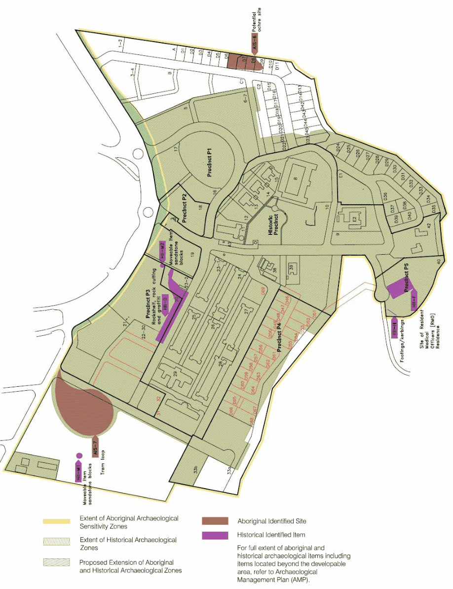
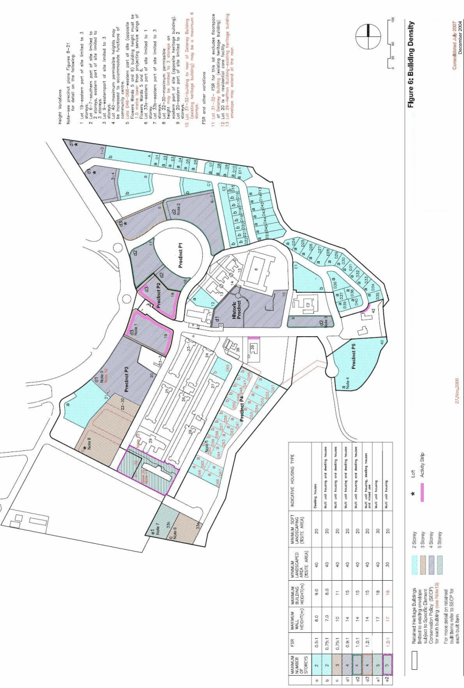
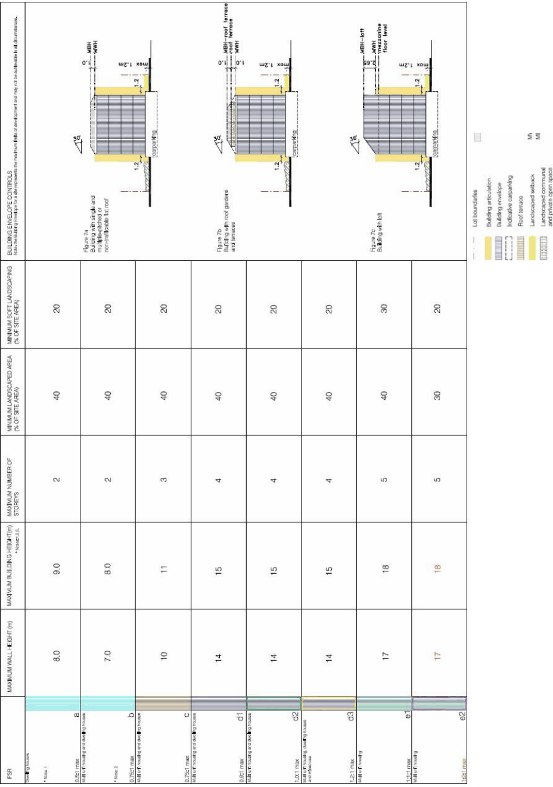

### 2.10. Desired Future Character

The desired future character for the redevelopment of the Prince Henry site (DCP area) can be summarised as:

• D evelopment that reflects the DCP area’s open, coastal location, and that does not dominate the landscape

• Development that is well integrated with surrounding development

• Development that seeks to minimise impact on the environment and which is environmentally sustainable

• Development which maintains an appropriate setting for the heritage elements to be retained, and which is appropriate in bulk, scale and form and recognises and builds upon the existing character

• Development that presents a strong, consistent edge to Anzac Parade, softened by substantial planting, with height and scale of development then gradually decreasing towards the coast

• Development that comprises a variety of dwelling types, including affordable housing, characterised by high quality, sustainable design

• Development that includes a mix of residential, open space, community, and neighbourhood scale retail

• Development that provides significant views and vistas throughout the site, towards the coast.

Figure AA: Land to which this plan applies

> [Picture on page 17: a picture, saved as a picture (images/part-d11-prince-henry-site-little-bay-page-17-2.gif, 150 dpi).]

Figure 1: Key plan precinct and lot numbers

> [Picture on page 18: a picture, saved as a picture (images/part-d11-prince-henry-site-little-bay-page-18-2.gif, 150 dpi).]

Note The lot numbers and boundaries may be superseded as subdivision continues across the site.

Figure 1A: Transport links and access

> [Picture on page 19: a picture, saved as a picture (images/part-d11-prince-henry-site-little-bay-page-19-2.gif, 150 dpi).]

Note The lot numbers and boundaries may be superseded as subdivision continues across the site.

Figure 2: Views and vistas

> [Picture on page 20: a picture, saved as a picture (images/part-d11-prince-henry-site-little-bay-page-20-2.gif, 150 dpi).]

Note The lot numbers and boundaries may be superseded as subdivision continues across the site.

Figure 3: Key landscape structure

> [Picture on page 21: a picture, saved as a picture (images/part-d11-prince-henry-site-little-bay-page-21-2.gif, 150 dpi).]

Note

1\. The lot numbers and boundaries may be superseded as subdivision continues across the site.

2\. Refer to the RLEP Biodiversity Map for the current mapping of ESBS.

Figure 4: Built and landscape heritage

> [Picture on page 22: a picture, saved as a picture (images/part-d11-prince-henry-site-little-bay-page-22-2.gif, 150 dpi).]

Note The lot numbers and boundaries may be superseded as subdivision continues across the site.

Figure 5: Identified aboriginal and historical archaeology

> [Picture on page 23: a picture, saved as a picture (images/part-d11-prince-henry-site-little-bay-page-23-2.gif, 150 dpi).]

Note The lot numbers and boundaries may be superseded as subdivision continues across the site.

Figure 6: Built Form Controls

> [Picture on page 24: a picture, saved as a picture (images/part-d11-prince-henry-site-little-bay-page-24-2.gif, 150 dpi).]

Note The lot numbers and boundaries may be superseded as subdivision continues across the site.

Figure 7: Built Form Controls

> [Picture on page 25: a picture, saved as a picture (images/part-d11-prince-henry-site-little-bay-page-25-2.gif, 150 dpi).]
