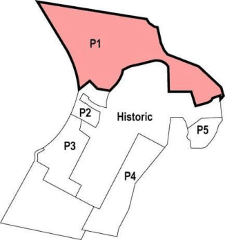
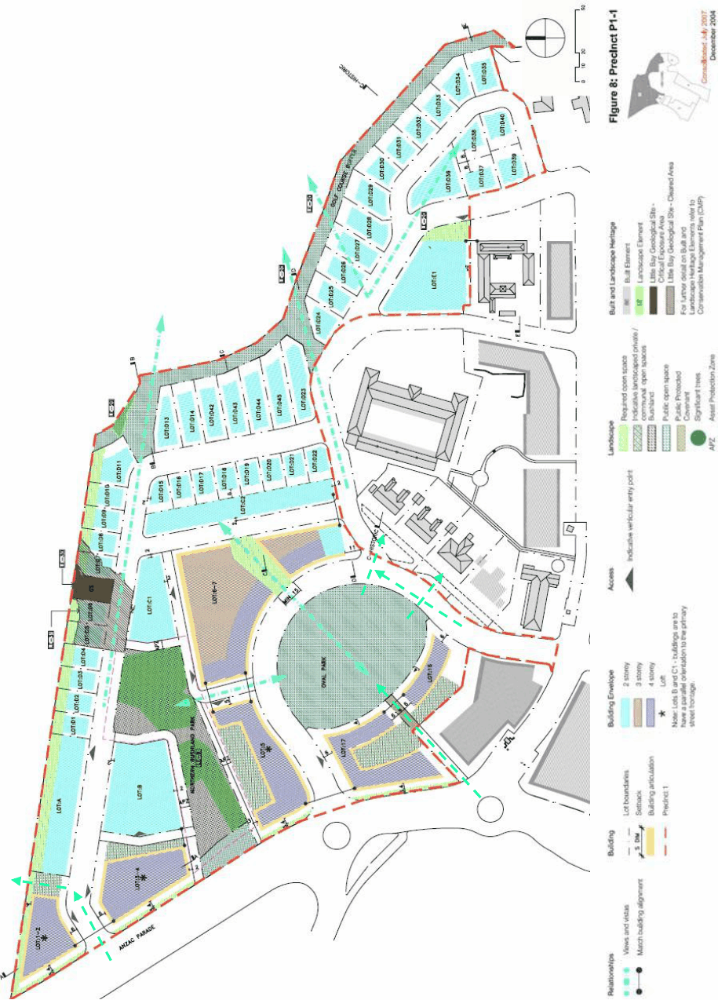
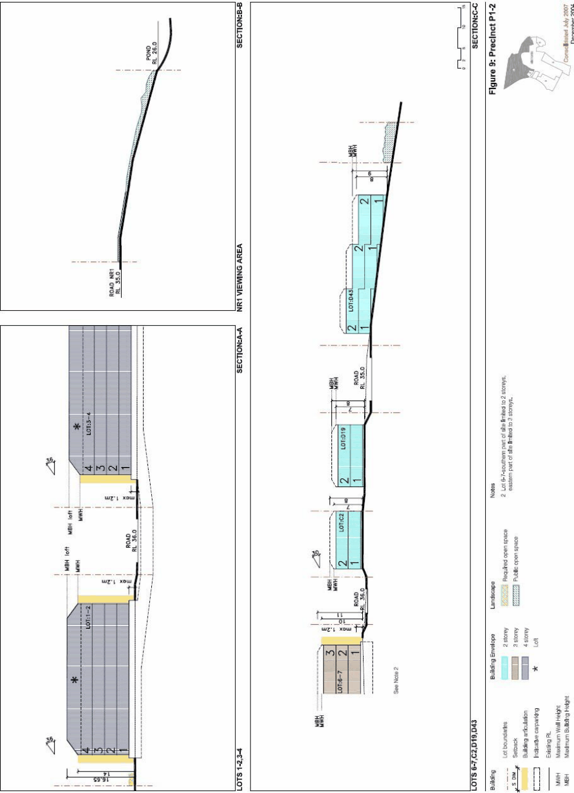
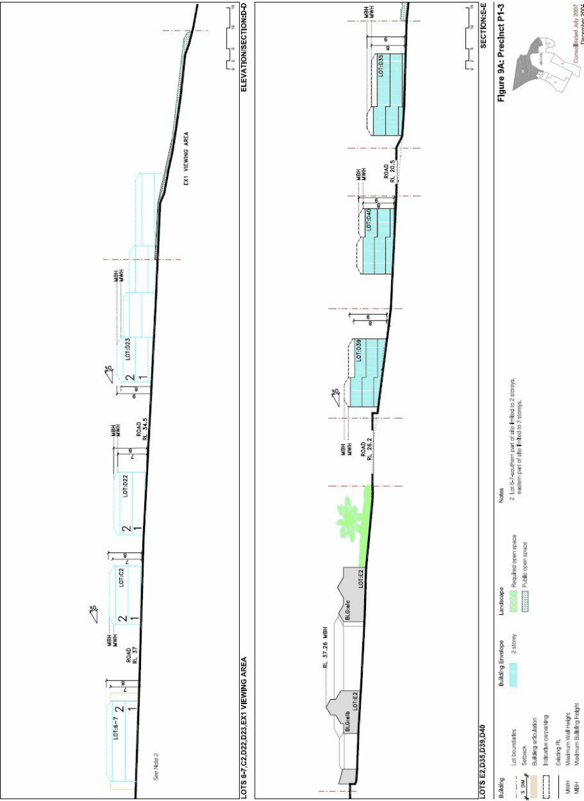

## 7. Precinct controls

### 7.1. Precinct P1

Precinct P1 is located in the north and north-western corner of the DCP area and is directly accessible from Anzac Parade. Key features within this precinct are the Northern Bushland Park and MaCartney Oval, located in the centre of the precinct, and the part of the Little Bay Geological site and Potential Ochre site located within the DCP area, along the northern boundary of the precinct. This precinct also contains the two northern road accesses to the site (i.e. Gubbuteh Road and Jenner Street).

Precinct Objectives

> [Picture on page 50: a picture, saved as a picture (images/part-d11-prince-henry-site-little-bay-page-50-13.gif, 150 dpi).]

1\. To achieve a distinctive built form and strong streetscape character along Anzac Parade with buildings framing the entrance road to the precinct

2\. To protect remnant bushland and the significant features of the Little Bay Geological site and potential ochre site

3\. To reinforce the curved form of MaCartney Oval via a strong, consistent built edge

4\. To ensure a consistent built edge along park and street frontages

5\. To encourage a mix of housing types within the precinct whilst maximising view sharing

6\. To provide a north-south biological link along the eastern edge of this precinct (forming part of a larger link across the Prince Henry site)

Desired Character This precinct will contain a mix of residential buildings focused around MaCartney Oval and the Northern Bushland Park and towards the ocean views. The Northern Bushland comprises an area of Eastern Suburbs Banksia Scrub (ESBS), an endangered ecological community that occurs on the Prince Henry site in a few locations. Building height and density will vary across the precinct, ranging from four storey envelopes suited to residential flat buildings along the western, Anzac Parade frontage, through to two storey envelopes suited to medium density attached dwellings and multi- dwelling housing (such as terrace and courtyard houses) towards the centre of the precinct. The building envelopes along the northern and eastern boundaries of the precinct suit low density detached and semi-detached housing. Development of this scale will retain a sense of openness, a significant characteristic of the site, and views and vistas to the ocean from all parts of the site. Building envelopes in the central part of the precinct will provide a transition in density and scale between the taller four storey envelopes along Anzac Parade and the two storey envelopes along the northern and eastern edges of this precinct. Building siting and design will maximise view-sharing opportunities. View corridors will offer visual and physical links between communal and private open space. The building envelopes have been designed so that where possible, communal open spaces are located adjacent to the remnant bushland or opposite other communal open spaces to create a feeling of a larger landscaped area and ensure that the landscape is not dominated by buildings. The detached dwelling allotments are located along the site’s northern and north-eastern boundary and

adjacent to the golf course, which will create a feeling of open space that is more extensive than the private open space of each individual allotment. A former oval on site has been incorporated into a similar scale open space (MaCartney Oval), with a pedestrian connection to the local shops in Precinct P2. Pedestrian paths also run along the edges of the Northern Bushland Park, linking it to Anzac Parade. Low fencing and substantial landscaping along the Anzac Parade boundary will provide a green corridor along Anzac Parade.

Little Bay Geological site and Potential Ochre site The Little Bay Geological site (which extends across the northern boundary of the Prince Henry site onto adjacent land) is a site of national significance. It provides evidence of topography, relative sea level, vertical land movements and coastal landscape prior to the formation of Sydney Harbour and other coastal valleys. The Little Bay Geological site has been divided into three management areas (the Critical Exposure Area, the Cleared Area and the Palaeovalley Area) which also extend across the northern boundary of the Prince Henry DCP site onto adjacent land. The Critical Exposure Area includes outcrops of exposed rock, clay shale and gully-fill sands. The part of the Critical Exposure Area within the Prince Henry site (and within this precinct) is to be retained (exposed) to form the ‘Geological Reserve’. The Cleared Area within the Prince Henry site (and this precinct) will be largely filled over to protect its significant surfaces. The Potential Ochre site, which has been identified as a potentially significant Aboriginal site, also extends across the northern boundary of the Prince Henry site onto adjacent land. Although largely underground within the Prince Henry site (and within this precinct), the Potential Ochre site is exposed within the Geological Reserve (Critical exposure area) which will remain exposed to allow for interpretation. Those areas of the Little Bay Geological site and the Potential Ochre site within the Prince Henry site are to be managed together with those areas on adjacent lands.

Controls In addition to the general controls contained in this Section the following controls also apply to development within this precinct.

Built Form

a) Building height, FSR and landscaped open space for all lots in Precinct P1 are to comply with the controls set out in the Built Form Control Table (Figures 6 and 7)

Note:

1\. Maximum height and FSR may not be able to be achieved in all instances, however the requirements for minimum landscaped open space must be achieved in all instances.

2\. Lofts are permitted in identified locations. These locations have been identified to enable a diversity of housing types whilst minimising the impact of development on the existing heritage buildings in the adjacent Historic Precinct.

b) Maximum building envelope depth for apartment buildings (3-4 storeys) is 13 metres

Note: Building envelope excludes building articulation depth.

c) All new buildings are to have a parallel alignment to the primary street frontage

d) New buildings are to be sited and designed to form a strong, predominantly continuous built edge to the primary street frontage and public parks and pathways, namely Anzac Parade, Gubbuteh Road, Jenner Street, Lister Avenue and Mayo Street, and MaCartney Oval and connecting path to the corner of Anzac Parade and Pine Avenue

e) Buildings are to be articulated along the facades identified on Figure 8 - Precinct P1-1

i. minimum articulation depth 2m

Note: Buildings should be appropriately articulated using a combination of measures. Refer to Subsection 4.6 Building Articulation for further details.

f) The following minimum setbacks apply to all buildings in Precinct P1, unless otherwise specified in Figure 8:

i. front setback - 3m

ii. side setback (detached dwelling houses) - 1.5m

iii. side setback (where side property boundary adjoins a road or public pedestrian path)

- 3m

iv. side setback (where side property boundary adjoins the Little Bay Geological Site – Critical Exposure Area) - 2m

v. rear setback (dwelling houses along northern site boundary and adjoining golf course) - 8m

Note: Side and rear setbacks for detached dwelling houses have been designed to maximise opportunities for view sharing.

g) Buildings along Anzac Parade (four storey, plus loft in identified locations) are to provide a built form consistent in height and scale along Anzac Parade and are to frame the entrance roads to the precinct. The building envelope for Lot 1-2 should provide for a landscaped area at the rear, to allow views northwards to the ocean

h) All development is to maximise the opportunity for view sharing. Maximum building height and FSR for detached dwelling houses may not be achieved where views (from private and public open spaces) would be unreasonably obstructed. View analysis details are to be included as part of the site analysis submitted at DA stage

i) All buildings are to be setback 7m from the Anzac Parade property boundary and should form a strong, consistent built edge along Anzac Parade

j) Buildings adjacent to Anzac Parade are to incorporate a 3m landscaped strip (as part of the 7m setback) and low fencing (700mm high), with both fencing and landscaping contributing to privacy, a high level of amenity and a consistent streetscape

k) Buildings surrounding MaCartney Oval are to follow the street and park alignment and reinforce its curved form

l) Development in Lot E1 is to match the front building alignment of the adjacent heritage building (former Institute of Tropical Medicine)

Landscaping

a) Landscape planting on sites adjacent to the Northern Bushland Park must not impact on the environmental processes of the remnant stands of Eastern Suburbs Banksia Scrub in the Northern Bushland Park

b) Buildings surrounding the Northern Bushland Park must demonstrate no adverse overshadowing impacts on this bushland

c) Landscaping, paths, driveways and the like, adjacent to the Northern Bushland Park, are to be designed to ensure no stormwater runoff into the remnant bushland areas

d) Landscaping plans must demonstrate that species planted will not result in any adverse weed invasion or overshadowing of this bushland

e) An asset protection zone of 6m (minimum) should be provided between new buildings and any remnant vegetation in the Northern Bushland Park (Figure 8) consistent with the requirements of Fire and Rescue NSW, Bushfire Hazards Section (See Appendix B). As shown on Figure 8, this asset protection zone should take the form of publicly accessible paths and private driveways

Heritage

a) All development must be in accordance with the Conservation Management Plan, Archaeological Management Plan and any relevant Specific Elements Conservation Policy and must demonstrate that:

i. new buildings maintain an appropriate setting for the former Matron Dickson Nurses Home, the Artisans Cottages, Institute of Tropical Medicine and former Motor Garage (all located in the adjacent Historic Precinct – see Figure 18)

ii. the Critical Exposure Area of the Little Bay Geological Site (which also contains the exposed part of the Potential Ochre Site) is to be retained intact, and new development is to be designed to minimise impacts on this area

iii. new development on lots within the Cleared Area of the Little Bay Geological Site and within the boundaries of the Potential Ochre site is designed so that non-essential excavation or scouring of significant rock surfaces is avoided

iv. the number and size of footings on the exposed rock surfaces within the Cleared Area and Potential Ochre site are minimised

v. ground level adjustments within the Cleared Area and extent of the Potential Ochre site are made by fill, not excavation

vi. excavation within the possible extent of the Palaeovalley Area should not be below RL 26 unless endorsed by Randwick City Council and the NSW Office of Environment and Heritage

b) Car parking for development within the Cleared Area and/or Potential Ochre site must be provided above ground to prevent any damage to their significant features

c) Development must demonstrate consideration of the Bushland Plan of Management (POM), and the Little Bay Geological Reserve Plan of Management (POM). In particular, development must meet the objectives of these POMs

Figure 8: Precinct P1-1

> [Picture on page 54: a picture, saved as a picture (images/part-d11-prince-henry-site-little-bay-page-54-2.gif, 150 dpi).]

Note:

The lot numbers and boundaries may be superseded as subdivision continues across the site.

Figure 9: Precinct P1-2

> [Picture on page 55: a picture, saved as a picture (images/part-d11-prince-henry-site-little-bay-page-55-2.gif, 150 dpi).]

Note The lot numbers and boundaries may be superseded as subdivision continues across the site.

Figure 9A: Precinct P1-3

> [Picture on page 56: a picture, saved as a picture (images/part-d11-prince-henry-site-little-bay-page-56-2.gif, 150 dpi).]

Note The lot numbers and boundaries may be superseded as subdivision continues across the site.
