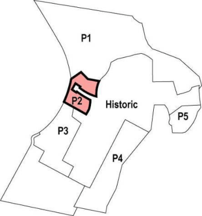
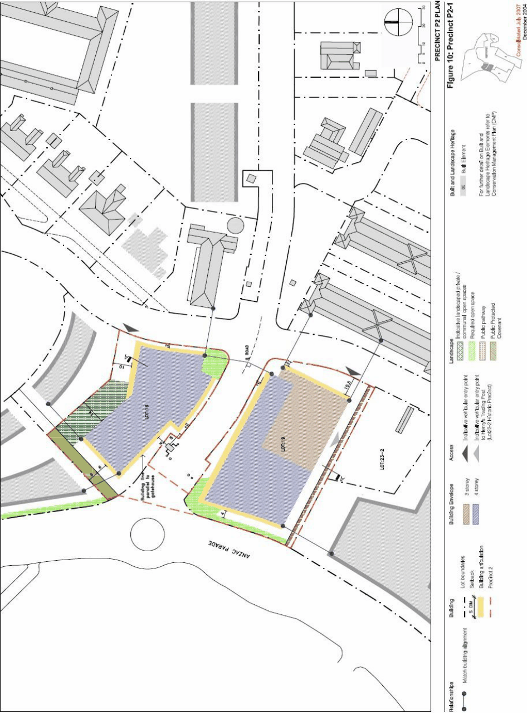
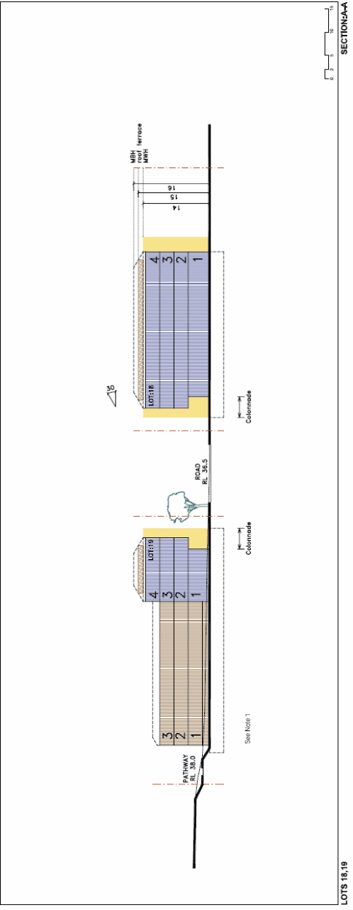
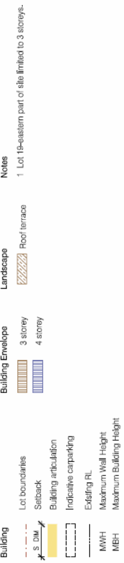
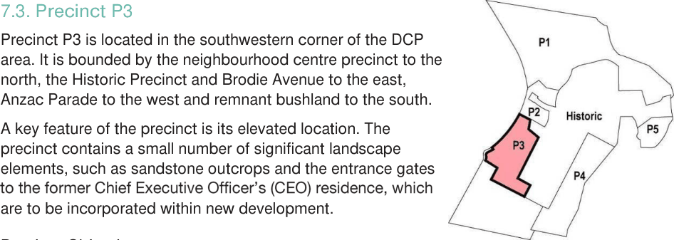

### 7.2. Precinct P2

Precinct P2 is located adjacent to Anzac Parade at the Pine Avenue entrance to the DCP area. Key features within this Precinct are Pine Avenue, which is the main entrance to the Prince Henry site. Significant historic elements including the entrance gateposts to the former hospital and the alignment of Pine Avenue form part of the adjoining historic precinct (which encompasses the majority of significant historic elements within the central part of the DCP area); however, these elements have an important relationship with the development of Precinct P2. Key views include the view along Pine Avenue, and the view towards the former Pathology Department Building, the Clocktower and Flowers Wards and beyond.

Precinct Objectives

> [Picture on page 57: a picture, saved as a picture (images/part-d11-prince-henry-site-little-bay-page-57-16.gif, 150 dpi).]

1\. To create a local neighbourhood centre that provides for the needs of new residents and the existing community in the locality

2\. To reinforce Pine Avenue as the gateway to the Prince Henry site

3\. To create a strong, consistent built edge along Anzac Parade

4\. To ensure new development maintains views along Pine Avenue to the Entrance Gates, Gateposts, Gatehouse, Flowers Wards, Clocktower and beyond

5\. To encourage a mix of neighbourhood scale retail, commercial and residential uses that will create a vibrant and attractive local neighbourhood centre.

Desired Character This precinct will contain a neighbourhood centre located at the Pine Avenue entrance to the

site. The centre will contain a mix of retail, commercial and community uses, including a potential medical centre and potential supermarket, with apartments above. The centre will serve the adjoining neighbourhoods. Building height within the precinct is generally four storeys, with a component in Lot 19 stepping down to three storeys opposite Flowers Ward 1 to create a transition in scale between development fronting Anzac Parade and the adjoining Historic Precinct to the east. Buildings are to provide a strong built edge to Anzac Parade, and active frontages are encouraged along all streets and public paths where activity strips are identified within this precinct (refer to Figure 6). Buildings along Pine Avenue will provide a strong, consistent alignment to reinforce the historic alignment and significance of Pine Avenue. Colonnades and broad pavements will extend along Pine Avenue at ground level, providing sheltered outdoor areas for social interaction. A public path provides a direct pedestrian and visual link between the neighbourhood centre/Anzac Parade and MaCartney Oval and the northern part of the site. A small parking area for the neighbourhood centre will be clearly separated from resident parking (to be located underground). The neighbourhood centre parking is provided at-grade (to maximise accessibility for less mobile people) in well landscaped car park(s), which will be screened from surrounding buildings and roads by the neighbourhood centre buildings. At grade car park(s) will be designed to maximise opportunities for water sensitive urban design (e.g. stormwater collection and re-use).

Controls In addition to the general controls contained in this Section, the following controls also apply to development within this precinct:

Built Form

a) Building height, FSR and landscaped open space for all lots in Precinct P2 are to comply with the controls set out in the Built Form Control Table (Figures 6 and 7)

Note: Maximum height and FSR may not be able to be achieved in all instances; however, the requirements for minimum landscaped open space must be achieved in all instances.

b) Development is to comply with the setbacks shown on Figure 10 Precinct P2-1

c) New buildings are to present a strong built edge to Anzac Parade and Pine Avenue

d) The preferred design solution for the corner of Anzac Parade/Pine Avenue corner of Lot 19 is a strong built corner and entry to the site, which follows the building envelope edge shown in Figure 10 Alternative design solutions (such as a landscaped plaza) may be considered, subject to the applicant demonstrating that this solution meets the objectives of this Section and is a preferable design solution to the preferred option outlined above

e) Building depth is to maximise opportunities for cross ventilation and dual aspect apartments

f) Active frontages are to be provided along Pine Avenue, Anzac Parade, and the southern side of Lot 18

g) Lot 18 is to provide an active frontage which maximises outlook over the pathway (which links the corner of Pine Avenue/Anzac Parade to McCartney Oval) to maximise pedestrian amenity and safety (see Figure 10 for setback requirements)

h) All buildings are to be setback 7m from the Anzac Parade property boundary to form a strong, consistent built edge along Anzac Parade

i) Development in Lots 18 and 19 is to match the building alignment of the adjacent heritage buildings, as shown on Figure 10

j) Awnings over a public footway are to be:

i. a minimum clear height of 3m above the footpath

ii. not less that 600mm from the edge of the road/kerb.

Landscaping

a) Details of the proposed landscaping along the Anzac Parade and Pine Avenue frontage (including paving materials and planting) are to be submitted at DA stage

b) Landscaped roof terraces may be used to provide communal open space for the residential levels of the buildings

c) At-grade car parking is to be well landscaped and is to maximise opportunities for deep soil areas and effective water cycle management.

Heritage

a) All development must be in accordance with the Conservation Management Plan, Archaeological Management Plan and any relevant Specific Elements Conservation Policy and must demonstrate that:

i. New buildings maintain an appropriate setting for the Historic Precinct, particularly significant buildings and landscape features in the vicinity such as the Gateposts and Gatehouse, former Pathology Department Building, as well as views along Pine Avenue to the Clocktower, former Flowers Wards and beyond (see also Section 2.4 Views and Vistas).

Figure 10: Precinct P2-1

> [Picture on page 59: a picture, saved as a picture (images/part-d11-prince-henry-site-little-bay-page-59-2.gif, 150 dpi).]

Note: The lot numbers and boundaries may be superseded as subdivision continues across the site.

Figure 11: Precinct P2-2

> [Picture on page 60: a picture, saved as a picture (images/part-d11-prince-henry-site-little-bay-page-60-2.gif, 150 dpi).]

Note:

> [Picture on page 60: a picture, saved as a picture (images/part-d11-prince-henry-site-little-bay-page-60-4.gif, 150 dpi).]

The lot numbers and boundaries may be superseded as subdivision continues across the site.

> [Picture on page 61: a picture, saved as a picture (images/part-d11-prince-henry-site-little-bay-page-61-1.gif, 150 dpi).]
> Words printed on the picture (title and legend, copied from the PDF):
> to the former Chief Executive Officer’s (CEO) residence, which
