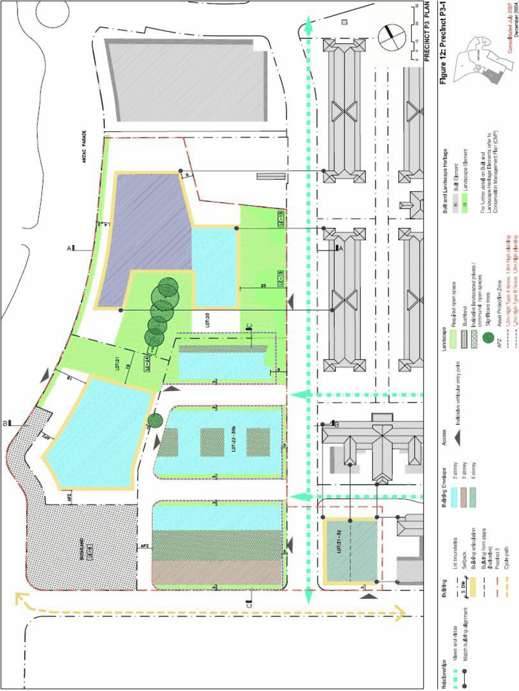
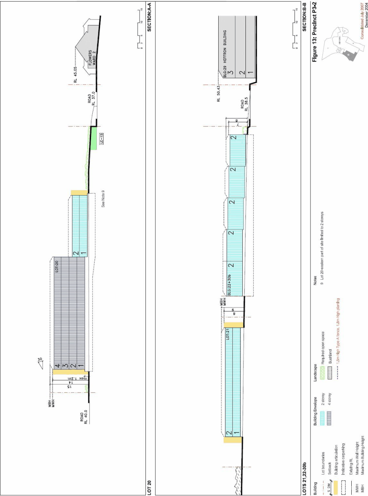
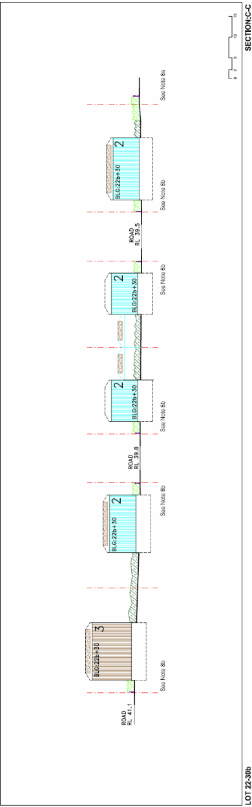
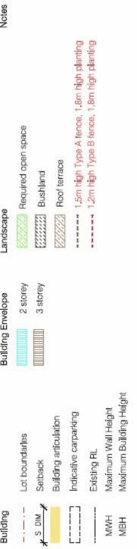

### 7.3. Precinct P3

Precinct P3 is located in the southwestern corner of the DCP

area. It is bounded by the neighbourhood centre precinct to the north, the Historic Precinct and Brodie Avenue to the east, Anzac Parade to the west and remnant bushland to the south. A key feature of the precinct is its elevated location. The precinct contains a small number of significant landscape elements, such as sandstone outcrops and the entrance gates

are to be incorporated within new development.

Precinct Objectives

1\. To achieve a transition in scale from the neighbourhood centre precinct to lower scale development to the east

2\. To achieve a strong landscape edge along Anzac Parade

3\. To protect remnant bushland and significant landscape features

4\. To ensure that the bulk, scale and design of new development complement adjacent heritage buildings

5\. To encourage simple, rectilinear block building forms which relate to the adjacent Flowers Wards

6\. To encourage a mix of housing types

Desired Character Development within this precinct will comprise aged care accommodation, residential development and a women’s health facility. These three different types of development are proposed to be quite separate entities and require visual separation via landscaping to act as a buffer between uses, to ensure appropriate levels of privacy. A key design objective for this precinct is to ensure outlooks from future buildings are to trees rather than adjacent buildings. This precinct contains significant rock outcrops and a number of significant trees. These landscape elements have been a key influence on building envelope design, indicative lot subdivision and indicative vehicular entry point location within this precinct, to ensure future development does not affect these elements. The built form controls of this precinct generally continue the pattern of Precincts P1 and P2, with the tallest building envelopes located along Anzac Parade and stepping down to the adjacent bushland (south of this precinct). The building envelopes also step down in height towards Brodie Avenue, to result in a built form compatible in scale with the adjacent buildings in the historic precinct. Buildings are to be well set back from Brodie Avenue so as not to compete visually with the former Flowers Wards opposite, and to conserve the sandstone rock cuttings and outcrops (identified in Figure 12, Precinct P3-1 Plan as LE-15). Buildings should have simple, rectilinear forms to relate to the historic Flowers Wards. The women’s health facility, Jarrah House, located in the southwestern corner of this precinct, will be low scale and will be visually separated from the rest of the site, by screen planting, with separate access from Anzac Parade. This facility will have direct vehicular access from Anzac Parade. This is the only direct access appropriate along Anzac Parade (in addition to the 3 main access roads to the Prince Henry site: Jenner Street; Pine Avenue; and Jennifer Street / Harvey Street).

The landscape design of the aged care accommodation is to incorporate the entrance gates to the former CEO’s Residence. The tallest building (5 storeys) is located along the southern edge of this precinct, adjacent to the Delaney Building, which is in the historic precinct. This building is required to be of an alignment, scale and form that avoids adverse impacts on the remnant bushland to the south and respects the nearby heritage buildings to the north and east, including the Flowers Wards and the Heffron and Delaney Buildings. This site (Lot 31) has been amalgamated with the site of the Delaney Building (Lot 32) to make more effective use of floor space and to facilitate a shared parking arrangement. Low fencing and substantial landscaping along the site’s Anzac Parade edge will provide a green corridor along Anzac Parade.

Controls In addition to the general controls contained in this Section the following controls also apply to development within this precinct:

Built Form

a) Building height, FSR and landscaped open space for all lots in Precinct P3 are to comply with the controls set out in the Built Form Control Table (Figures 6 and 7)

Note:

1\. Maximum height and FSR may not be able to be achieved in all instances; however, the requirements for minimum landscaped open space must be achieved in all instances.

2\. Lofts are permitted in identified locations. These locations have been identified to minimise the impact of development on the existing heritage buildings in the adjacent Historic Precinct.

3\. The attached houses on Lots 22-30 will be a maximum of 2 storeys (with roof terraces) at the northernmost block and the centre block and a maximum of 3 storeys (with roof terraces) at the southernmost block, as identified on Figure 12, Precinct P3-1.

b) The following minimum building setbacks apply, unless otherwise specified in Figure 12:

i. Anzac Parade property boundary 7m

ii. Brodie Avenue property boundary 7m

Note: A large setback to Brodie Avenue is required to accommodate a change in ground level and to ensure landscape elements (rock cuttings and outcrops) are adequately protected.

c) Buildings adjacent to Anzac Parade are to be aligned and designed to give an attractive edge and address to Anzac Parade

d) Residential building setback areas facing Anzac Parade are to incorporate a 3m landscaped strip (as part of the 7m setback) and low fencing, with both fencing and landscaping contributing to privacy and a high level of amenity

e) Development in Lot 20 is to match the building alignment of existing heritage buildings (in the adjacent Historic Precinct), as identified on Figure 12

f) Development in Lot 22-30 will have a setback of 9m from Brodie Avenue at the northernmost block to protect the rock ledge and the setting of the Flowers Wards. The setback at the centre and southernmost blocks will be 3m to allow for a landscaped strip to define Brodie Avenue, as identified on Figure 12

Landscaping

a) Landscaping plans for lots adjacent to remnant bushland must demonstrate that species planted will not result in any weed invasion or overshadowing of this bushland

b) An asset protection zone of 8m (minimum) is to be provided between new buildings and any remnant bushland consistent with the requirements of Fire and Rescue NSW, Bushfire Hazards section (see Subsection 5.2 and Appendix B)

c) Buildings adjacent to the southern bushland must demonstrate no adverse overshadowing impacts on this bushland

d) Landscaping, paths, driveways and the like, adjacent to the southern bushland are to be designed to ensure no stormwater runoff into the remnant bushland areas

e) Development must demonstrate consideration of the Bushland Plan of Management (POM). In particular, development must meet the objectives of this POM

Heritage

a) All development must be in accordance with the Conservation Management Plan, the Archaeological Management Plan and any relevant Specific Elements Conservation Policy and must demonstrate that:

i. New buildings maintain an appropriate setting for the Historic Precinct including significant buildings and landscape features in the vicinity such as the Flowers Wards, Henry’s Trading Post, Heffron House and the Delaney Building (see Figures 18-19)

ii. The entrance gates to the former CEO’s Residence are to be incorporated into the landscaping for the Aged Care facility

iii. significant landscape heritage elements such as outcropping sandstone adjoining the Historic Precinct are conserved and incorporated into the landscape design for new development

iv. landscaping in this precinct complements that in the adjoining Historic Precinct

Figure 12: Precinct P3-1

> [Picture on page 64: a picture, saved as a picture (images/part-d11-prince-henry-site-little-bay-page-64-2.gif, 150 dpi).]

Note: The lot numbers and boundaries may be superseded as subdivision continues across the site.

Figure 13: Precinct P3-2

> [Picture on page 65: a picture, saved as a picture (images/part-d11-prince-henry-site-little-bay-page-65-2.gif, 150 dpi).]

Note: The lot numbers and boundaries may be superseded as subdivision continues across the site.

Figure 13A: Precinct P3-3

> [Picture on page 66: a picture, saved as a picture (images/part-d11-prince-henry-site-little-bay-page-66-2.gif, 150 dpi).]

Note:

> [Picture on page 66: a picture, saved as a picture (images/part-d11-prince-henry-site-little-bay-page-66-4.gif, 150 dpi).]

The lot numbers and boundaries may be superseded as subdivision continues across the site.
