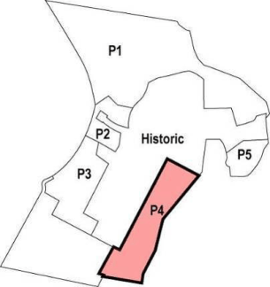
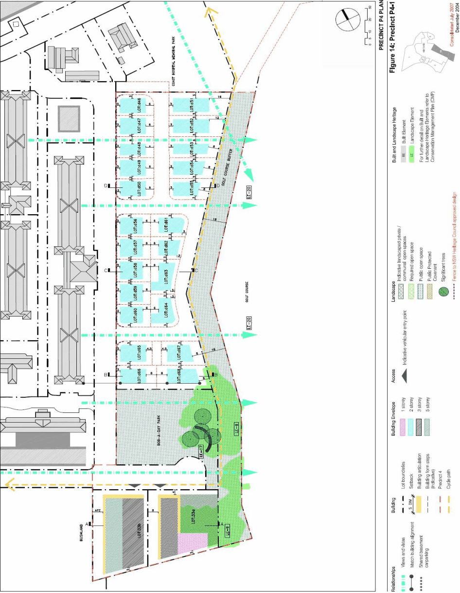
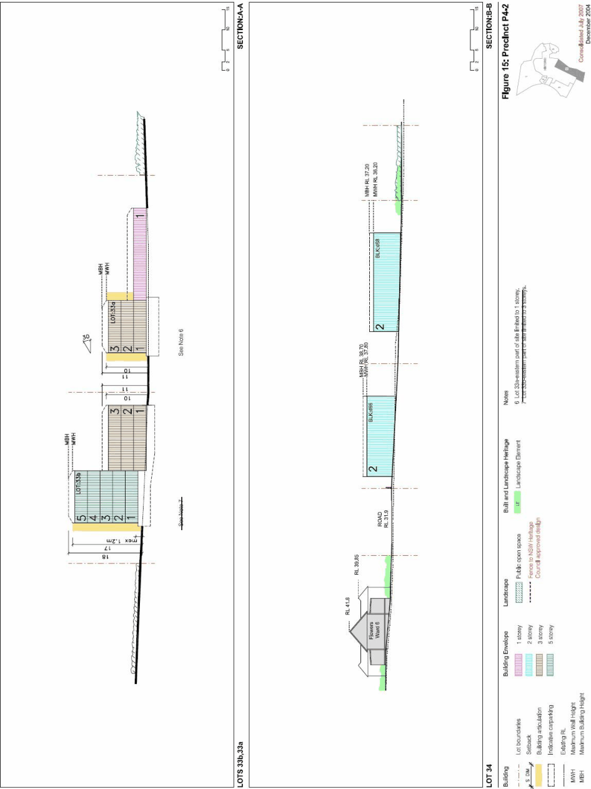
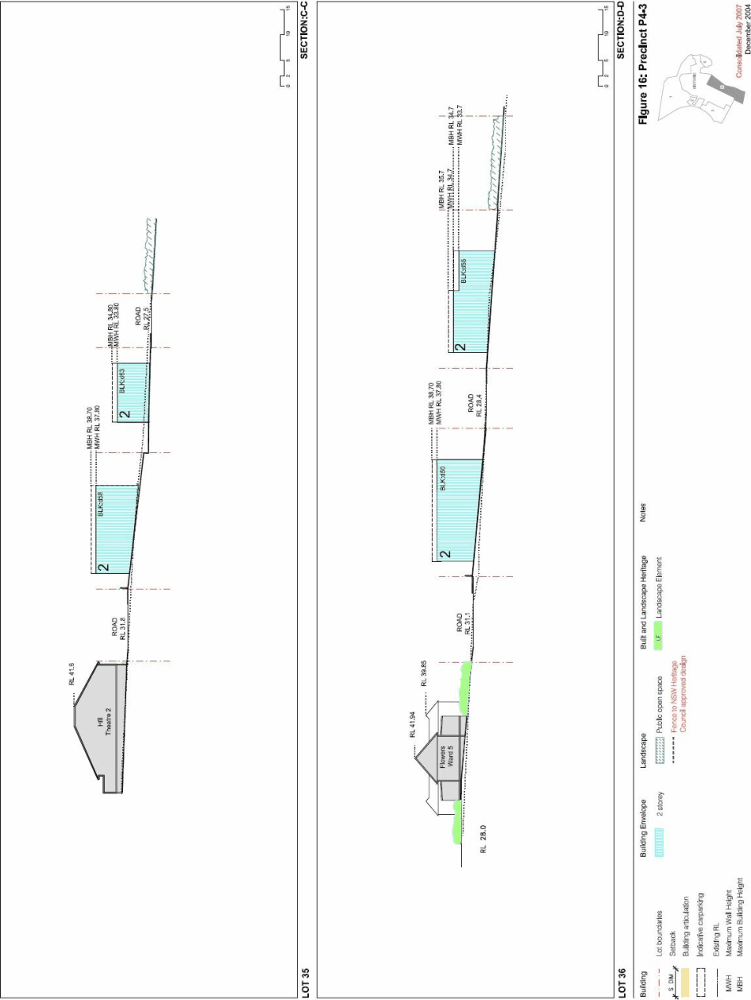

### 7.4. Precinct P4

Precinct P4 is located in the southeastern part of the DCP area adjoining the Coast Golf Course. Key features within this precinct are Bob-A-Day Park and the adjoining Golf Course buffer separating the DCP area from the golf course. This precinct adjoins the Historic Precinct to the north and west, and an area of remnant bushland, also to the

west. The topography slopes down to the east towards the golf course and coast.

Precinct Objectives

> [Picture on page 67: a picture, saved as a picture (images/part-d11-prince-henry-site-little-bay-page-67-11.gif, 150 dpi).]

1\. To create a consistent edge of buildings facing Ewing Avenue that respect the heritage buildings opposite and step down toward the golf course

2\. To protect remnant bushland to the southwest and within the buffer strip and Bob-A-Day Park, and provide for a vegetated link along the southern boundary of the DCP area between the Jennifer Street remnant bushland and the golf course buffer

3\. To maximise view sharing within the precinct and from the historic precinct

Desired Character This precinct will be characterised by residential uses in the form of dwelling houses which will be accessed from Ewing Avenue and a new loop road that has been aligned to protect the view corridors from Flowers Wards 5 and 6. Significant open space will link to the golf course and beyond. Dwellings will be a maximum of two storeys in height immediately opposite the former Flowers Wards This precinct also includes a medical research facility (Lot 33a) of 3 storeys in height. The precinct overlooks the Coast Golf Course and adjoins open space to the north, east and southwest. New development will maximise view opportunities and open view corridors from significant places within the adjoining historic precinct, including the main axis of the former Flowers Wards. The dwellings which line Ewing Avenue will form a group of buildings of height and scale consistent with the former Flowers Wards buildings. The dwellings will be set behind a wall on the Ewing Avenue frontage that will be designed as a single entity. The wall will present as a consistent element to establish a uniform appearance opposite the Flowers Wards. A built form that steps down in response to the precinct’s sloping topography is encouraged. Key open spaces in this precinct include Bob-A-Day Park and the linear buffer strip running along the eastern edge of the site. Pedestrian and cycle connections will be provided along the buffer strip connecting Bob-A-Day Park to Coast Hospital Memorial Park, while also providing for a vegetated north-south habitat corridor. Pedestrian paths will also connect the Historic Precinct to the buffer strip.

Controls In addition to the general controls contained in this Section the following controls also apply to development within this precinct:

Built Form

a) Building height, FSR and landscaped open space for all lots in Precinct P4 are to comply with the controls set out in the Built Form Control Table (Figures 6 and 7)

Note:

1\. Maximum height and FSR may not be able to be achieved in all instances; however, the requirements for minimum landscaped open space must be achieved in all instances.

2\. The ten detached dwelling lots (D46-D50, D56-D60) directly opposite the Flowers Wards may achieve a maximum FSR of 0.75:1 to strengthen the built form adjacent to the heritage buildings. All other detached dwellings may achieve a maximum FSR of 0.5:1 consistent with similar dwelling houses in Precinct P1.

b) The following minimum building setbacks apply, unless otherwise specified in Figure 14:

i. Setback from Ewing Avenue: 3m

ii. Side setback (where property boundary adjoins a road or pedestrian path or park: 4.5m

iii. Rear setback and/or setback from boundary adjoining remnant bushland: 8m

c) New buildings facing Ewing Avenue are to create a strong built edge of setback, scale and height and to be consistent with the scale and form of the historic Flowers Wards

d) Buildings in Lots 33a and 33b are to be articulated along the facades identified in Figure 14 Precinct P4-1. Minimum articulation depth required is 2m

e) Buildings in Lots 33a & 33b and D66 & D68 are to address the park with articulated facades including windows that overlook the park

f) Development in Lots D66 and D68 is to match the building alignment of the Flowers Wards opposite, indicated on Figure 14

g) All development is to maximise the opportunity for view sharing. Maximum building height and FSR for detached dwellings may not be achieved where views (from private and public open spaces) would be unreasonably obstructed. View analysis details are to be included as part of the site analysis

h) Demonstrate that building design does not obstruct views along Ewing Avenue and along the axis with the Flowers Wards

Landscaping

a) Planting is to comprise local native species, primarily low in mature height, to maintain views and vistas of Little Bay and the adjoining coastal scenery from both the private and public domain

b) Landscape Plans for lots adjacent to remnant bushland and the buffer strip are to demonstrate that species planted will not result in any weed invasion or overshadowing of indigenous vegetation

c) Lots 33a and 33b are to comprise suitably designed landscaping along their southern boundaries to provide a continuous, vegetated link along the southern boundary of the DCP area, between the Jennifer Street remnant bushland and the golf course buffer

d) An asset protection zone of 8m is to be provided between new buildings and remnant bushland or the buffer strip, and the golf course consistent with the requirements of Fire and Rescue NSW, Bushfire Hazard section (see Subsection 5.2 and Appendix B)

e) Landscaping, paths, driveways and the like, adjacent to the southern bushland are to be designed to ensure no stormwater runoff into the remnant bushland areas

f) Development must demonstrate consideration of the Bushland Plan of Management (POM). In particular, development must meet the objectives of this POM

Heritage

a) All development must be in accordance with the Conservation Management Plan (CMP), Archaeological Management Plan (AMP) and any relevant Specific Elements Conservation Policy (SECP) and must demonstrate that:

i. new buildings maintain an appropriate setting for the Historic Precinct including significant buildings and landscape features in the vicinity such as the Flowers Wards and the Heffron and Delaney Buildings

ii. view corridors from the central axes of Flowers Wards 5 and 6 are recovered and maintained

iii. the significant quarried sandstone pieces will be conserved and incorporated into the landscaping for Bob-A-Day Park

Figure 14: Precinct P4-1

> [Picture on page 70: a picture, saved as a picture (images/part-d11-prince-henry-site-little-bay-page-70-2.gif, 150 dpi).]

Note:

1\) The lot numbers and boundaries may be superseded as subdivision continues across the site.

2\) The storey control for Lot 65, DP 270427 (noted as Lot 33b above) has been revised to 5 storeys for the full building envelope, consistent with its height control under RLEP 2012.

Figure 15: Precinct P4-2

> [Picture on page 71: a picture, saved as a picture (images/part-d11-prince-henry-site-little-bay-page-71-2.gif, 150 dpi).]

Note:

1\) The lot numbers and boundaries may be superseded as subdivision continues across the site.

2\) The storey control for Lot 65, DP 270427 (noted as Lot 33b above) has been revised to 5 storeys for the full building envelope, consistent with its height control under RLEP 2012.

Figure 16: Precinct P4-3

> [Picture on page 72: a picture, saved as a picture (images/part-d11-prince-henry-site-little-bay-page-72-2.gif, 150 dpi).]

Note: The lot numbers and boundaries may be superseded as subdivision continues across the site.
